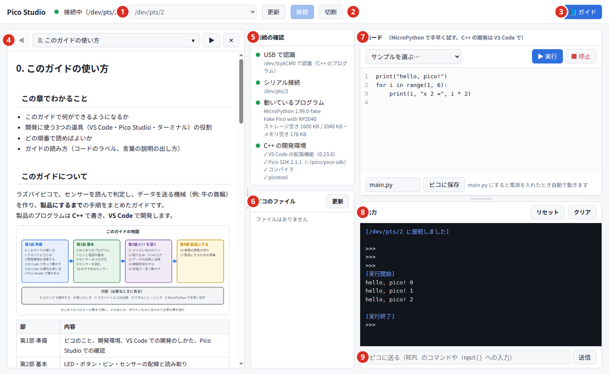

# Pico Studio

Raspberry Pi Pico（RP2040 / RP2350）が**つながっているかを確かめる**ためのローカルツールと、C++ と VS Code でピコを開発して**製品にするまで**のガイド。

C++ の開発は VS Code の拡張機能「Raspberry Pi Pico」で行い、Pico Studio は次のことに使う。

- ピコが USB で見えているか、何が動いているか（C++ のプログラム / MicroPython / 書き込みモード）を確かめる
- C++ の開発環境（VS Code の拡張機能・Pico SDK・コンパイラ・picotool）がそろっているかを確かめる
- `printf` の出力を見て、ピコに1行送る
- `.uf2` を書き込む（MicroPython や、VS Code でビルドしたもの）
- MicroPython のコードをすぐ試す（配線やセンサーの下調べ）
- 教科書のような**ガイド**を横に表示する。付箋・線・メモを付けて、どこまで読んだかを残せる

サーバーは自分のPC（`127.0.0.1`）だけで動き、外部には公開しない。



## 必要なもの

- Linux（Ubuntu で確認）
- Python 3.10 以上と pyserial
- C++ の開発には VS Code と拡張機能「Raspberry Pi Pico」（ガイド2章）

```sh
sudo apt install python3-serial
sudo cp 70-pico-studio.rules /etc/udev/rules.d/    # ピコを sudo なしで使う（シリアルポートと picotool）
sudo udevadm control --reload-rules                 # 入れたら、ピコを一度抜いてつなぎ直す
```

開発環境がそろっているかは、画面の「C++ の開発環境」か、次のコマンドで確かめられる。

```sh
python3 devenv.py check
```

## 起動のしかた

```sh
./start.sh
```

ブラウザで http://localhost:8765 が開く。止めるときはターミナルで `Ctrl + C`。

ポート番号を変えたいとき:

```sh
PORT=9000 ./start.sh
# または
python3 server.py --port 9000
```

## 使い方

くわしくはガイドの [5. Pico Studio でつながりを確かめる](guide/05-studio.md) にまとめてある。

1. ピコを USB ケーブルでつなぐ（充電専用ケーブルでは認識しない）
2. ポート欄で「(ピコ・…)」と書かれたポートを選び、「接続」を押す
3. 左の「接続の確認」で、USB・シリアル・動いているプログラム・C++ の開発環境を確かめる
4. C++ のプログラムが動いていれば、`printf` の出力が出力欄に出る。MicroPython なら、コード欄のコードを「▶ 実行」で試せる（付録E）

つなぎ方（MicroPython の REPL か、出力の表示だけか）は、USB の番号（MicroPython は `2e8a:0005`）から自動で決める。

## ガイド

画面右上の「📘 ガイド」で、ガイドを横に表示できる。GitHub 上でも [guide/](guide/) フォルダの Markdown をそのまま読める。

| 章 | 内容 |
| --- | --- |
| **第1部 準備** | |
| [0. このガイドの使い方](guide/00-guide.md) | ガイドの地図、VS Code・Pico Studio・ターミナルの役割、読む順番、コードのラベルの読み方 |
| [1. ラズパイピコとは](guide/01-pico.md) | マイコンとは、ピコの種類、ボードの各部、BOOT・USR・RST、書き込みモード、C/C++ と MicroPython の使い分け、用語集 |
| [2. 開発環境を用意する](guide/02-setup.md) | VS Code と拡張機能「Raspberry Pi Pico」、拡張機能が `~/.pico-sdk` に入れるもの、udev ルール、そろったかの確かめ方 |
| [3. VS Code でプロジェクトを作って動かす](guide/03-vscode.md) | New C/C++ Project、できるファイル、書く → Compile → Run (USB) → Serial Monitor、BOOT が要るとき（図つき） |
| [4. VS Code の便利な使い方](guide/04-vscode-more.md) | Quick Access の各メニュー、補完と F12、ライブラリの足し方、ファイルの分け方、Debug Probe でのデバッグ、git |
| [5. Pico Studio でつながりを確かめる](guide/05-studio.md) | Pico Studio の画面、接続の確認の4項目、C++ の出力を見る、.uf2 の書き込み、つながらないとき |
| **第2部 基本** | |
| [6. はじめてのプログラム](guide/06-first-program.md) | はじめてのプログラム、printf、Lチカ（ボード・外付け・RGB）、ボタン、止め方 |
| [7. ピンと電源の基本](guide/07-pins.md) | ピン配置図、電源、GPIO とプルアップ、ADC、PWM、I2C/SPI/UART、注意点 |
| [8. センサーのつなぎ方](guide/08-wiring.md) | ブレッドボード、ジャンパーワイヤー、ピンヘッダの付け方、I2C の配線と I2C スキャン |
| [9. センサーを読む](guide/09-sensors.md) | レジスタ、バイトの変換、MPU-6050・BMP280 の読み取り、一定間隔のサンプリング |
| [10. おすすめのセンサー](guide/10-sensor-picks.md) | 最初に使うセンサー、農業向けのセンサー、SHT31 と土壌水分センサー、商品の説明の読み方 |
| **第3部 C++ を深く** | |
| [11. マイコン向けの C++ の書き方](guide/11-cpp-style.md) | 型の選び方、float と整数、メモリの置き場所、使ってよい標準ライブラリ、エラーの扱い、クラスとファイルの分け方、状態機械 |
| [12. 割り込み・タイマー・2つのコア](guide/12-interrupts.md) | GPIO の割り込み、くり返しタイマー、リングバッファ、2つのコアと FIFO、クリティカルセクション |
| [13. データの記録と送信](guide/13-data.md) | フラッシュへの記録、CSV で PC に持ってくる、USB で PC に送って保存、メモリの置き場所 |
| [14. 機械学習モデルの導入](guide/14-ml.md) | 特徴量、データ集め、PC で決定木を学習、`model.h` に書き出してピコで判定、大きなモデルの選択肢 |
| [15. 省電力と長く動かすための工夫](guide/15-power.md) | 電力を減らす方法、電池の電圧、ウォッチドッグ、設定のフラッシュ保存 |
| **第4部 製品にする** | |
| [16. 実際の開発の流れ](guide/16-development.md) | 牛の行動判定システムを例にした開発の順番、役割分担、無線の選び方、電池の計算 |
| [17. 製品にするための準備](guide/17-product.md) | PC でのテスト、バージョンの埋め込み、gdb、量産の書き込み、ユニーク ID、出荷前のチェックリスト |
| **付録** | |
| [付録A. コマンドで操作する](guide/a-cli.md) | コマンド用の道具（setup-sdk.sh）、`.cpp` ごとにプログラムができるプロジェクト、cmake・make・picotool・miniterm |
| [付録B. 困ったとき](guide/b-trouble.md) | VS Code で書き込めないときの流れ図、ビルドのエラー、動きがおかしいとき、Pico Studio でつながらないとき |
| [付録C. ラズパイとピコの比較](guide/c-compare.md) | ラズパイ（Linux）とピコの違い、ラズパイの C++ との違い、使い分け |
| [付録D. マイコンでできること・おすすめリンク](guide/d-links.md) | マイコンの使い道、そろえる部品、リンク集と読む順番 |
| [付録E. MicroPython で手早く試す](guide/e-micropython.md) | MicroPython の書き込み、Pico Studio での実行・保存、よく使う書き方、C++ との対応表、mpremote |
| [付録F. git と GitHub の使い方](guide/f-git.md) | 最初の設定、SSH キーの作成と登録、新しいリポジトリの作り方、ふだんの記録・戻し方・ブランチ、ラズパイ・Jetson・別の PC からのクローン（デプロイキー・LAN）、よくあるエラー |

`http://localhost:8765/#chapter=5` のように開くと、その章を直接表示する（番号は目次の並び順）。

本文の文字を選ぶと、線（黄・ピンク・緑・青）・メモ・付箋を付けられる。🔖 で一覧を開き、押すとその場所へ飛ぶ（ガイドの [0章](guide/00-guide.md)）。
保存先は `~/.local/share/pico-studio/notes.json`（`XDG_DATA_HOME` があればその下。1つ前の状態は `notes.json.bak`）。Git には入れない。
場所は「選んだ文字・前後の文字・だいたいの位置」で覚えるので、ガイドの文章を直しても、その文字が残っていれば同じ場所に付く。

### ガイドの書き方

- 章は `guide/*.md`（Markdown）。順番・タイトル・部（目次のまとまり）は `guide/chapters.json` で決める
- ` ```cpp run ` は、そのままビルドできる1つの C++ のプログラム（最初に `stdio_init_all()` を呼ぶ）。「コピー」ボタンが付く。` ```cpp ` はプログラムの一部。書き足したら `tests/build_guide_cpp.py` でビルドを確かめる
- ` ```python run ` は Pico Studio で試せる MicroPython。「エディタに入れる」ボタンが付く
- ` ```python ` は PC で動かすコード、` ```cmake ` は CMakeLists.txt、` ```bash ` はコマンド、` ```text ` は説明用
- 表の中で縦線を書くときは `\|` と書く
- 画像は `guide/images/` に置いて `` と書く（png / jpg / gif / webp / svg）。図の多くは SVG で、文字を直接書いている
- 番号付きの手順の途中に画像やコードをはさんでも、続きの番号（例: `4.`）から書けばその番号から表示される
- 手順の下に2文字以上字下げした `- ` を書くと、入れ子の箇条書きになる
- 動画も同じ書き方で表示できる（mp4 / webm、YouTube の URL）
- コードの関数・引数・コマンドをクリックしたときの説明は `guide/glossary.json` に書く
  - キーは `"関数名.引数名"`（例: `"train_test_split.stratify"`）か `"単語"`（例: `"gpio_put"`）
  - コマンドの説明は `"$ コマンド"` の形で書く（例: `"$ cmake"`、`"$ picotool load"`）
  - 説明の先頭の行を `語源: 〜` にすると、吹き出しの中で折りたたんで表示する

## うまくいかないとき

| 症状 | 確認すること |
| --- | --- |
| ポートが見つからない | ケーブルがデータ通信対応か。BOOT ボタンを押しながらつなぐと「RPI-RP2」が出るか。USB を使わないプログラムが動いていないか |
| 「ポートを開く権限がありません」 | 上の udev ルールを入れて、ピコを抜き差しする |
| 「MicroPython の応答がありません」 | C++ のプログラムが動いていないか。VS Code の Serial Monitor などが同じポートを使っていないか |
| 「サーバーが古いままです」 | `Ctrl + C` で止めて `./start.sh` で起動し直す |

ガイドの [付録B. 困ったとき](guide/b-trouble.md) にくわしくある。

## 仕組み

```
ブラウザ (static/index.html)
   │  HTTP (localhost:8765)
   ▼
server.py ── pyserial ──▶ /dev/ttyACM0 ──▶ ピコ（C++ のプログラム / MicroPython）
   │
   └─ devenv.py ── ~/.vscode/extensions, ~/.pico-sdk, ~/pico/pico-sdk を見て、開発環境を確かめる
```

- `server.py` が USB シリアルでピコとつながる。MicroPython なら **raw REPL**（`Ctrl-A` で入る、プログラムを丸ごと送って実行するモード）でコードを実行し、C++ のプログラムなら出力を表示するだけにする
- 実行中の出力はサーバーが受け取り、ブラウザが 0.15〜0.4 秒ごとに取りに行って表示する
- 他のサイトから勝手に操作されないように、サーバーは `127.0.0.1` だけで待ち受け、別のオリジンからの POST は拒否する

## ファイル構成

```
server.py               ローカルサーバー（ピコとの通信と API）
devenv.py               C++ の開発環境の確認（check）と、コマンド用のプロジェクトの用意（init）
static/index.html       画面（HTML / CSS / JavaScript を1ファイルに）
guide/                  ガイド（Markdown・図）。画面の横に表示される
cpp/include/            ガイドで使うヘッダー（mpu6050.h、ws2812.h）。プロジェクトにコピーして使う
cpp/setup-sdk.sh        コマンドでビルドするための道具をまとめて入れるスクリプト（付録A）
start.sh                起動してブラウザを開くスクリプト
70-pico-studio.rules    ピコを sudo なしで使えるようにする udev ルール
tests/fake_pico.py      テスト用の「偽のピコ」
tests/test_devenv.py    開発環境の確認とプロジェクトの用意、接続の自動判定のテスト
tests/test_notes.py     ガイドの付箋・線・メモを保存する API のテスト
tests/build_guide_cpp.py  ガイドの C++ のプログラムを、本物の Pico SDK で全部ビルドして確かめる
```

## テスト・ピコなしで試す（開発用）

```sh
python3 tests/test_devenv.py
python3 tests/test_notes.py
python3 tests/build_guide_cpp.py pico pico2   # ガイドの C++（```cpp run）を Pico と Pico 2 でビルド。Pico SDK が必要
```

`build_guide_cpp.py` は、エラーや警告をガイドのファイルと行（例: `guide/09-sensors.md:325`）で表示する。17章の PC 用テストも g++ で動かす。

`tests/fake_pico.py` は、MicroPython の REPL のやり取りをまねる偽のピコ。
疑似端末（`/dev/pts/N`）を作るので、実機がなくても画面や API の動作を確かめられる。

```sh
python3 tests/fake_pico.py      # 表示された /dev/pts/N を覚えておく
./start.sh                      # 別のターミナルで
curl -X POST -H 'Content-Type: application/json' \
     -d '{"port":"/dev/pts/N"}' http://localhost:8765/api/connect
```

中身は CPython で実行しているので、`machine` などピコ専用のモジュールは使えない。

## API

| メソッド | パス | 内容 |
| --- | --- | --- |
| GET | `/api/ports` | シリアルポートの一覧（動いているもの `kind` つき）と BOOTSEL モードの状態 |
| GET | `/api/state?since=N` | 接続状態（`mode`: `python` か `cpp`）と、N 番より後の出力 |
| GET | `/api/env` | C++ の開発環境（VS Code の拡張機能・SDK・コンパイラ・picotool） |
| GET | `/api/info` | MicroPython のバージョン・空き容量 |
| GET | `/api/notes` | ガイドの付箋・線・メモ（`items`）と保存先（`path`） |
| GET | `/api/files` | ピコのファイル一覧（MicroPython） |
| GET | `/api/file?name=...` | ファイルの中身（MicroPython） |
| POST | `/api/connect` `{"port"}` | 接続。動いているものから、REPL か出力の表示だけかを自動で決める |
| POST | `/api/disconnect` | 切断 |
| POST | `/api/run` `{"code"}` | MicroPython のコードを実行 |
| POST | `/api/stop` | 実行中のプログラムを止める（Ctrl-C） |
| POST | `/api/send` `{"text"}` | 1行送る（REPL、`input()`、`getchar()` 用） |
| POST | `/api/reset` | ソフトリセット（`main.py` が実行される） |
| POST | `/api/file` `{"name","content"}` | ファイルを保存（MicroPython） |
| POST | `/api/delete` `{"name"}` | ファイルを削除（MicroPython） |
| POST | `/api/flash` | 送った .uf2 を書き込む |
| POST | `/api/flash-latest` | 最新の MicroPython をダウンロードして書き込む |
| POST | `/api/clear` | 出力の記録を消す |
| POST | `/api/notes` `{"items"}` | ガイドの付箋・線・メモを丸ごと保存する |
