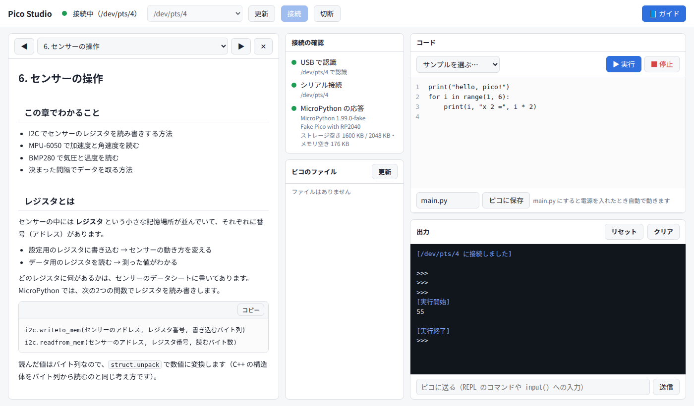

# Pico Studio

Raspberry Pi Pico（RP2040 / MicroPython）を、ブラウザから操作するためのローカルツール。

- ピコとPCの接続を確認する（USB認識・シリアル接続・MicroPythonの応答）
- ブラウザで Python のコードを書き、ボタン1つでピコの上で実行する
- 実行結果をリアルタイムに表示し、`input()` への入力やREPLのコマンドを送る
- ピコの中のファイルを一覧・開く・保存・削除する（`main.py` に保存すると電源オンで自動実行）
- BOOTSELモードのピコに MicroPython（.uf2）を書き込む
- 教科書のような**ガイド**を横に表示しながら操作できる。コード例は「エディタに入れる」ですぐ実行できる

サーバーは自分のPC（`127.0.0.1`）だけで動き、外部には公開しない。



## 必要なもの

- Linux（Ubuntu で確認）
- Python 3.10 以上
- pyserial

```sh
sudo apt install python3-serial
```

## 起動のしかた

```sh
./start.sh
```

ブラウザで http://localhost:8765 が開く。止めるときはターミナルで `Ctrl + C`。

ポート番号を変えたいとき:

```sh
PORT=9000 ./start.sh
# または
python3 server.py --port 9000
```

## 使い方

くわしくはガイドの [0. Pico Studio の使い方](guide/00-studio.md) にまとめてある。

1. ピコを USB ケーブルでつなぐ（充電専用ケーブルでは認識しない）
2. 画面上部のポート欄で「(ピコ)」と書かれたポートを選び、「接続」を押す
3. 左の「接続の確認」が3つとも緑になればOK
4. 真ん中にコードを書いて「▶ 実行」（`Ctrl + Enter`）
5. 止めるときは「■ 停止」
6. 残しておきたいコードは「ピコに保存」（`Ctrl + S`）。名前を `main.py` にすると、電源を入れたときに自動で動く

「サンプルを選ぶ」から、LED の点滅・温度センサー・PCとの送受信などのサンプルを読み込める。

### MicroPython がまだ入っていないとき

1. ピコの **BOOT** ボタンを押したまま USB をつなぐ
2. 「RPI-RP2」というドライブが出てくると、画面に「最新の MicroPython を書き込む」ボタンが出る
3. ボタンを押すと、[micropython.org](https://micropython.org/download/RPI_PICO/) から最新版をダウンロードして書き込む
   （手元の .uf2 ファイルを選んで書き込むこともできる）
4. 数秒でピコが再起動するので、「更新」を押してから接続する

## ガイド

画面右上の「📘 ガイド」で、ラズパイピコの使い方をまとめたガイドを横に表示できる。
GitHub 上でも [guide/](guide/) フォルダの Markdown をそのまま読める。

| 章 | 内容 |
| --- | --- |
| [0. Pico Studio の使い方](guide/00-studio.md) | しくみ、起動と終了、接続と権限の設定、画面の見方、実行・停止・保存、ファイルの確認、ガイドの使い方、関数・引数の説明（スクリーンショット付き） |
| [1. ラズパイピコとは](guide/01-pico.md) | マイコンとは、ピコの種類、ボードの各部、BOOT・USR・RST、書き込みモード、MicroPython と C/C++、用語集 |
| [2. コマンドで操作する](guide/02-cli.md) | Pico Studio を使わない操作の順番、mpremote での接続確認・実行・停止・保存・ファイル確認・REPL、ボタンとの対応 |
| [3. マイコンでできること・おすすめリンク](guide/03-usecases.md) | 使い道、牛の行動監視 IoT の流れ、向き・不向き、そろえる部品、リンク集と読む順番 |
| [4. はじめての操作](guide/04-first-steps.md) | MicroPython の書き込み、REPL、はじめてのプログラム、Lチカ（ボード・外付け・RGB）、main.py、ボタン |
| [5. ピンと電源の基本](guide/05-pins.md) | ピン配置図、電源、GPIO とプルアップ、ADC（ボリューム）、PWM、I2C/SPI/UART、注意点 |
| [6. センサーのつなぎ方](guide/06-wiring.md) | ブレッドボード、ジャンパーワイヤー、ピンヘッダの付け方、I2C の配線図と手順、I2C スキャン |
| [7. センサーの操作](guide/07-sensors.md) | レジスタ、バイト列の変換、MPU-6050（加速度）・BMP280（気圧）の読み取り、一定間隔のサンプリング |
| [8. おすすめのセンサー](guide/08-sensor-picks.md) | 最初に使うセンサー、農業向けのセンサー、選ぶときの注意、SHT31 と土壌水分センサーの配線とコード、商品の説明の読み方（ADC コンバータなど） |
| [9. データの記録と送信](guide/09-data.md) | CSV 保存と PC への持ち出し、USB で PC に送って保存、メモリの注意 |
| [10. 機械学習モデルの導入](guide/10-ml.md) | 特徴量、データ収集（手で試す方法）、PC で決定木を学習、成績表の読み方、ピコで推論、大きなモデルの選択肢 |
| [11. 困ったとき](guide/11-trouble.md) | つながらないときの流れ図、接続・エラー・動作のトラブル、コマンドでの確認、初期化 |
| [12. ラズパイとピコの実装の比較](guide/12-compare.md) | Linux との違い、ssh・scp・systemd との対応、同じプログラムの実装手順、複数の処理の動かし方、つまずきやすいところ、使い分け |
| [13. 実際の開発の流れ](guide/13-development.md) | 牛の行動判定システムを例にした開発の順番、首輪・受信機・スマホの役割分担、無線の選び方、電池の計算、試験のしかた |
| [14. C++ で実装する](guide/14-cpp.md) | Pico SDK の準備、CMake でのビルドと書き込み、MicroPython との対応表、Lチカ・ボタン・温度・MPU-6050・一定間隔の測定・決定木の判定・2つのコアを C++ で書く、MicroPython に戻す |

`http://localhost:8765/#chapter=5` のように開くと、その章を直接表示する。

### ガイドの書き方

- 章は `guide/*.md`（Markdown）。順番とタイトルは `guide/chapters.json` で決める
- ` ```python run ` で始めたコードには「エディタに入れる」ボタンが付く（ピコで動くコード）。
  ` ```python ` は PC で動かすコード、` ```cpp ` は C++ のコード、` ```cmake ` は CMakeLists.txt、` ```text ` は説明用
- 画像は `guide/images/` に置いて `` と書く（png / jpg / gif / webp / svg）
- 番号付きの手順の途中に画像やコードをはさんでも、続きの番号（例: `4.`）から書けばその番号から表示される
- 手順の下に2文字以上字下げした `- ` を書くと、入れ子の箇条書きになる
- 動画も同じ書き方で表示できる
  - 動画ファイル: `guide/videos/` などに置いて ``（mp4 / webm）
  - YouTube: `` と書くと、埋め込みで再生できる
- コードの関数・引数をクリックしたときの説明は `guide/glossary.json` に書く
  - キーは `"関数名.引数名"`（例: `"train_test_split.stratify"`）か `"単語"`（例: `"fit"`、`"Pin.OUT"`）
  - 関数名は最後の部分だけ（`serial.Serial` なら `Serial`）。`"関数名.引数名"` があれば、そちらが優先される
  - コマンドの説明は `"$ コマンド"` の形で書く（例: `"$ sudo"`、`"$ apt install"`、`"$ ls -l"`）。` ```bash ` のコードと、`mpremote ls` のようなインラインのコマンドで出る
  - 説明の先頭の行を `語源: 〜` にすると、吹き出しの中で折りたたんで表示する

## 権限の設定（初回だけ）

Linux では、そのままだとシリアルポートを開く権限がないことがある。
次の udev ルールを入れると、ピコをつないだときにログイン中のユーザーが使えるようになる。

```sh
sudo cp 70-pico-studio.rules /etc/udev/rules.d/
sudo udevadm control --reload-rules
```

入れたあとは、ピコを一度抜いてつなぎ直す。

> 以前の `99-pico-studio.rules` を入れていた場合は、番号が大きすぎて効かない（`uaccess` は 73 番のルールで処理されるため）。
> `sudo rm /etc/udev/rules.d/99-pico-studio.rules` で消してから、上の手順で入れ直す。

udev ルールの代わりに、`dialout` グループに入る方法もある（ログインし直しが必要）。

```sh
sudo usermod -aG dialout $USER
```

## うまくいかないとき

| 症状 | 確認すること |
| --- | --- |
| ポートが見つからない | ケーブルがデータ通信対応か。BOOT ボタンを押しながらつなぐと「RPI-RP2」が出るか |
| 「ポートを開く権限がありません」 | 上の「権限の設定」をする |
| 「MicroPython の応答がありません」 | MicroPython が書き込まれているか。Thonny や mpremote が同じポートを使っていないか |
| 実行が止まらない | 「■ 停止」を押す。それでもだめなら「切断」→ ケーブルを抜き差し |

## 仕組み

```
ブラウザ (static/index.html)
   │  HTTP (localhost:8765)
   ▼
server.py ── pyserial ──▶ /dev/ttyACM0 ──▶ ピコ (MicroPython)
```

- `server.py` が USB シリアルでピコとつながり、MicroPython の **raw REPL**
  （`Ctrl-A` で入る、プログラムを丸ごと送って実行するモード）でコードを実行する
- 実行中の出力はサーバーが受け取り、ブラウザが 0.15〜0.4 秒ごとに取りに行って表示する
- ファイル操作も、ピコの上で小さな Python コードを実行して行う
- 他のサイトから勝手に操作されないように、サーバーは `127.0.0.1` だけで待ち受け、
  別のオリジンからの POST は拒否する

## ファイル構成

```
server.py               ローカルサーバー（ピコとの通信と API）
static/index.html       画面（HTML / CSS / JavaScript を1ファイルに）
guide/                  ガイド（Markdown・図）。画面の横に表示される
start.sh                起動してブラウザを開くスクリプト
70-pico-studio.rules    シリアルポートの権限を設定する udev ルール
tests/fake_pico.py      テスト用の「偽のピコ」
```

## ピコなしで試す（開発用）

`tests/fake_pico.py` は、MicroPython の REPL のやり取りをまねる偽のピコ。
疑似端末（`/dev/pts/N`）を作るので、実機がなくても画面や API の動作を確かめられる。

```sh
python3 tests/fake_pico.py      # 表示された /dev/pts/N を覚えておく
./start.sh                      # 別のターミナルで
curl -X POST -H 'Content-Type: application/json' \
     -d '{"port":"/dev/pts/N"}' http://localhost:8765/api/connect
```

中身は CPython で実行しているので、`machine` などピコ専用のモジュールは使えない。

## API

| メソッド | パス | 内容 |
| --- | --- | --- |
| GET | `/api/ports` | シリアルポートの一覧と BOOTSEL モードの状態 |
| GET | `/api/state?since=N` | 接続状態と、N 番より後の出力 |
| GET | `/api/info` | MicroPython のバージョン・空き容量 |
| GET | `/api/files` | ピコのファイル一覧 |
| GET | `/api/file?name=...` | ファイルの中身 |
| POST | `/api/connect` `{"port"}` | 接続 |
| POST | `/api/disconnect` | 切断 |
| POST | `/api/run` `{"code"}` | コードを実行 |
| POST | `/api/stop` | 実行中のプログラムを止める（Ctrl-C） |
| POST | `/api/send` `{"text"}` | 1行送る（REPL や `input()` 用） |
| POST | `/api/reset` | ソフトリセット（`main.py` が実行される） |
| POST | `/api/file` `{"name","content"}` | ファイルを保存 |
| POST | `/api/delete` `{"name"}` | ファイルを削除 |
| POST | `/api/flash` | 送った .uf2 を書き込む |
| POST | `/api/flash-latest` | 最新の MicroPython をダウンロードして書き込む |
