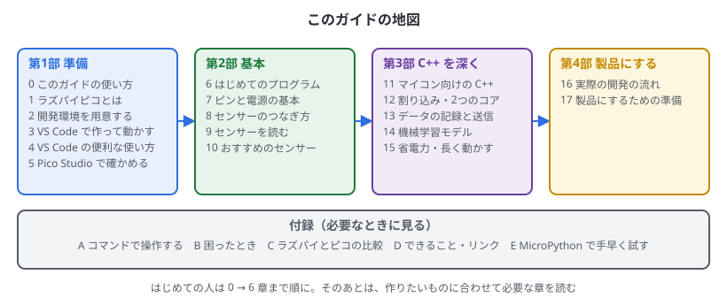
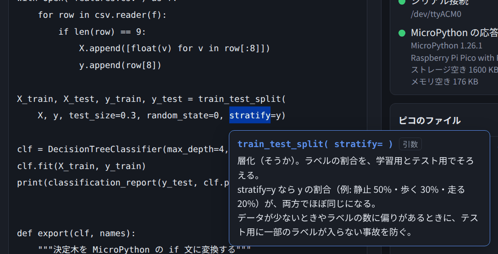

# 0. このガイドの使い方

## この章でわかること

- このガイドで何ができるようになるか
- 開発に使う3つの道具（VS Code・Pico Studio・ターミナル）の役割
- どの順番で読めばよいか
- ガイドの読み方（コードのラベル、言葉の説明の出し方）

## このガイドについて

ラズパイピコで、センサーを読んで判定し、データを送る機械（例: 牛の首輪）を作り、**製品にするまで**の手順をまとめたガイドです。
製品のプログラムは **C++** で書き、**VS Code** で開発します。

| 部 | 内容 |
| --- | --- |
| 第1部 準備 | ピコのこと、開発環境、VS Code での開発のしかた、Pico Studio での確認 |
| 第2部 基本 | LED・ボタン・ピン・センサーの配線と読み取り |
| 第3部 C++ を深く | マイコン向けの C++、割り込み、データの記録、機械学習、省電力 |
| 第4部 製品にする | 実際の開発の流れ、テスト・デバッグ・量産の準備 |
| 付録 | コマンドでの操作、困ったとき、ラズパイとの比較、リンク集、MicroPython |

## 3つの道具の役割

| 道具 | 役割 | 使う章 |
| --- | --- | --- |
| **VS Code**（拡張機能「Raspberry Pi Pico」） | **開発の中心。** C++ を書く・ビルドする・ピコに書き込む・デバッグする | 3・4章、6章から先の全部 |
| **Pico Studio** | **確かめる道具。** ピコがつながっているか、何が動いているか、開発環境がそろっているかを見る。`printf` の出力を見る。このガイドを表示する | 5章 |
| ターミナル | コマンドで同じことをするとき。スクリプトにまとめるとき | 付録A |

ふだんは、**VS Code で書いて書き込み、うまく動かないときに Pico Studio でつながりを確かめる**、という使い方になります。
Pico Studio では MicroPython のコードを手早く試すこともできます（付録E）。配線やセンサーが正しいかを、C++ を書く前に確かめたいときに便利です。

## 読む順番

| 人 | 読む順番 |
| --- | --- |
| はじめての人 | 0 → 1 → 2 → 3 → 5 → 6 章まで順に。そのあと 7 → 8 → 9 章で、センサーを読めるようにする |
| C++ や組み込みの経験がある人 | 2・3 章で開発環境を作り、あとは必要な章だけ |
| 製品にする段階の人 | 11・12・15・16・17 章 |
| うまく動かないとき | 付録B「困ったとき」 |

## ガイドの読み方

### コードのラベル

コードの上に出ているラベルで、どこで使うコードかがわかります。

| ラベル | 意味 | 使い方 |
| --- | --- | --- |
| C++ のプログラム（VS Code のプロジェクトの .cpp に貼り付ける） | ピコで動く、1つの完成したプログラム | 「コピー」して、VS Code のプロジェクトの `.cpp` に貼り付け、Compile → Run（3章） |
| C++ のコード（一部分） | 説明のためのプログラムの一部 | そのままではビルドできない。読んで使い方を知る |
| CMakeLists.txt | ビルドの設定 | プロジェクトの `CMakeLists.txt` に書く |
| PC で実行するコード（Python） | PC のターミナルで動かす Python（13・14章） | ファイルに保存して `python3 ファイル名` |
| ▶ ピコで実行できるコード（MicroPython） | Pico Studio ですぐ試せる MicroPython（付録E） | 「エディタに入れる」→「▶ 実行」 |
| ラベルなし | コマンドや、結果の例 | 読む。コマンドはターミナルで打つ |

### 言葉の意味を調べる

コードの中の関数名や引数名（`gpio_put`、`i2c_write_blocking` など）や、コマンドの単語（`cmake`、`picotool` など）を**クリックすると、意味が吹き出しで出ます**。

- 吹き出しは、ほかの場所をクリックするか、Esc キーで消えます
- 説明がない単語では何も出ません。説明は `guide/glossary.json` に足せます

### ガイドの画面

| 操作 | 動き |
| --- | --- |
| 上の章の名前を押す | 目次が開く。部ごとにまとまっている。章の左の ▶ で、章の中の見出しが開く |
| ◀ ▶ | 前の章・次の章へ |
| ガイドと右側の間の仕切りをドラッグ | ガイドの幅を変える（ダブルクリックで元に戻る） |
| `http://localhost:8765/#chapter=9` のように開く | その章を直接表示する（番号は目次の並び順） |

このガイドは、GitHub の `guide/` フォルダでも、そのまま読めます。

## まとめ

- 製品のプログラムは C++ で書き、VS Code で開発する
- Pico Studio は、つながりや開発環境を確かめる道具。MicroPython で手早く試すこともできる
- はじめての人は 0〜6章を順に。困ったら付録B
- コードのラベルで使い方がわかる。単語をクリックすると意味が出る
