# 0. Pico Studio の使い方

## この章でわかること

- Pico Studio とは何か、どうやって動いているか
- 起動のしかた・終わり方
- ピコにつなぐまでの手順と、うまくいかないときの直し方
- コードを書く・実行する・止める・保存する方法
- ピコに保存したファイルの確認のしかた
- このガイドの読み方と、関数や引数の意味を調べる方法

はじめて使うときは、この章を上から順に進めてください。
読み終わるころには、ピコにプログラムを入れて動かせるようになります。

## Pico Studio とは

ブラウザからラズパイピコを操作するための、自分の PC で動くツールです。
次のことが1つの画面でできます。

- ピコに MicroPython（ピコで Python を動かすためのソフト）を書き込む
- コードを書いて、ピコで実行する
- 実行結果やエラーを見る
- ピコにファイルを保存する・開く・消す
- このガイドを横に表示しながら作業する

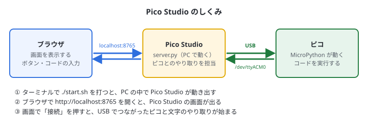

Pico Studio は、PC の中で動く小さなサーバー（`server.py`）と、その画面を表示するブラウザでできています。
インターネットにはつながず、PC の中だけで動きます。

## 用意するもの

| もの | 説明 |
| --- | --- |
| PC | Linux（Ubuntu など）。Python 3 と pyserial が入っていること |
| ラズパイピコ | 公式ピコでも互換ボードでもよい |
| USB ケーブル | **データ通信に対応したもの**。充電専用のケーブルではピコが認識されない |
| ブラウザ | Chrome・Firefox など |

> USB ケーブルは、見た目では充電専用かどうかわかりません。
> うまく認識されないときは、まずケーブルを替えてみるのが近道です。

## 起動する

ターミナル（Ctrl + Alt + T で開く黒い画面）で、次の2行を打ちます。

```bash
cd ~/pico-studio
./start.sh
```

少しするとブラウザが開き、Pico Studio の画面が出ます。
開かないときは、ブラウザで **http://localhost:8765** を開いてください。

- すでに起動しているときに `./start.sh` を打つと、ブラウザで開くだけになります（2つ起動されることはありません）
- ブラウザのタブを閉じても、Pico Studio は動き続けます。もう一度 http://localhost:8765 を開けば戻れます

### 終わるとき

1. 画面上の「切断」を押す
2. `./start.sh` を打ったターミナルで **Ctrl + C** を押す

ターミナルを閉じても終わります。

## 画面の見方

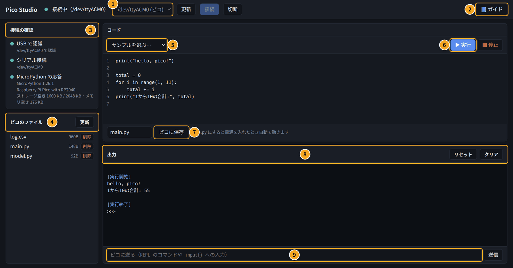

| 番号 | 場所 | できること |
| --- | --- | --- |
| ① | ポート欄 | ピコがつながっている場所（ポート）を選ぶ。右の「更新」「接続」「切断」と一緒に使う |
| ② | 📘 ガイド | このガイドを画面の左に表示する・隠す |
| ③ | 接続の確認 | ピコとつながっているかを3段階で表示する |
| ④ | ピコのファイル | ピコに保存されているファイルの一覧。開く・消す |
| ⑤ | サンプルを選ぶ | 練習用のコードを読み込む |
| ⑥ | ▶ 実行・■ 停止 | コード欄のコードをピコで動かす・止める |
| ⑦ | ピコに保存 | コード欄のコードを、ピコにファイルとして保存する |
| ⑧ | 出力 | `print()` の結果やエラーが出る |
| ⑨ | 送信欄 | ピコに1行ずつ命令を送る（REPL） |

ガイドを表示していないときは、上の図のように3つのパネルが画面いっぱいに広がります。

## はじめてつなぐまで

### 手順

1. ピコを USB ケーブルで PC につなぐ
2. 画面上の **「更新」** を押す
3. ポート欄に **「/dev/ttyACM0 (ピコ)」** のように「(ピコ)」と付いたものが出たら、それを選ぶ
4. **「接続」** を押す

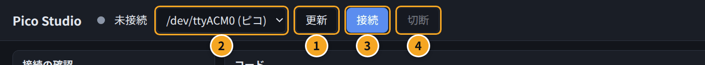

| 番号 | ボタン | 役割 |
| --- | --- | --- |
| ① | 更新 | ポートの一覧を読み直す。ピコをつないだあとに押す |
| ② | ポート欄 | つなぐポートを選ぶ。ピコには「(ピコ)」と付く |
| ③ | 接続 | 選んだポートのピコにつなぐ |
| ④ | 切断 | ピコとの接続を切る。ほかのソフトでピコを使う前に押す |
| ⑤ | 📘 ガイド | ガイドの表示・非表示 |

> 未接続のときは、3秒ごとに自動でポートを探しています。「更新」を押さなくても出てくることがあります。

### 接続の確認

つながると、左の「接続の確認」が3つとも **緑** になります。これで準備完了です。

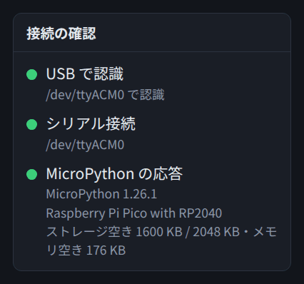

| 項目 | 緑のとき | 緑にならないとき |
| --- | --- | --- |
| USB で認識 | PC がピコを見つけている | ケーブル・USB ポートを確認する |
| シリアル接続 | ピコと通信できる状態 | 「接続」を押す。権限のエラーなら下を見る |
| MicroPython の応答 | ピコの MicroPython が返事をした | MicroPython が入っていないか、ほかのソフトが使っている |

「MicroPython の応答」の下には、MicroPython のバージョン、ボードの名前、ストレージ（保存領域）とメモリの空きが出ます。

点の色の意味は次のとおりです。

| 色 | 意味 |
| --- | --- |
| 緑 | OK |
| 黄 | 注意（書き込みモード、プログラムの実行中など） |
| 赤 | 問題がある（見つからない、応答がないなど） |
| 灰 | まだ確認していない（未接続など） |

### 「見つかりません」と出たとき

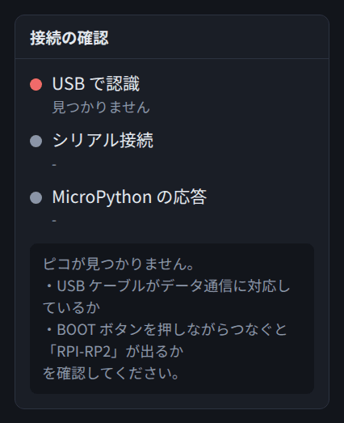

PC がピコを見つけられていません。次の順に試してください。

1. USB ケーブルを、データ通信に対応したものに替える
2. PC の別の USB ポートにさす。USB ハブを使っているなら、PC に直接さす
3. ピコの **BOOT** ボタンを押しながらつなぐ。「BOOTSEL モード」と出れば、ケーブルは大丈夫で、MicroPython が入っていないだけ（下の「MicroPython がまだ入っていないとき」へ）

コマンドで確かめる方法は9章にあります。

### 「ポートを開く権限がありません」と出たとき

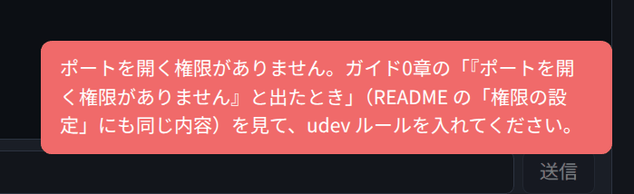

Linux では、最初の1回だけ、ピコのポートを使えるようにする設定が必要です。
ターミナルで次を打ちます（途中でパスワードを聞かれます。打っても画面には何も出ませんが、そのまま打って Enter を押します）。

```bash
cd ~/pico-studio
sudo cp 70-pico-studio.rules /etc/udev/rules.d/
sudo udevadm control --reload-rules
```

打ち終わったら、**ピコを一度抜いて、つなぎ直します**。そのあと「更新」→「接続」を押します。

> 以前に `99-pico-studio.rules` を入れていた場合は、番号が大きすぎて効きません。
> 先に `sudo rm /etc/udev/rules.d/99-pico-studio.rules` で消してから、上の手順で入れてください。

設定できたかどうかは、ターミナルで次のコマンドを打つとわかります。

```bash
ls -l /dev/ttyACM0
```

行の最初が `crw-rw----+` のように **`+` 付き**になっていれば成功です。

### MicroPython がまだ入っていないとき

買ったばかりのピコには、MicroPython が入っていないことがあります。

1. ピコの **BOOT** ボタンを押したまま、USB ケーブルで PC につなぐ（くわしくは1章の図）
2. つないだらボタンを離す
3. 「接続の確認」に **BOOTSEL モード（書き込み待ち）** と出る

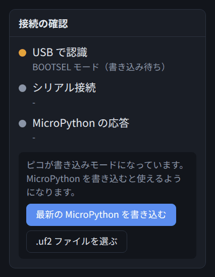

4. **「最新の MicroPython を書き込む」** を押す。インターネットから最新版をダウンロードして、自動で書き込みます
5. 数秒でピコが再起動するので、「更新」→「接続」を押す

手元にある .uf2 ファイル（ピコに書き込むソフトのファイル）を使いたいときは、「.uf2 ファイルを選ぶ」を押します。

> 「ドライブがまだ開かれていません」と出たときは、ファイルマネージャーで「RPI-RP2」を開いてから「更新」を押してください。

## コードを書いて実行する

### 実行のしかた

1. 真ん中の「コード」欄にコードを書く
2. **「▶ 実行」** を押す（または **Ctrl + Enter**）
3. 下の「出力」欄に結果が出る

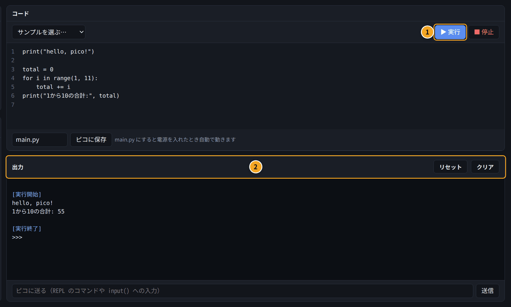

出力欄の青い文字は、Pico Studio からのお知らせです。

| 表示 | 意味 |
| --- | --- |
| `[実行開始]` | ピコがコードを受け取って、動かし始めた |
| `[実行終了]` | 最後まで動いた（または止めた） |
| `>>>` | ピコが次の命令を待っている |

### コード欄の便利な機能

| 操作 | 動き |
| --- | --- |
| Tab | 字下げ（スペース4つ）を入れる。複数行を選んで押すと、まとめて字下げ |
| Shift + Tab | 字下げを1段戻す |
| Enter | 前の行と同じだけ字下げした改行。`:` で終わる行のあとは、1段深く字下げする |
| Ctrl + Enter | 実行 |
| Ctrl + S | ピコに保存 |

書いたコードはブラウザに自動で残るので、画面を閉じても次に開いたときに戻ります。

### サンプルを使う

「サンプルを選ぶ」から、すぐ試せるコードを読み込めます。

| サンプル | 内容 |
| --- | --- |
| hello: 文字と計算 | 文字を表示して、簡単な計算をする |
| LED を点滅させる | ボードの LED をチカチカさせる |
| RGB LED を光らせる | RGB LED が付いたボードで、赤・緑・青に光らせる |
| 内蔵の温度センサー | ピコのチップの温度を読む |
| PC と送受信する | 送信欄に入れた数字を2倍にして返す |

> 今のコードは上書きされます。残しておきたいときは、先に「ピコに保存」してください。

### 実行を止める

ずっとくり返すプログラムは、自分では終わりません。止めるときは **「■ 停止」** を押します。

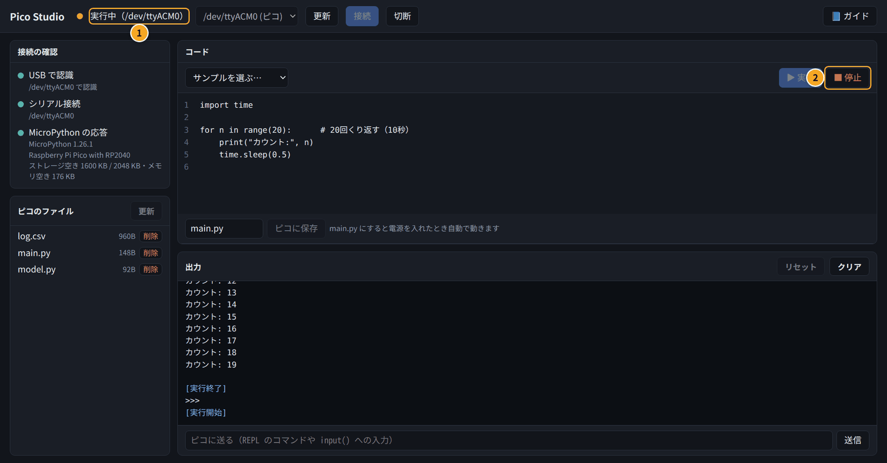

- 実行中は、上のバーに **「実行中」**（①）と出て、「▶ 実行」が押せなくなります
- 「■ 停止」（②）を押すと、ピコに Ctrl-C を送って止めます
- 止めると出力欄に `KeyboardInterrupt` と出ることがありますが、エラーではありません

### エラーが出たとき

コードにまちがいがあると、出力欄に **赤い文字** でエラーが出ます。

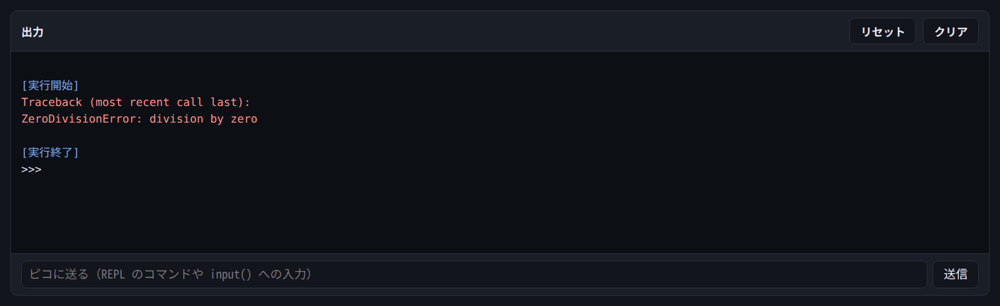

エラーは **最後の行** が一番大事です。上の例の `ZeroDivisionError: division by zero` は「0 で割り算した」という意味です。
よくあるエラーと直し方は9章にまとめてあります。

## 出力欄と REPL

出力欄の下の送信欄に、Python を1行打って **「送信」**（または Enter）を押すと、ピコがその場で実行して結果を返します。これを **REPL**（対話モード）といいます。

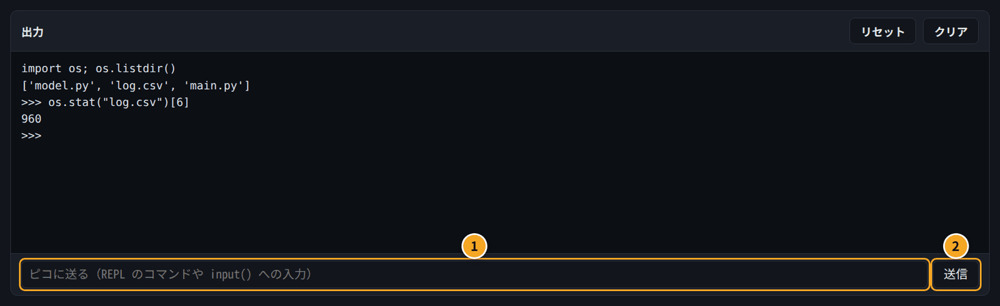

| 番号 | 場所 | 役割 |
| --- | --- | --- |
| ① | 送信欄 | 1行の命令を打つ。プログラムの `input()` への入力にも使う |
| ② | 送信 | ピコに送る（Enter でも同じ） |

- 前に打った変数や `import` は覚えているので、続けて使えます
- ちょっとした確認は REPL、まとまったプログラムはコード欄、と使い分けると便利です
- 出力欄の右上の **「クリア」** で表示を消せます
- **「リセット」** はピコを再起動します（ソフトリセット）。main.py があれば、それが動き始めます

## ピコに保存する

コード欄のコードを、ピコの中にファイルとして保存できます。

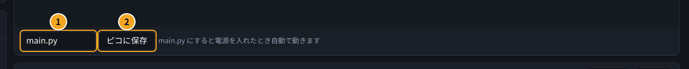

1. ファイル名の欄（①）に名前を入れる。名前は `.py` で終わるようにする（例: `blink.py`）
2. **「ピコに保存」**（②）を押す（または **Ctrl + S**）
3. 「ピコのファイル」の一覧に出てくる

### 電源を入れたら自動で動かす（main.py）

名前を **main.py** にして保存すると、ピコの電源を入れたときに自動で動きます。
PC につながなくても、USB の充電器やモバイルバッテリーにさすだけで動くようになります。

- main.py が動いていても、Pico Studio で「接続」すると自動で止まります
- もう一度動かしたいときは、出力欄の「リセット」を押す
- 自動で動かしたくなくなったら、ファイル一覧で main.py を「削除」する

## ピコに保存したファイルを確認する

### 「ピコのファイル」で見る（おすすめ）

ピコに接続すると、左の **「ピコのファイル」** に、ピコに保存されているファイルの一覧が出ます。

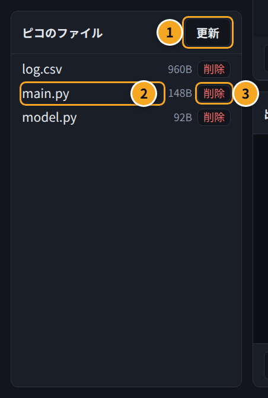

| 番号 | 場所 | 役割 |
| --- | --- | --- |
| ① | 更新 | 一覧を読み直す。保存したあとや、プログラムがファイルを作ったあとに押す |
| ② | ファイル名 | クリックすると、中身がコード欄に開く |
| ③ | 削除 | ピコからファイルを消す（元に戻せないので注意） |

- 名前の横の数字は、ファイルの大きさです（B はバイト）
- 📁 が付いているのはフォルダです。この一覧ではフォルダの中までは開けないので、下の REPL の方法で確かめます
- ストレージの空きは、「接続の確認」の「MicroPython の応答」の下に出ます

ファイル名をクリックすると、コード欄に中身が開き、ファイル名の欄にもその名前が入ります。

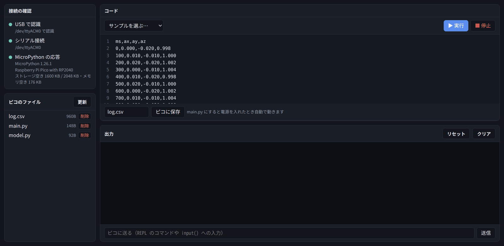

開いたファイルを書き直して「ピコに保存」すると、同じ名前で上書きされます。
CSV などのデータを PC に持ってくる方法は7章にあります。

### REPL で調べる

送信欄に次のように打つと、ファイルの一覧や大きさを調べられます。

```text
>>> import os; os.listdir()
['model.py', 'log.csv', 'main.py']
>>> os.stat("log.csv")[6]
960
```

| 打つもの | わかること |
| --- | --- |
| `import os; os.listdir()` | ファイルの一覧 |
| `os.listdir("フォルダ名")` | フォルダの中身 |
| `os.stat("log.csv")[6]` | ファイルの大きさ（バイト） |
| `print(open("log.csv").read())` | ファイルの中身を表示する |

## ガイドの使い方

画面右上の **「📘 ガイド」** を押すと、このガイドが画面の左に出ます。

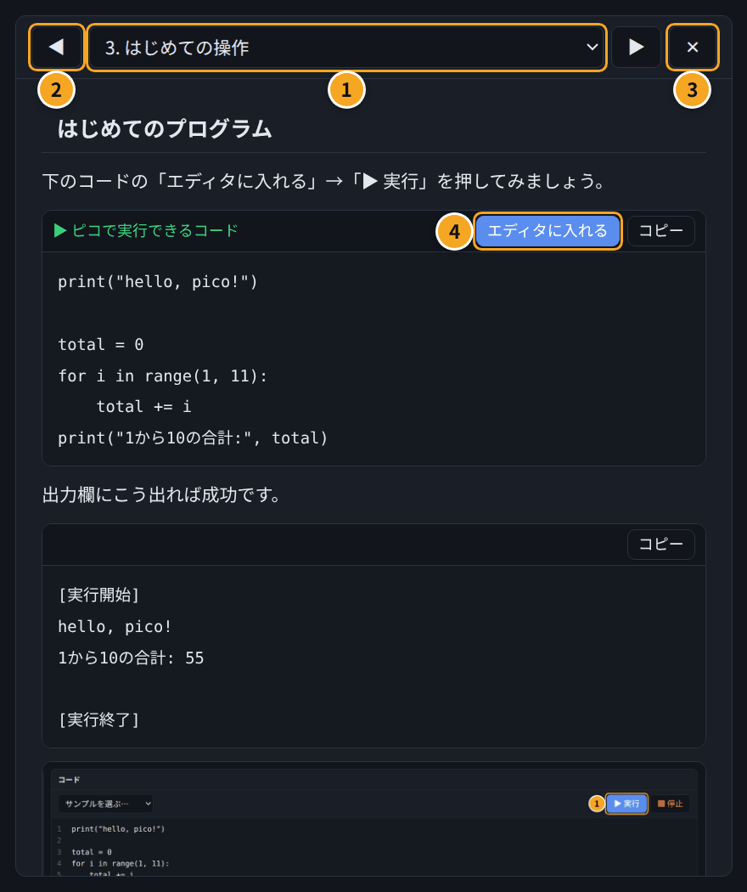

| 番号 | 場所 | 役割 |
| --- | --- | --- |
| ① | 章の選択 | 読みたい章を選ぶ |
| ② | ◀ ▶ | 前の章・次の章へ |
| ③ | ✕ | ガイドを閉じる |
| ④ | エディタに入れる | そのコードをコード欄に入れる。あとは「▶ 実行」を押すだけ |
| ⑤ | コピー | コードをコピーする |

コードの上に出ているラベルで、どこで動かすコードかがわかります。

| ラベル | 意味 |
| --- | --- |
| ▶ ピコで実行できるコード（緑） | 「エディタに入れる」→「▶ 実行」で、ピコで動かせる |
| PC で実行するコード | ピコではなく、PC のターミナルで動かす（7章・8章） |
| ラベルなし | 説明用。コマンドや結果の例 |

`http://localhost:8765/#chapter=5` のように開くと、その章（この例では5章）を直接表示できます。

## 関数や引数の意味を調べる

ガイドのコードやコード欄で、**関数名や引数名をクリック**すると、その意味が吹き出しで出ます。

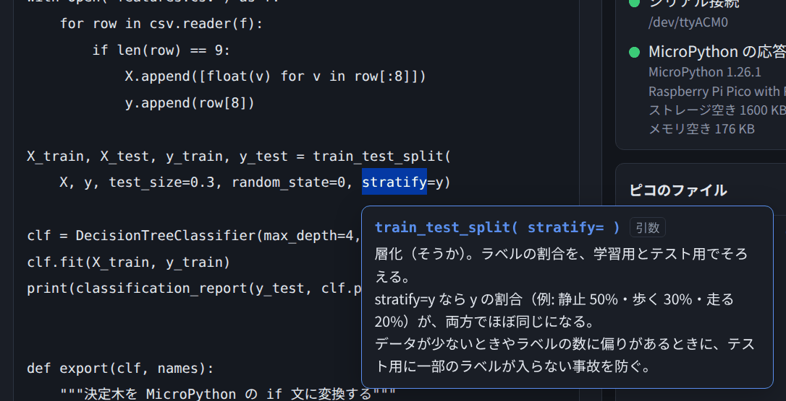

例えば8章のコードで `stratify` をクリックすると、上のように説明が出ます。

- 同じ名前の引数でも、関数によって意味が違うことがあります。吹き出しには `train_test_split( stratify= )` のように、どの関数の引数かも表示されます
- `Pin.OUT` や `Pin.PULL_UP` のような設定値もクリックで調べられます
- 吹き出しは、ほかの場所をクリックするか、Esc キーで消えます
- 説明がない単語では何も出ません。説明は `guide/glossary.json` に足せます

## キーボードの操作まとめ

| キー | 動き |
| --- | --- |
| Ctrl + Enter | 実行 |
| Ctrl + S | ピコに保存 |
| Tab / Shift + Tab | 字下げ / 字下げを戻す |
| Enter（送信欄） | ピコに1行送る |
| Esc | 関数・引数の説明を閉じる |

## 困ったとき

うまくつながらないとき、エラーの意味がわからないときは、9章「困ったとき」を見てください。
PC がピコを認識しているかをコマンドで確かめる方法も、9章に書いてあります。

## まとめ

- `./start.sh` で起動し、ブラウザで http://localhost:8765 を開く
- 「更新」→「(ピコ)」のポートを選ぶ→「接続」。「接続の確認」が3つとも緑なら準備完了
- コードは「▶ 実行」（Ctrl + Enter）で動かし、「■ 停止」で止める
- 「ピコに保存」で保存。main.py にすると電源オンで自動で動く
- 関数や引数をクリックすると、意味が出る
