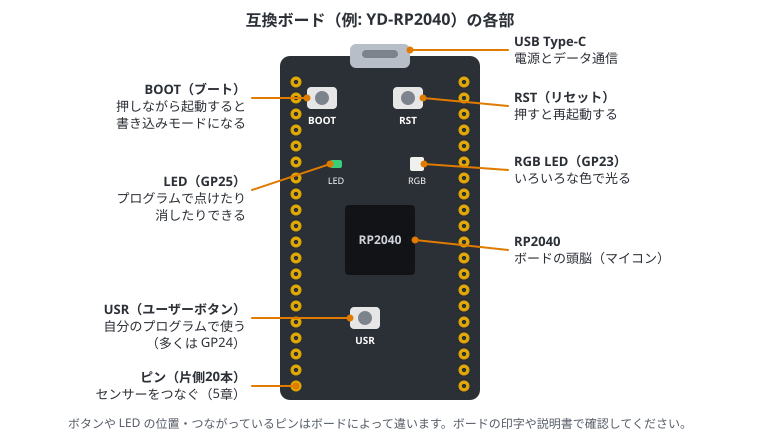
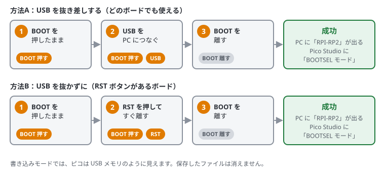

# 1. ラズパイピコとは

## この章でわかること

- マイコンとは何か、パソコンとどう違うか
- Raspberry Pi Pico（ラズパイピコ）の特徴と種類
- ボードの各部の名前（BOOT・USR・RST ボタンなど）
- 書き込みモード（BOOTSEL）の入り方
- ピコのプログラムを書く方法（MicroPython と C/C++）と使い分け
- このガイドでよく出てくる言葉

## マイコンとは

**マイコン（マイクロコントローラー）** は、CPU・メモリ・入出力の回路を1つのチップにまとめた、小さなコンピューターです。
電子レンジ、エアコン、炊飯器、車、おもちゃなど、身の回りの多くの機械の中で動いています。

たとえば炊飯器のマイコンは、温度センサーで釜の温度を測り、ヒーターを入れたり切ったりして、ごはんを炊いています。
このように「**センサーで測る → 考える → 何かを動かす**」をくり返すのが、マイコンの仕事です。

パソコンとの大きな違いは次のとおりです。

| | パソコン | マイコン |
| --- | --- | --- |
| OS | Windows / Linux など | なし（自分のプログラムが1つだけ動く） |
| メモリ | 数GB〜 | 数百KB（パソコンの数万分の1） |
| 電源を入れてから動くまで | 数十秒 | 一瞬 |
| 消費電力 | 数十W | 0.1W 前後（電池で何日も動く） |
| 大きさ・値段 | 大きい・数万円〜 | 指くらい・数百円〜 |
| 得意なこと | 画面・ネット・重い計算 | センサーの読み取り・モーターや LED の制御 |

OS がないので、電源を入れるとすぐに自分のプログラムが動き、電池で長時間動かせます。
その代わり、SSH でログインしたり、複数のアプリを同時に動かしたりはできません。

## ラズパイピコとは

**Raspberry Pi Pico** は、Raspberry Pi 財団が作ったマイコンボードです。値段は千円前後です。
「ラズパイ」という名前がついていますが、Linux が動く Raspberry Pi（ラズパイ4 や 5）とは別物で、マイコンの仲間です。

中心にあるチップは **RP2040** です。

| 項目 | 内容 | ひとことで言うと |
| --- | --- | --- |
| CPU | ARM Cortex-M0+ デュアルコア 133MHz | 頭脳が2つ。1秒に約1億回の計算 |
| メモリ (SRAM) | 264KB | 動いている間だけ使う作業場所 |
| フラッシュ（保存領域） | 公式ピコは 2MB（互換ボードには 16MB のものもある） | 電源を切っても消えないファイル置き場 |
| 入出力ピン (GPIO) | 26本 | センサーや LED をつなぐ足 |
| アナログ入力 (ADC) | 3本（12bit） | 電圧を数値で読める足 |
| 通信 | I2C ×2、SPI ×2、UART ×2、USB | センサーや PC とやり取りする方法 |
| その他 | PIO、内蔵温度センサー | 自由に作れる入出力回路など |

### ピコの種類

| 名前 | 特徴 |
| --- | --- |
| Pico | 基本のモデル |
| Pico H | Pico にピンヘッダ（ブレッドボードに差すための足）が最初から付いている |
| Pico W / Pico WH | WiFi と Bluetooth が付いている |
| Pico 2 / Pico 2 W | 新しいチップ RP2350 を使った、速くてメモリの多いモデル |
| 互換ボード | ほかの会社が作ったもの。USB Type-C、ボタンや RGB LED が付いているものが多い |

書き方はほぼ同じなので、このガイドの内容はどれでもそのまま使えます。

## ボードの各部

USB Type-C の互換ボードの例です。公式ピコの場合、ボタンは BOOT だけで、USB 端子は micro-B です。

| 部分 | 説明 |
| --- | --- |
| **USB 端子** | PC とつないで、電源とデータ通信の両方に使う |
| **BOOT ボタン** | 押しながら起動すると、書き込みモード（BOOTSEL）になる |
| **RST ボタン** | 押すとピコが再起動する |
| **USR ボタン** | 自分のプログラムで自由に使えるボタン |
| **LED** | プログラムで点けたり消したりできる小さなランプ |
| **RGB LED** | 赤・緑・青を混ぜて、いろいろな色で光る LED |
| **RP2040** | ボードの頭脳（マイコンのチップ） |
| **ピン** | 両側に20本ずつ、合計40本。センサーなどをつなぐ（5章で詳しく説明） |

## 3つのボタン（BOOT・USR・RST）

| ボタン | 名前 | 役割 |
| --- | --- | --- |
| **BOOT** | ブートボタン（BOOTSEL） | 押しながら起動すると書き込みモードになり、PC に「RPI-RP2」という USB メモリとして見える。.uf2 ファイルをコピーすると書き込める |
| **USR** | ユーザーボタン | 自分のプログラムで自由に使えるボタン。多くのボードでは **GP24** につながっている（押すと 0、離すと 1）。4章で読み方を説明 |
| **RST** | リセットボタン | 押すとピコが再起動する。USB を抜き差ししたのと同じ。main.py があれば最初から動き直す |

### 書き込みモード（BOOTSEL）に入る

MicroPython を入れるときや、入れ直すときに使います。やり方は2つあります。

- **方法A（どのボードでも使える）**: BOOT を押したまま USB をつなぎ、つないだら離す
- **方法B（RST があるボード）**: USB をつないだまま、BOOT を押したまま RST を押して離し、そのあと BOOT を離す

うまく入ると、Pico Studio の「接続の確認」に **BOOTSEL モード** と出ます（0章の図）。

### よく使う操作

| やりたいこと | 操作 |
| --- | --- |
| プログラムを最初からやり直す | RST を1回押す |
| 書き込みモードにする | 上の方法A か方法B |
| 止まって反応しない | RST を押す。それでもだめなら書き込みモードにして MicroPython を入れ直す（11章） |

> BOOT や RST を押しても、ピコに保存したファイル（main.py など）は消えません。
> 消えるのは flash_nuke.uf2 を書き込んだときだけです（11章）。

## プログラムを書く方法

ピコでは、主に2つの方法でプログラムを書けます。

### MicroPython

マイコン向けに小さくした Python です。

- 書き込みが不要で、書いたコードをすぐに実行できる
- REPL（対話モード）で1行ずつ試せる
- Python の文法がそのまま使える（ライブラリは標準ライブラリの一部と、`machine` などのマイコン専用のもの）

Pico Studio では、MicroPython のコードをすぐ実行できます。

### C/C++（Pico SDK）

Raspberry Pi 公式の **Pico SDK** を使うと、C/C++ で書けます。

- MicroPython より 10〜100 倍速い
- メモリを細かく管理できる
- 書いたらビルド（コンパイル）して .uf2 ファイルを書き込む必要がある。Pico Studio なら「▶ ビルドして書き込む」でまとめてできる

**使い分けの目安**

| | MicroPython | C/C++ |
| --- | --- | --- |
| 試す・学ぶ | 向いている。すぐ動かせる | ビルドが要るぶん、少し手間 |
| 製品にする | 向いていない | **向いている** |
| 速さ | 遅い | 速い |
| 電池の持ち | 短め | 長くできる（省電力の機能を細かく使える。17章） |
| 動きの確かさ | メモリ不足などで止まることがある | メモリの使い方を決めておけるので、長く安定して動かしやすい |
| 書き込み | MicroPython を入れて、.py を置く | .uf2 を1つ書き込むだけ（量産しやすい） |

**製品にするときは C++ で書くのが基本です。** まず MicroPython で配線やセンサーを確かめ、決まった処理を C++ で書き直す、という進め方がおすすめです。
このガイドは、4章から先を **Python と C++ の両方**で書いています。Pico Studio のコード欄かガイドの上で「C++」を選ぶと、C++ の説明とコードが出ます。
C++ の開発環境の用意は14章、C++ だけの話（書き方のコツ・割り込み・省電力・製品にする準備）は15〜18章、VS Code での開発は19章にあります。
C++ がわかるなら、Arduino の書き方で使える **arduino-pico** という選択肢もあります（3章のリンク参照）。

## よく出てくる言葉

| 言葉 | 意味 |
| --- | --- |
| MicroPython | ピコで Python を動かすためのソフト。最初に1回だけピコに書き込む |
| ファームウェア | ピコの中で一番最初に動くソフト。MicroPython もファームウェアの一種 |
| .uf2 ファイル | ピコに書き込むファームウェアのファイル。書き込みモードのピコにコピーすると書き込める |
| BOOTSEL（書き込みモード） | ファームウェアを書き込むためのモード。ピコが USB メモリのように見える |
| REPL | 1行ずつ命令を打って、すぐ結果を見られるモード |
| GPIO | プログラムで 0 / 1 を出したり読んだりできるピン |
| フラッシュ | 電源を切っても消えない保存領域。main.py などのファイルが入る |
| RAM（メモリ） | プログラムが動いている間だけ使う作業場所。電源を切ると消える |
| main.py | ピコの電源を入れると自動で動くファイル |
| ポート | PC がピコと通信するための窓口。Linux では `/dev/ttyACM0` など |

## まとめ

- マイコンは OS のない小さなコンピューターで、センサーや LED の制御が得意
- ラズパイピコは RP2040 を載せたマイコンボード。種類が違っても書き方はほぼ同じ
- BOOT は書き込みモード、RST は再起動、USR は自分で使うボタン
- 試すのは MicroPython、製品にするのは C/C++。ガイドはどちらでも読める（言語を切り替える）
