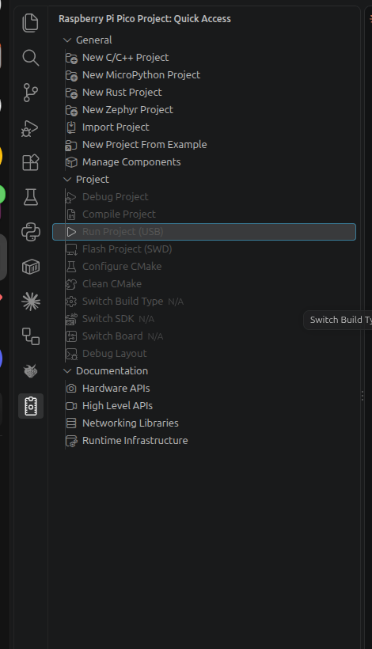

# 2. 開発環境を用意する

## この章でわかること

- C++ でピコを開発するのに、何が必要か
- VS Code と拡張機能「Raspberry Pi Pico」の入れ方
- 拡張機能が自動で入れるものと、その場所
- Pico Studio を使えるようにする方法
- そろったかどうかの確かめ方

Ubuntu の場合です。最初の1回だけ行います。

## 必要なもの

| もの | 役割 | 入れ方 |
| --- | --- | --- |
| **VS Code** | プログラムを書くソフト | この章の手順1 |
| **拡張機能「Raspberry Pi Pico」** | ビルド・書き込み・デバッグをボタンでできるようにする。コンパイラや Pico SDK も自動で入れてくれる | この章の手順2 |
| **拡張機能「Serial Monitor」** | `printf` の出力を VS Code の中で見る | この章の手順2 |
| udev ルール | ピコを sudo なしで使う（書き込み・出力を見る） | この章の手順3 |
| Pico Studio | ピコがつながっているかを確かめる（5章） | この章の手順3 |
| （必要なら）コマンド用の道具 | VS Code を使わず、ターミナルでビルド・書き込みする | 付録A |

ピコのプログラムを作るには、ほかに **ARM 用のコンパイラ**（ピコ用の機械語を作るソフト）と **Pico SDK**（Raspberry Pi 公式の C/C++ の部品集）が必要です。どちらも拡張機能が自動で入れるので、自分で入れる必要はありません。

## 手順1: VS Code を入れる

すでに入っていれば飛ばします。

1. [VS Code のダウンロードページ](https://code.visualstudio.com/) で **.deb**（Ubuntu 用）をダウンロードする
2. ターミナルで、ダウンロードしたファイルを入れる

```bash
sudo apt install ~/ダウンロード/code_*.deb
```

## 手順2: 拡張機能「Raspberry Pi Pico」を入れる

1. VS Code の左の **拡張機能**（四角が4つのアイコン）を開く
2. 検索欄に `Raspberry Pi Pico` と入れる
3. 作者が **Raspberry Pi** のものを選んで「インストール」を押す
4. 左に **ピコの形のアイコン** が出る。押すと「Quick Access」のメニューが開く



拡張機能は、git・tar・python3 などを使います。Ubuntu にはたいてい入っていますが、ないと言われたら次を打ちます。

```bash
sudo apt install git tar python3 build-essential
```

### Serial Monitor も入れる

`printf` の出力を VS Code の中で見るために、拡張機能 **Serial Monitor**（作者: Microsoft）も入れます（3章で使います）。
拡張機能の検索欄に `Serial Monitor` と入れて、作者が Microsoft のものをインストールします。ターミナルからなら、次のコマンドでも入ります。

```bash
code --install-extension ms-vscode.vscode-serial-monitor
```

ほかのおすすめの拡張機能は、4章の「おすすめの拡張機能」にあります。

## 拡張機能が入れるもの

**初めてプロジェクトを作ったとき**（3章）に、拡張機能が次のものを **`~/.pico-sdk`** にダウンロードします。数分かかり、インターネットが必要です。

| 入るもの | 場所 | 役割 |
| --- | --- | --- |
| Pico SDK | `~/.pico-sdk/sdk/2.x.x` | ピコの部品（GPIO・I2C など）を動かす関数の集まり |
| ARM 用のコンパイラ | `~/.pico-sdk/toolchain/…` | C++ をピコの機械語にする |
| CMake・Ninja | `~/.pico-sdk/cmake`、`~/.pico-sdk/ninja` | ビルドの手順を作って、実行する |
| picotool | `~/.pico-sdk/picotool/…` | USB でピコを書き込みモードにして、書き込む |
| OpenOCD | `~/.pico-sdk/openocd/…` | Debug Probe でデバッグする（4章） |

- バージョンごとにフォルダが分かれるので、プロジェクトごとに違うバージョンを使っても、ぶつかりません
- 入っているバージョンは、Quick Access の **Manage Components** で見たり、足したり消したりできます
- PC 全体（`/usr/bin` など）には何も入れないので、ほかのソフトに影響しません

## 手順3: ピコを sudo なしで使えるようにする

VS Code からピコに書き込むときと、Pico Studio（5章）でピコとやり取りするときに、sudo なしで使えるようにします。

```bash
sudo apt install python3-serial
cd ~/apps/pico-studio
sudo cp 70-pico-studio.rules /etc/udev/rules.d/
sudo udevadm control --reload-rules
```

| コマンド | すること |
| --- | --- |
| `sudo apt install python3-serial` | Pico Studio がピコと通信するのに使う pyserial を入れる |
| `sudo cp 70-pico-studio.rules …` | ピコを sudo なしで使えるようにする設定（udev ルール）を入れる。シリアルポート（出力を見る）と、USB での書き込み（VS Code の Run Project (USB)）の両方に効く |
| `sudo udevadm control --reload-rules` | 設定を読み直す |

入れたあとは、**ピコを一度抜いて、つなぎ直します**。Pico Studio の起動のしかたは5章にあります。

> 以前に `70-pico-studio.rules` を入れていても、もう一度コピーしてください。USB での書き込みの設定が足されています。

## そろったか確かめる

Pico Studio を起動すると（5章）、「接続の確認」の4つ目に **C++ の開発環境** が出ます。

| 表示 | 意味 |
| --- | --- |
| ✓ VS Code の拡張機能 | 拡張機能「Raspberry Pi Pico」が入っている |
| ✓ Pico SDK | SDK がある。VS Code で最初のプロジェクトを作ると ✓ になる |
| ✓ コンパイラ | ARM 用のコンパイラがある。同じく、最初のプロジェクトで ✓ になる |
| ✓ picotool | USB でピコを操作するツールがある |

緑の点なら準備完了です。ターミナルで確かめることもできます。

```bash
python3 ~/apps/pico-studio/devenv.py check
```

> 拡張機能を入れただけでは、SDK とコンパイラはまだ ✗ です。3章で最初のプロジェクトを作ると、自動で入って ✓ になります。

## まとめ

- 必要なのは VS Code と拡張機能「Raspberry Pi Pico」「Serial Monitor」。コンパイラと SDK は拡張機能が `~/.pico-sdk` に入れる
- udev ルールを入れて、ピコを sudo なしで使えるようにする（前に入れていても、入れ直す）
- 初めてプロジェクトを作るときに、数分かけてダウンロードする
- Pico Studio を使うには pyserial と udev ルール
- そろったかは、Pico Studio の「C++ の開発環境」か `devenv.py check` で確かめる
