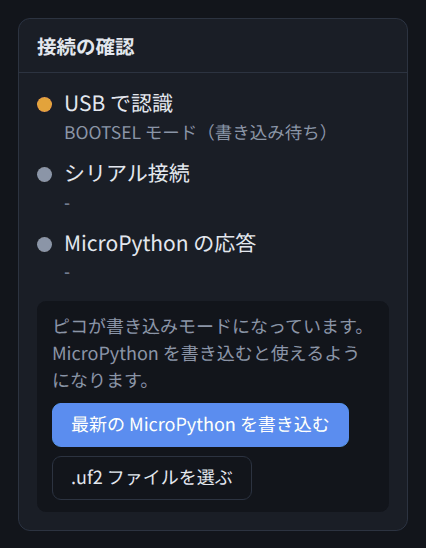
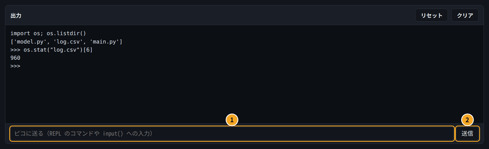
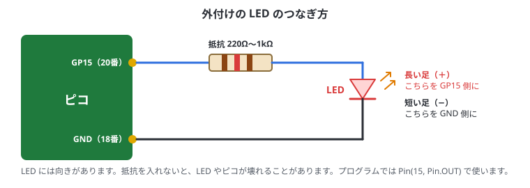

# 3. はじめての操作

## この章でわかること

- MicroPython をピコに書き込む方法
- REPL で1行ずつ試す方法
- はじめてのプログラムを動かして、読めるようになる
- LED を点滅させる（「Lチカ」）。ボードの LED と外付けの LED
- ボタンを読む
- 電源を入れたら自動で動くようにする（main.py）

Pico Studio の画面の使い方は0章にまとめてあります。先に0章の「はじめてつなぐまで」を済ませてください。

## MicroPython を書き込む

買ったばかりのピコには、MicroPython が入っていないことがあります。すでに入っていれば、この節は飛ばしてかまいません。
（「接続の確認」の「MicroPython の応答」が緑になれば、入っています。）

### 手順

1. ピコの **BOOT** ボタンを押したまま、USB ケーブルで PC につなぐ
2. つないだらボタンを離す
3. Pico Studio の「接続の確認」に **BOOTSEL モード** と出て、「最新の MicroPython を書き込む」ボタンが表示される
4. ボタンを押すと、自動でダウンロードして書き込む（数十秒かかることがあります）
5. 数秒でピコが再起動するので、「更新」→ ポートを選んで「接続」
6. 「接続の確認」が3つとも緑になれば完了



> **RST ボタンがあるボード**なら、USB を抜かずに書き込みモードにできます。
> BOOT を押したまま RST を押して離し、そのあと BOOT を離します（1章の「書き込みモード（BOOTSEL）に入る」）。

> 何も出てこないときは、USB ケーブルが充電専用かもしれません。データ通信対応のケーブルに替えてみてください。

### 書き込めたか確かめる

送信欄に次のように打って Enter を押します。

```text
>>> import sys
>>> sys.implementation
(name='micropython', version=(1, 26, 1, ''), _machine='Raspberry Pi Pico with RP2040', ...)
```

`name='micropython'` と出れば、MicroPython が動いています。

## REPL で1行ずつ試す

出力欄の下の送信欄に、Python を1行ずつ打って「送信」すると、その場で実行されます（REPL）。
電卓のように使ってみましょう。

```text
>>> 1 + 2
3
>>> 10 / 4
2.5
>>> name = "pico"
>>> print("hello,", name)
hello, pico
```



- 前の行で作った変数（この例では `name`）は、次の行でも使えます
- まちがえてもピコは壊れません。エラーが出たら、打ち直せば大丈夫です

ちょっとした確認には REPL、まとまったプログラムはコード欄、と使い分けます。

## はじめてのプログラム

下のコードの「エディタに入れる」→「▶ 実行」を押してみましょう（実行のしかたは0章の「コードを書いて実行する」）。

```python run
print("hello, pico!")

total = 0
for i in range(1, 11):
    total += i
print("1から10の合計:", total)
```

出力欄にこう出れば成功です。

```text
[実行開始]
hello, pico!
1から10の合計: 55

[実行終了]
```

### コードの読み方

| 行 | 意味 |
| --- | --- |
| `print("hello, pico!")` | 文字を出力欄に表示する |
| `total = 0` | `total` という入れ物（変数）を作って、0 を入れる |
| `for i in range(1, 11):` | `i` を 1, 2, …, 10 と変えながら、下の字下げした部分をくり返す |
| `    total += i` | `total` に `i` を足す（`total = total + i` と同じ） |
| `print("1から10の合計:", total)` | 結果を表示する。`,` で区切ると、間に空白が入る |

> Python では **字下げ（行の頭の空白）** に意味があります。`for` の中身は、スペース4つで字下げします。
> コード欄で `:` のあとに Enter を押すと、自動で字下げされます。

## LED を点滅させる（Lチカ）

マイコンの最初の一歩は、LED を点滅させること（Lチカ）です。

### ボードの LED

公式ピコでは、ボード上の LED は **GP25** につながっています。

```python run
from machine import Pin
import time

led = Pin(25, Pin.OUT)   # GP25 を出力にする

for i in range(10):
    led.on()
    time.sleep(0.3)
    led.off()
    time.sleep(0.3)

print("おわり")
```

ボードの小さな LED が10回点滅すれば成功です。

| コード | 意味 |
| --- | --- |
| `from machine import Pin` | ピンを使うための部品（`Pin`）を読み込む |
| `import time` | 時間を扱う部品を読み込む |
| `Pin(25, Pin.OUT)` | 25番ピンを「出力」として使う |
| `led.on()` / `led.off()` | 3.3V を出す（点く）/ 0V にする（消える） |
| `time.sleep(0.3)` | 0.3秒待つ |

> Pico W / Pico 2 W では、LED は `Pin("LED", Pin.OUT)` と書きます。
> 互換ボードでは LED のピン番号が違うことがあります。光らなければ、ボードの説明書を確認してください。

### 外付けの LED

ブレッドボードに LED と抵抗をつないで、同じように点滅させてみます。配線は **USB を抜いてから** 行います。



1. USB を抜く
2. ピコの **GP15（20番ピン）** から、抵抗（220Ω〜1kΩ）につなぐ
3. 抵抗のもう片方を、LED の **長い足（＋）** につなぐ
4. LED の **短い足（−）** を、ピコの **GND（18番ピン）** につなぐ
5. USB をつないで、下のコードを実行する

```python run
from machine import Pin
import time

led = Pin(15, Pin.OUT)   # GP15

for i in range(20):
    led.toggle()          # 点いていたら消す、消えていたら点ける
    time.sleep(0.2)
led.off()
```

光らないときは、LED の向き（長い足が GP15 側）と、ピン番号（物理ピンの20番 = GP15）を確かめてください。
ピンの番号の読み方は4章、ブレッドボードの使い方は5章で詳しく説明します。

### RGB LED（付いているボードだけ）

RGB LED が付いた互換ボードなら、色を変えて光らせられます。

```python run
from machine import Pin
import neopixel, time

np = neopixel.NeoPixel(Pin(23), 1)   # ピン番号はボードによって違う（例: 23, 16）
for color in [(30, 0, 0), (0, 30, 0), (0, 0, 30), (30, 30, 30), (0, 0, 0)]:
    np[0] = color                     # (赤, 緑, 青) をそれぞれ 0〜255 で指定
    np.write()
    time.sleep(0.5)
```

数字を大きくすると明るくなります。とてもまぶしいので、30 くらいから試してください。

## 止めるとき

ずっとくり返すプログラムは「■ 停止」で止めます（くわしくは0章の「実行を止める」）。

```python run
from machine import Pin
import time

led = Pin(25, Pin.OUT)
while True:              # ずっとくり返す
    led.toggle()
    time.sleep(0.5)
```

## 電源を入れたら自動で動かす（main.py）

コードを **main.py** という名前で「ピコに保存」すると、PC につながなくても、電源を入れたときに自動で動きます。
保存のしかた、止め方、消し方は0章の「ピコに保存する」にまとめてあります。

1. 上の「ずっとくり返す」コードをコード欄に入れる
2. ファイル名の欄を **main.py** にして、「ピコに保存」を押す
3. 「切断」を押して、USB を抜く
4. USB の充電器やモバイルバッテリーにさす → LED が点滅し始める

## ボタンを読む

互換ボードの中には、ユーザーボタン（**USR**、多くは **GP24**）が付いているものがあります。下のコードを実行して USR を押すと「押されている」と出ます。
外付けのボタンなら、ボタンの片側を GPIO（例: GP14）、もう片側を GND につなぎ、コードの `24` を `14` に変えます。

```python run
from machine import Pin
import time

button = Pin(24, Pin.IN, Pin.PULL_UP)   # 押していないとき 1、押すと 0

for i in range(50):
    print("押されている" if button.value() == 0 else "-")
    time.sleep(0.2)
```

`Pin.PULL_UP` はピコの中の抵抗で、何もつながっていないときの値を 1 に固定するための設定です（4章で図を使って説明）。

### ボタンで LED を点ける

2つを組み合わせると、「押している間だけ LED が点く」が作れます。

```python run
from machine import Pin
import time

led = Pin(25, Pin.OUT)
button = Pin(24, Pin.IN, Pin.PULL_UP)

for i in range(200):                 # 約10秒
    led.value(1 if button.value() == 0 else 0)
    time.sleep(0.05)
led.off()
```

## やってみよう

少しずつ変えて、動きがどう変わるか試してみましょう。

- Lチカの `time.sleep(0.3)` を `0.05` や `1` にする
- `range(10)` を `range(3)` にする
- ボタンを押した回数を数えて表示する（ヒント: 前の値を覚えておき、1 から 0 に変わったときに数を増やす）

## まとめ

- BOOT ボタンを押しながらつなぐと、MicroPython を書き込める
- REPL で1行ずつ試せる。まとまったコードはコード欄で「▶ 実行」
- `Pin` で LED やボタンを扱える。外付け LED は抵抗と一緒に、向きに注意
- main.py に保存すると電源オンで自動実行
