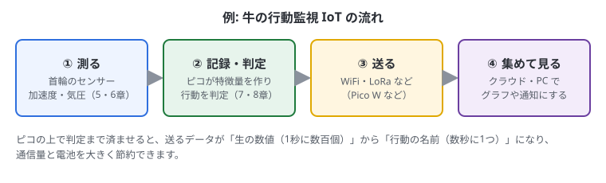

# 3. マイコンでできること・おすすめリンク

## この章でわかること

- マイコンがどんなところで使われているか
- 自分のプロジェクトにマイコンが向いているかの判断のしかた
- 最初にそろえるとよい部品
- 勉強に役立つサイトと、読む順番

## マイコンの主な使い道

| 分野 | 例 |
| --- | --- |
| センサーで測る | 温度・湿度・気圧・加速度・照度・土の水分を測って記録する |
| 動かす | モーター、サーボ、LED、ブザー、リレー（家電のオン/オフ）を制御する |
| つなぐ | センサーの値を WiFi や Bluetooth、LoRa で送る（IoT） |
| 入力機器 | 自作キーボード、ゲームコントローラー、MIDI 機器 |
| 見守り | 動物や人の動き、設備の振動を監視して異常を知らせる |
| エッジAI | 小さな機械学習モデルで、その場で音や動きを判定する |

### 例: 牛の行動監視 IoT

首輪にピコと加速度センサーを付けて、牛の動きを測るとします。このガイドの6〜10章は、この流れにそって進みます。

1. **測る**: 加速度センサーで首の動き、気圧センサーで頭の高さの変化を測る（6・7章）
2. **記録・判定する**: 一定時間ごとにデータをまとめて保存し（9章）、「歩行」「採食」「反芻」「休息」などを機械学習で判定する（10章）
3. **送る**: WiFi 付きのボード（Pico W など）や LoRa で、判定結果を送る
4. **集めて見る**: クラウドや PC で集めて、グラフにしたり、異常を知らせたりする

実際に作るときの順番は、13章にまとめてあります。

マイコンの上で判定まで済ませると、送るデータが「生の加速度」から「行動の種類」になり、通信量と電池を大きく節約できます。

## マイコンが向いている・向いていない

**向いている**

- 電池で長く動かしたい
- 電源を入れたらすぐ動いてほしい
- センサーを決まった間隔で正確に読みたい
- 小さく・安く作りたい
- 同じものをたくさん作りたい

**向いていない（Raspberry Pi 4/5 や PC が向いている）**

- カメラ映像の処理や、大きな AI モデル
- 画面に複雑な表示をしたい
- 大量のデータを保存・集計したい

よくある構成は「**現場ではマイコンが測って送る → クラウドや PC で集めて分析する**」です。

## 最初にそろえるとよいもの

このガイドを最後まで進めるのに使う部品です。通販サイトで「部品名 + モジュール」で探すと見つかります。

| 部品 | 使う章 | メモ |
| --- | --- | --- |
| ラズパイピコ（または互換ボード） | 全部 | ピンヘッダ付き（Pico H など）だと、はんだ付けが不要 |
| データ通信対応の USB ケーブル | 全部 | ボードの端子（micro-B か Type-C）に合わせる |
| ブレッドボード | 4〜7章 | 400穴か 830穴くらいのもの |
| ジャンパーワイヤー（オス-オス） | 4〜7章 | 色がいろいろあるセット |
| LED と抵抗（220Ω〜1kΩ） | 4・5章 | 電子工作の入門セットに入っていることが多い |
| タクトスイッチ（押しボタン） | 4・5章 | ボードに USR ボタンがあればなくてもよい |
| ボリューム（可変抵抗 10kΩ） | 5章 | アナログ入力の練習用 |
| MPU-6050 モジュール（GY-521） | 6〜10章 | 加速度・ジャイロセンサー |
| BMP280 モジュール | 6・7章 | 気圧・温度センサー |
| はんだごて一式 | 6章 | ピンヘッダが付いていない場合だけ |

> 部品がなくても、[Wokwi](https://wokwi.com/) というサイトで、ブラウザ上でピコとセンサーを試せます。

## おすすめリンク

### どれから読めばいい？

1. まずはこのガイドを順番に進める
2. 書き方で迷ったら **MicroPython RP2 クイックリファレンス** を見る（一番よく使う）
3. センサーの使い方は **Random Nerd Tutorials** で、型番を探す
4. もっと詳しく知りたくなったら、公式の PDF（Python SDK・データシート）を見る

### 公式ドキュメント（まず見るところ）

- [MicroPython RP2 クイックリファレンス](https://docs.micropython.org/en/latest/rp2/quickref.html)
  — ピン・I2C・タイマーなどの書き方が1ページにまとまっている。一番よく使う
- [MicroPython の I2C の説明](https://docs.micropython.org/en/latest/library/machine.I2C.html)
  — センサーとの通信で使う
- [Raspberry Pi Pico Python SDK（PDF）](https://datasheets.raspberrypi.com/pico/raspberry-pi-pico-python-sdk.pdf)
  — 公式の MicroPython 入門書。例がたくさんある
- [Raspberry Pi Pico データシート（PDF）](https://datasheets.raspberrypi.com/pico/pico-datasheet.pdf)
  — ピン配置図や電源の仕様
- [RP2040 データシート（PDF）](https://datasheets.raspberrypi.com/rp2040/rp2040-datasheet.pdf)
  — チップの詳しい仕様。細かいことを調べるとき用
- [MicroPython のダウンロード](https://micropython.org/download/RPI_PICO/)
  — ファームウェア（.uf2）。Pico Studio のボタンからも書き込める

### チュートリアル・作例

- [Getting started with Raspberry Pi Pico（公式プロジェクト）](https://projects.raspberrypi.org/en/projects/getting-started-with-the-pico)
  — LED・ボタン・センサーを順番に試せる公式チュートリアル
- [Random Nerd Tutorials: Raspberry Pi Pico](https://randomnerdtutorials.com/projects-raspberry-pi-pico/)
  — センサーごとの配線とコードの作例がとても多い
- [Wokwi](https://wokwi.com/)
  — ブラウザ上でピコとセンサーをシミュレーションできる。部品がなくても試せる

### ライブラリ

- [micropython-lib](https://github.com/micropython/micropython-lib)
  — 公式のライブラリ集
- [umqtt.simple](https://github.com/micropython/micropython-lib/tree/master/micropython/umqtt.simple)
  — IoT でよく使う MQTT でデータを送るためのライブラリ
- [ulab](https://github.com/v923z/micropython-ulab)
  — MicroPython 用の numpy のようなもの（ファームウェアに組み込んで使う）

### C/C++ で書くとき

- [Pico SDK](https://github.com/raspberrypi/pico-sdk) — 公式の C/C++ 開発キット
- [pico-examples](https://github.com/raspberrypi/pico-examples) — Pico SDK の公式サンプル集
- [arduino-pico](https://github.com/earlephilhower/arduino-pico) — Arduino の書き方でピコを使えるようにするもの

### 機械学習（10章で使う）

- [emlearn](https://github.com/emlearn/emlearn) / [emlearn-micropython](https://github.com/emlearn/emlearn-micropython)
  — scikit-learn のモデルをマイコン用に変換する
- [LiteRT for Microcontrollers（旧 TensorFlow Lite Micro）](https://ai.google.dev/edge/litert/microcontrollers/overview)
  — ニューラルネットをマイコンで動かす
- [pico-tflmicro](https://github.com/raspberrypi/pico-tflmicro) — 上をピコ用に移植したもの（C++）
- [Edge Impulse](https://edgeimpulse.com/) / [ドキュメント](https://docs.edgeimpulse.com/)
  — データ集めから学習・マイコンへの書き出しまでをブラウザでできるサービス
- [scikit-learn の決定木](https://scikit-learn.org/stable/modules/tree.html)

### センサー

- [MPU-6050（加速度・ジャイロセンサー）](https://invensense.tdk.com/products/motion-tracking/6-axis/mpu-6050/)
  — 製品ページ。レジスタの資料もここから

## まとめ

- マイコンは「測る・動かす・つなぐ」が得意。重い処理は PC やクラウドに任せる
- 牛の行動監視なら「測る → 判定する → 送る → 集める」の流れになる
- 迷ったら RP2 クイックリファレンスと Random Nerd Tutorials を見る
