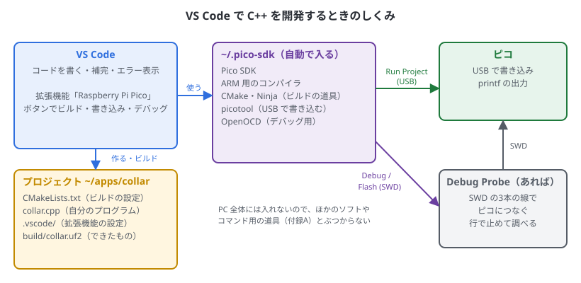
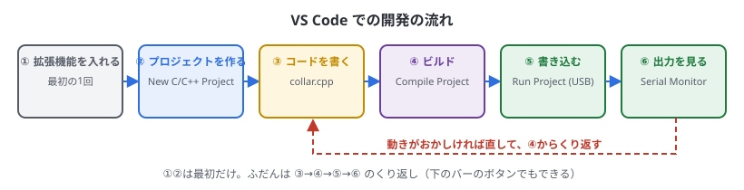
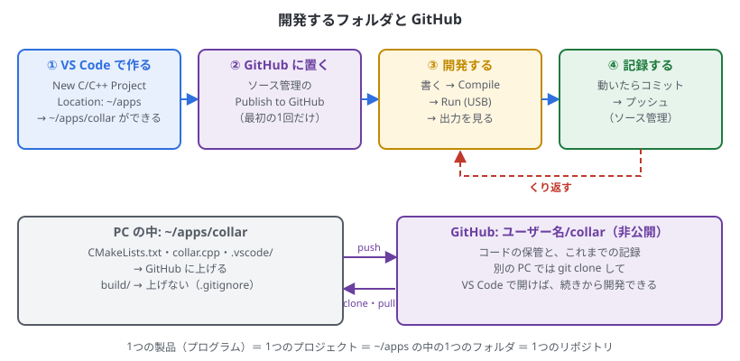
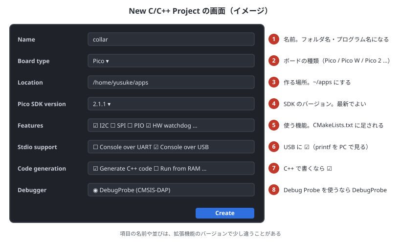

# 3. VS Code でプロジェクトを作って動かす

## この章でわかること

- VS Code の拡張機能で開発するときのしくみ
- 開発するフォルダの場所と、GitHub への置き方
- 新しいプロジェクトの作り方と、できるファイルの意味
- 書く → ビルド → 書き込む → 出力を見る、の流れ
- 最初のプログラム（Lチカ）を動かすまで

2章の開発環境ができている前提です。この章のとおりに進めると、ボードの LED が点滅し、VS Code に `printf` の出力が出ます。

## しくみ



- **プロジェクト**は1つのフォルダで、1つのプログラムになります（例: `~/apps/collar` → `collar.uf2`）
- 拡張機能は、`~/.pico-sdk` の SDK・コンパイラ・CMake を使ってビルドし、picotool で USB からピコに書き込みます
- Debug Probe があれば、SWD という線から書き込んだり、行で止めて調べたりできます（4章）


## 開発の流れ



①（2章）と②は最初だけです。ふだんは「③書く → ④ビルド → ⑤書き込む → ⑥出力を見る」をくり返します。

## 開発するフォルダ



- **1つの製品（プログラム）が、1つのプロジェクト**です。プロジェクトは1つのフォルダで、GitHub では1つのリポジトリにします
- 場所は **`~/apps/名前`**（例: `~/apps/collar`）にそろえます。New C/C++ Project の Location で `~/apps` を選ぶと、その中に名前のフォルダができます
- **順番は「VS Code で作る → GitHub に置く」** です。拡張機能がフォルダとファイル（`.gitignore` も）を作るので、先に作ってから GitHub に置くほうが簡単です
- このガイドの6〜15章を試す**練習用**は、`~/apps/pico-practice` のようなプロジェクトを1つ作り、章ごとに `.cpp` の中身を置き換えて試すのが手軽です（GitHub に置かなくてもかまいません）
- 製品のプログラムは、練習用とは別にプロジェクトを作って、GitHub に置きます

ターミナルで作業するときも、このフォルダにいます。VS Code の中のターミナル（表示 → ターミナル）は、最初からプロジェクトのフォルダで開きます。

## ② 新しいプロジェクトを作る

左のピコのアイコンを押して、Quick Access の **New C/C++ Project** を押すと、プロジェクトを作る画面が開きます。



| 番号 | 項目 | 選ぶもの |
| --- | --- | --- |
| ① | Name | プロジェクトの名前（例: `blink`）。フォルダとプログラムの名前になる。英数字と `_` だけにする |
| ② | Board type | ボードの種類。公式ピコなら **Pico**、Pico 2 なら **Pico 2**、Pico W なら **Pico W** |
| ③ | Location | 作る場所。**`/home/ユーザー名/apps`** を選ぶと、`~/apps/blink` ができる |
| ④ | Pico SDK version | SDK のバージョン。いちばん新しいものでよい |
| ⑤ | Features | 使う機能（SPI、I2C、UART、PIO、DMA、HW watchdog、HW timer、HW clocks など）。選ぶと `CMakeLists.txt` にライブラリが足され、使い方の例のコードも入る。あとから足すこともできる |
| ⑥ | Stdio support | **Console over USB に ☑**。`printf` が USB で PC に届く。Console over UART の ☑ は外してよい |
| ⑦ | Code generation options | **Generate C++ code に ☑**（`.cpp` ができる）。**Use project name as entry point file name も ☑ のまま**（`blink.cpp` ができる。☐ だと `main.cpp` になる）。Run the program from RAM rather than flash、Enable C++ exceptions と RTTI は ☐ のまま（11章） |
| ⑧ | Debugger | Debug Probe を使うなら **DebugProbe (CMSIS-DAP)**（そのままでよい） |

最後に **Create** を押します。VS Code が、できたプロジェクトのフォルダを開き直します。

- **初めてのときは、`~/.pico-sdk` に SDK やコンパイラをダウンロードするので、数分かかります**（右下に進み具合が出ます）
- 右下の **CMake Tools**（Enable CMake-Tools extension integration）は ☐ のままでかまいません。ビルドと書き込みはピコの拡張機能の Compile と Run で行います
- **⑥の Console over USB はとても大事です。** USB の出力がないプログラムを書き込むと、次の書き込みのときに、BOOT ボタンを押す必要があります
- 項目の名前や並びは、拡張機能のバージョンで少し違うことがあります（この図は 0.23.0 のもの）

### できるファイル

```text
~/apps/blink/
├── CMakeLists.txt          ビルドの設定（下で説明）
├── blink.cpp               自分のプログラム。ここに書く
├── pico_sdk_import.cmake   SDK を読み込む
├── .gitignore              git に上げないもの（build フォルダ）
├── .vscode/                拡張機能の設定（ふつうは触らない）
│   ├── settings.json
│   ├── tasks.json          Compile や Run の中身
│   ├── launch.json         デバッグの設定
│   └── c_cpp_properties.json   補完の設定
└── build/                  ビルドしてできたもの（blink.uf2 など）
```

`CMakeLists.txt` の中心は、次の部分です。

```cmake
# == DO NOT EDIT THE FOLLOWING LINES for the Raspberry Pi Pico VS Code Extension to work ==
# （SDK のバージョンと場所を決める行。消したり書き換えたりしない）
# ……

add_executable(blink blink.cpp)

pico_enable_stdio_uart(blink 0)
pico_enable_stdio_usb(blink 1)

target_link_libraries(blink
        pico_stdlib)
```

| 行 | 意味 |
| --- | --- |
| `DO NOT EDIT` の部分 | 拡張機能が SDK・コンパイラの場所を決める。触らない |
| `add_executable(blink blink.cpp)` | `blink.cpp` から `blink` というプログラムを作る |
| `pico_enable_stdio_usb(blink 1)` | `printf` を USB で PC に送る |
| `target_link_libraries(blink pico_stdlib)` | 使うライブラリ。I2C を使うなら `hardware_i2c` を足す（4章の表） |

## GitHub に置く

製品のプロジェクトは、作ったらすぐ GitHub に置いておきます。PC が壊れてもコードが残り、これまでの記録から前の状態に戻すこともできます。

### VS Code のボタンで置く

1. 左の **ソース管理**（枝分かれのアイコン）を開く
2. **Publish to GitHub** を押す。初めてのときは、GitHub へのサインインを聞かれる
3. **Publish to GitHub private repository**（非公開）を選ぶ
4. 上げるファイルを聞かれたら、そのまま OK を押す

### コマンドで置く

GitHub CLI（`gh`）を使っているなら、ターミナルで次を打っても同じです。

```bash
cd ~/apps/collar
git init
git add .
git commit -m "最初のバージョン"
gh repo create collar --private --source=. --push
```

- 拡張機能が作った `.gitignore` で、`build` フォルダ（ビルドしてできたもの）は上がりません
- `.vscode/` と `CMakeLists.txt` は上げます。別の PC でも同じ設定で開けます
- ふだんのコミットとプッシュは4章の「git でバージョンを管理する」

### 別の PC で続きを開発する

```bash
cd ~/apps
git clone https://github.com/ユーザー名/collar.git
code collar
```

VS Code でフォルダを開き、Compile と Run を押せば、続きから開発できます（その PC に拡張機能がまだなければ、2章の手順で入れます。必要な SDK などは、拡張機能がダウンロードします）。

## ③ 書く（Lチカ）

`blink.cpp` を開いて、中身を全部消し、次のプログラムを貼り付けます。ボードの LED（GP25）を点滅させ、そのたびに `printf` で知らせます。

```cpp run
#include <cstdio>
#include "pico/stdlib.h"

constexpr uint LED_PIN = 25;      // 公式ピコの LED は GP25

int main() {
    stdio_init_all();             // printf を USB で送れるようにする
    gpio_init(LED_PIN);
    gpio_set_dir(LED_PIN, GPIO_OUT);

    bool on = false;
    while (true) {
        on = !on;
        gpio_put(LED_PIN, on);
        printf("LED %s\n", on ? "ON" : "OFF");
        sleep_ms(500);
    }
}
```

中身の意味は6章で説明します。

- 関数名を打ち始めると、候補が出ます（補完）。`gpio_` まで打つと、GPIO の関数の一覧が出ます
- まちがいがあると、**ビルドする前に**赤い波線が出ます

> Pico W のときは、LED の点け方が違います（6章）。

## ④ ビルドする

Quick Access の **Compile Project** を押します（下のバーの **Compile** でも同じ）。
下の「ターミナル」に進み具合が出て、最後に `build/blink.uf2` ができます。

- 1回目は SDK 全体をビルドするので、1〜2分かかります。2回目からは変えたところだけなので、数秒です
- エラーは「問題」の欄（Ctrl + Shift + M）にも一覧で出て、クリックするとその行に飛びます。エラーの読み方は付録B

## ⑤ 書き込む

ピコを USB でつないで、Quick Access の **Run Project (USB)** を押します（下のバーの **Run** でも同じ）。
picotool がピコを書き込みモードにして書き込み、ピコが再起動してプログラムが動き出します。ボードの LED が点滅すれば成功です。

**ピコで今なにが動いているか**で、BOOT ボタンが要るかどうかが変わります。

| ピコで動いているもの | Run Project (USB) で |
| --- | --- |
| C++ のプログラム（Console over USB あり） | そのまま書き込める。BOOT は要らない |
| 書き込みモード（`RPI-RP2` が見えている） | そのまま書き込める |
| MicroPython（買ったときや、付録E で使ったあと） | 自動で書き込みモードにできない。**BOOT を押しながら USB をつないでから** Run を押す |
| USB を使わない C++ のプログラム | 同じく、BOOT を押しながらつないでから Run を押す |

何が動いているかは、Pico Studio の「接続の確認」（5章）でわかります。

> 「デバイスが見つからない」「権限がない（LIBUSB_ERROR_ACCESS）」と出たら、2章の手順3の udev ルールを入れて、ピコを抜き差しします。

## ⑥ 出力を見る

`printf` の出力は、次のどちらかで見ます。

**VS Code の Serial Monitor**（拡張機能 Serial Monitor が必要。2章）

1. 下の欄の **SERIAL MONITOR** タブを開く（なければ、表示 → ターミナルを開いてから探す）
2. Port で `/dev/ttyACM0`、Baud rate で `115200` を選ぶ
3. **Start Monitoring** を押す → `LED ON` / `LED OFF` が流れる

**Pico Studio**（5章）

1. ポートを選んで「接続」を押す → 出力欄に `LED ON` / `LED OFF` が流れる

> **ポートは1つのソフトでしか使えません。** 書き込む前に、Serial Monitor は **Stop Monitoring**、Pico Studio は「切断」を押します。開いたままだと、書き込みのあとにつながらないことがあります。

## プログラムを直して、もう一度

`sleep_ms(500)` を `sleep_ms(100)` に変えて、保存（Ctrl + S）→ Compile → Run と進めると、LED が速く点滅します。
これが、ふだんの開発のくり返しです。

### 6章から先のコードを試すとき

- 練習用のプロジェクト（`~/apps/pico-practice` など）の `.cpp` の中身を置き換えて試します
- I2C などを使うコードは、`target_link_libraries` にライブラリを足します（4章の表）
- 9章の `mpu6050.h` など、Pico Studio に入っているヘッダーを使うときは、プロジェクトのフォルダにコピーします

```bash
cp ~/apps/pico-studio/cpp/include/*.h ~/apps/blink/
```

## まとめ

- 1つの製品が1つのプロジェクト。`~/apps/名前` に作り、製品のものは GitHub に置く（VS Code で作る → Publish to GitHub の順）
- **New C/C++ Project** で、場所を `~/apps`、Console over USB と Generate C++ code に ☑ して作る
- ふだんは「書く → Compile → Run (USB) → Serial Monitor」のくり返し
- MicroPython が動いているピコや、USB を使わないプログラムのときは、BOOT を押しながらつないでから Run
- ポートは1つのソフトでしか使えない。書き込む前に Serial Monitor や Pico Studio を止める
