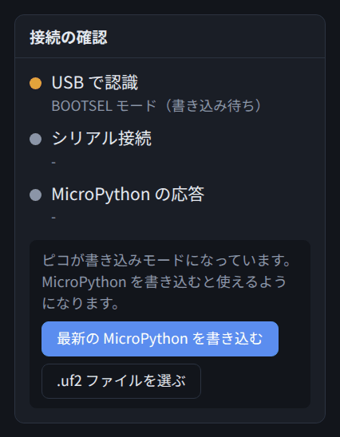
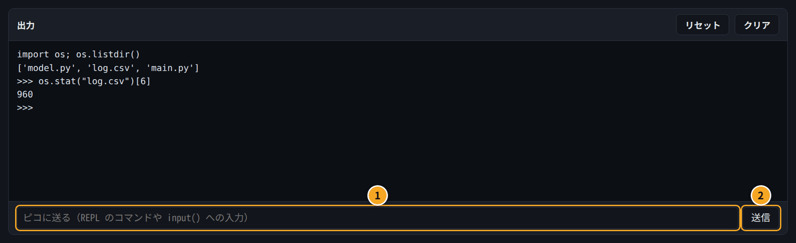
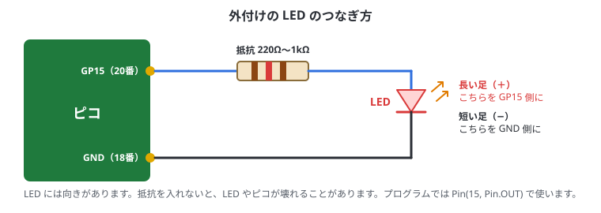

# 4. はじめての操作

## この章でわかること

- MicroPython をピコに書き込む方法（C++ では、開発環境を用意して、初めてのプログラムを書き込む方法）
- REPL で1行ずつ試す方法（C++ には REPL がないこと）
- はじめてのプログラムを動かして、読めるようになる
- LED を点滅させる（「Lチカ」）。ボードの LED と外付けの LED
- ボタンを読む
- 電源を入れたら自動で動くようにする（Python は main.py に保存、C++ は書き込むだけ）

Pico Studio の画面の使い方は0章にまとめてあります。先に0章の「はじめてつなぐまで」を済ませてください。

この章から先は、**Python と C++ の両方**で書いてあります。ガイドの上の「Py / C++」か、コード欄の「Python / C++」で切り替えると、選んだ言語の説明とコードだけが出ます。

<!-- python -->

## MicroPython を書き込む

買ったばかりのピコには、MicroPython が入っていないことがあります。すでに入っていれば、この節は飛ばしてかまいません。
（「接続の確認」の「MicroPython の応答」が緑になれば、入っています。）

### 手順

1. ピコの **BOOT** ボタンを押したまま、USB ケーブルで PC につなぐ
2. つないだらボタンを離す
3. Pico Studio の「接続の確認」に **BOOTSEL モード** と出て、「最新の MicroPython を書き込む」ボタンが表示される
4. ボタンを押すと、自動でダウンロードして書き込む（数十秒かかることがあります）
5. 数秒でピコが再起動するので、「更新」→ ポートを選んで「接続」
6. 「接続の確認」が3つとも緑になれば完了



> **RST ボタンがあるボード**なら、USB を抜かずに書き込みモードにできます。
> BOOT を押したまま RST を押して離し、そのあと BOOT を離します（1章の「書き込みモード（BOOTSEL）に入る」）。

> 何も出てこないときは、USB ケーブルが充電専用かもしれません。データ通信対応のケーブルに替えてみてください。

### 書き込めたか確かめる

送信欄に次のように打って Enter を押します。

```text
>>> import sys
>>> sys.implementation
(name='micropython', version=(1, 26, 1, ''), _machine='Raspberry Pi Pico with RP2040', ...)
```

`name='micropython'` と出れば、MicroPython が動いています。

<!-- /python -->
<!-- cpp -->

## C++ の準備

C++ では、PC でプログラムをビルド（機械語に変換）してから、ピコに書き込みます。
そのための道具（Pico SDK とコンパイラ）を、最初に1回だけ PC に入れます。

1. 14章の「開発環境を用意する」の手順で、Pico SDK とコンパイラを入れる
2. Pico Studio のコード欄で **C++** を選ぶ
3. 「接続の確認」の3つ目の **「C++ の開発環境」** が緑になれば準備完了

赤のときは、足りないものが表示されます。14章の手順をもう一度確かめてください。

> C++ のプログラムを書き込むと、ピコの中の MicroPython は消えます。Python に戻すときは、MicroPython を書き込み直します（14章の「MicroPython に戻す」）。

<!-- /cpp -->

<!-- python -->

## REPL で1行ずつ試す

出力欄の下の送信欄に、Python を1行ずつ打って「送信」すると、その場で実行されます（REPL）。
電卓のように使ってみましょう。

```text
>>> 1 + 2
3
>>> 10 / 4
2.5
>>> name = "pico"
>>> print("hello,", name)
hello, pico
```



- 前の行で作った変数（この例では `name`）は、次の行でも使えます
- まちがえてもピコは壊れません。エラーが出たら、打ち直せば大丈夫です

ちょっとした確認には REPL、まとまったプログラムはコード欄、と使い分けます。

<!-- /python -->
<!-- cpp -->

## C++ には REPL がない

MicroPython では1行ずつ打って試せましたが、C++ にはこの方法（REPL）がありません。
C++ では、いつも次の流れになります。

1. プログラム全体を書く
2. 「▶ ビルドして書き込む」を押す（PC でビルド → ピコに書き込み → ピコが再起動して動き出す）
3. 出力欄で `printf` の結果を見る

1回のビルドと書き込みは、2回目からは10秒前後です（初回は SDK 全体をビルドするので数分かかります）。
ちょっとした計算を確かめたいときは、PC の C++ で試すか、Python の REPL を使うのも手です。

<!-- /cpp -->

<!-- python -->

## はじめてのプログラム

下のコードの「エディタに入れる」→「▶ 実行」を押してみましょう（実行のしかたは0章の「コードを書いて実行する」）。

```python run
print("hello, pico!")

total = 0
for i in range(1, 11):
    total += i
print("1から10の合計:", total)
```

出力欄にこう出れば成功です。

```text
[実行開始]
hello, pico!
1から10の合計: 55

[実行終了]
```

### コードの読み方

| 行 | 意味 |
| --- | --- |
| `print("hello, pico!")` | 文字を出力欄に表示する |
| `total = 0` | `total` という入れ物（変数）を作って、0 を入れる |
| `for i in range(1, 11):` | `i` を 1, 2, …, 10 と変えながら、下の字下げした部分をくり返す |
| `    total += i` | `total` に `i` を足す（`total = total + i` と同じ） |
| `print("1から10の合計:", total)` | 結果を表示する。`,` で区切ると、間に空白が入る |

> Python では **字下げ（行の頭の空白）** に意味があります。`for` の中身は、スペース4つで字下げします。
> コード欄で `:` のあとに Enter を押すと、自動で字下げされます。

<!-- /python -->
<!-- cpp -->

## はじめてのプログラム

下のコードの「エディタに入れる」→「▶ ビルドして書き込む」を押してみましょう。
ピコをつないでおけば、書き込みモードへの切り替えも自動で行います。

```cpp run
#include <cstdio>
#include "pico/stdlib.h"

int main() {
    stdio_init_all();
    sleep_ms(1500);            // PC が出力を受け取れるようになるまで待つ

    printf("hello, pico!\n");

    int total = 0;
    for (int i = 1; i <= 10; i++) {
        total += i;
    }
    printf("1から10の合計: %d\n", total);

    while (true) {             // main() は終わらないようにする
        sleep_ms(1000);
    }
}
```

出力欄にこう出れば成功です。

```text
[ビルド開始] ボード: pico
[ビルド完了] 8.2 秒・プログラムの大きさ 31.5 KB
[ピコを書き込みモードにします]
[書き込み中] /run/media/user/RPI-RP2
[書き込み完了。ピコが再起動します]
[/dev/ttyACM0 に接続しました（C++ のプログラムの出力を表示します）]
hello, pico!
1から10の合計: 55
```

### コードの読み方

| 行 | 意味 |
| --- | --- |
| `#include <cstdio>` | `printf` を使うための部品を読み込む |
| `#include "pico/stdlib.h"` | ピコの基本の部品（ピン・時間・USB の出力など）を読み込む |
| `int main() { ... }` | プログラムは `main` から始まる |
| `stdio_init_all();` | `printf` の出力を USB で PC に送れるようにする |
| `sleep_ms(1500);` | 1.5秒待つ。ピコが再起動してすぐの出力は、PC が受け取る前に消えてしまうため |
| `int total = 0;` | 整数（`int`）の入れ物 `total` を作って、0 を入れる |
| `for (int i = 1; i <= 10; i++) { ... }` | `i` を 1, 2, …, 10 と変えながら、`{ }` の中をくり返す |
| `printf("...%d\n", total);` | 文字を出力する。`%d` のところに `total` の値が入る。`\n` は改行 |
| `while (true) { ... }` | ずっとくり返す。`main` が終わると、ピコは何もしなくなる |

> C++ では、文の終わりに **`;`** が必要です。忘れると、ビルドのときにエラーになります。
> エラーが出たら、出力欄の `main.cpp:10:5: error: ...` をクリックすると、コード欄のその行（10行目）が選ばれます。

| `printf` の書き方 | 意味 | 例 |
| --- | --- | --- |
| `%d` | 整数 | `printf("%d", 55)` → `55` |
| `%.2f` | 小数（小数点以下2けた） | `printf("%.2f", 3.14159)` → `3.14` |
| `%s` | 文字列 | `printf("%s", "pico")` → `pico` |
| `%02x` | 16進数（2けた、0 で埋める） | `printf("%02x", 104)` → `68` |
| `\n` | 改行 | |

<!-- /cpp -->

## LED を点滅させる（Lチカ）

マイコンの最初の一歩は、LED を点滅させること（Lチカ）です。

<!-- python -->

### ボードの LED

公式ピコでは、ボード上の LED は **GP25** につながっています。

```python run
from machine import Pin
import time

led = Pin(25, Pin.OUT)   # GP25 を出力にする

for i in range(10):
    led.on()
    time.sleep(0.3)
    led.off()
    time.sleep(0.3)

print("おわり")
```

ボードの小さな LED が10回点滅すれば成功です。

| コード | 意味 |
| --- | --- |
| `from machine import Pin` | ピンを使うための部品（`Pin`）を読み込む |
| `import time` | 時間を扱う部品を読み込む |
| `Pin(25, Pin.OUT)` | 25番ピンを「出力」として使う |
| `led.on()` / `led.off()` | 3.3V を出す（点く）/ 0V にする（消える） |
| `time.sleep(0.3)` | 0.3秒待つ |

> Pico W / Pico 2 W では、LED は `Pin("LED", Pin.OUT)` と書きます。
> 互換ボードでは LED のピン番号が違うことがあります。光らなければ、ボードの説明書を確認してください。

<!-- /python -->
<!-- cpp -->

### ボードの LED

公式ピコでは、ボード上の LED は **GP25** につながっています。

```cpp run
#include <cstdio>
#include "pico/stdlib.h"

constexpr uint LED_PIN = 25;      // GP25

int main() {
    stdio_init_all();
    gpio_init(LED_PIN);
    gpio_set_dir(LED_PIN, GPIO_OUT);   // 出力にする

    for (int i = 0; i < 10; i++) {
        gpio_put(LED_PIN, true);       // 点ける
        sleep_ms(300);
        gpio_put(LED_PIN, false);      // 消す
        sleep_ms(300);
    }
    printf("おわり\n");

    while (true) sleep_ms(1000);
}
```

ボードの小さな LED が10回点滅すれば成功です。

| コード | 意味 |
| --- | --- |
| `constexpr uint LED_PIN = 25;` | ピン番号に名前を付ける。`constexpr` は「変わらない値」、`uint` は符号なし整数 |
| `gpio_init(LED_PIN);` | 25番ピンを使えるようにする |
| `gpio_set_dir(LED_PIN, GPIO_OUT);` | 25番ピンを「出力」にする（Python の `Pin(25, Pin.OUT)`） |
| `gpio_put(LED_PIN, true);` | 3.3V を出す（点く）。`false` で 0V（消える） |
| `sleep_ms(300);` | 300ミリ秒（0.3秒）待つ |

> **Pico W / Pico 2 W** では、LED が無線のチップにつながっているので、書き方が違います。ボードの欄で Pico W を選んでから、次のように書きます。
>
> - `#include "pico/cyw43_arch.h"` を足す
> - 最初に `cyw43_arch_init();` を呼ぶ
> - 点けるのは `cyw43_arch_gpio_put(CYW43_WL_GPIO_LED_PIN, true);`
>
> 互換ボードでは LED のピン番号が違うことがあります。光らなければ、ボードの説明書を確認してください。

<!-- /cpp -->

### 外付けの LED

ブレッドボードに LED と抵抗をつないで、同じように点滅させてみます。配線は **USB を抜いてから** 行います。



1. USB を抜く
2. ピコの **GP15（20番ピン）** から、抵抗（220Ω〜1kΩ）につなぐ
3. 抵抗のもう片方を、LED の **長い足（＋）** につなぐ
4. LED の **短い足（−）** を、ピコの **GND（18番ピン）** につなぐ
5. USB をつないで、下のコードを実行する

<!-- python -->

```python run
from machine import Pin
import time

led = Pin(15, Pin.OUT)   # GP15

for i in range(20):
    led.toggle()          # 点いていたら消す、消えていたら点ける
    time.sleep(0.2)
led.off()
```

<!-- /python -->
<!-- cpp -->

```cpp run
#include "pico/stdlib.h"

constexpr uint LED_PIN = 15;      // GP15

int main() {
    stdio_init_all();
    gpio_init(LED_PIN);
    gpio_set_dir(LED_PIN, GPIO_OUT);

    for (int i = 0; i < 20; i++) {
        gpio_put(LED_PIN, !gpio_get(LED_PIN));   // 今の状態の反対にする（点いていたら消す）
        sleep_ms(200);
    }
    gpio_put(LED_PIN, false);

    while (true) sleep_ms(1000);
}
```

`!` は「反対」という意味です。`gpio_get` で今の状態を読み、反対の値を出しています。

<!-- /cpp -->

光らないときは、LED の向き（長い足が GP15 側）と、ピン番号（物理ピンの20番 = GP15）を確かめてください。
ピンの番号の読み方は5章、ブレッドボードの使い方は6章で詳しく説明します。

### RGB LED（付いているボードだけ）

RGB LED が付いた互換ボードなら、色を変えて光らせられます。

<!-- python -->

```python run
from machine import Pin
import neopixel, time

np = neopixel.NeoPixel(Pin(23), 1)   # ピン番号はボードによって違う（例: 23, 16）
for color in [(30, 0, 0), (0, 30, 0), (0, 0, 30), (30, 30, 30), (0, 0, 0)]:
    np[0] = color                     # (赤, 緑, 青) をそれぞれ 0〜255 で指定
    np.write()
    time.sleep(0.5)
```

数字を大きくすると明るくなります。とてもまぶしいので、30 くらいから試してください。

<!-- /python -->
<!-- cpp -->

C++ では、Pico Studio に入っている `ws2812.h` を使います。中では PIO（ピコの、自由に作れる入出力回路）で RGB LED 用の信号を作っています。

```cpp run
#include "pico/stdlib.h"
#include "ws2812.h"

Ws2812 rgb(23);                   // ピン番号はボードによって違う（例: 23, 16）

int main() {
    stdio_init_all();
    rgb.begin();
    const uint8_t colors[][3] = {{30, 0, 0}, {0, 30, 0}, {0, 0, 30}, {30, 30, 30}, {0, 0, 0}};
    for (auto& c : colors) {      // colors の中身を1つずつ c に入れてくり返す
        rgb.put(c[0], c[1], c[2]);   // 赤, 緑, 青 をそれぞれ 0〜255 で指定
        sleep_ms(500);
    }
    while (true) sleep_ms(1000);
}
```

数字を大きくすると明るくなります。とてもまぶしいので、30 くらいから試してください。
`ws2812.h` の中身は、Pico Studio の `cpp/include/ws2812.h` にあります。コマンドでビルドするときは、自分のプロジェクトにコピーして使います。

<!-- /cpp -->

<!-- python -->

## 止めるとき

ずっとくり返すプログラムは「■ 停止」で止めます（くわしくは0章の「実行を止める」）。

```python run
from machine import Pin
import time

led = Pin(25, Pin.OUT)
while True:              # ずっとくり返す
    led.toggle()
    time.sleep(0.5)
```

<!-- /python -->
<!-- cpp -->

## 止めるとき

C++ のプログラムには「止める」操作がありません。書き込んだプログラムは、**次に別のプログラムを書き込むまで**動き続けます。

- 「■ 停止」は、ビルドの途中で止めるためのボタンです
- 動きを止めたいときは、何もしないプログラム（下の例）を書き込むか、MicroPython を書き込み直します
- USB を抜けば止まりますが、つなぐとまた最初から動きます

```cpp run
#include "pico/stdlib.h"

int main() {
    stdio_init_all();             // USB の出力だけは使えるようにしておく（次の書き込みを自動で行うため）
    while (true) sleep_ms(1000);  // 何もしない
}
```

> **C++ のプログラムでは、いつも最初に `stdio_init_all()` を呼びます。** `printf` を使わないプログラムでも同じです。
> 呼ばないプログラムを書き込むと、次の書き込みのときにピコを自動で書き込みモードにできません。そのときは BOOT を押しながらつなぎ直します。

<!-- /cpp -->

<!-- python -->

## 電源を入れたら自動で動かす（main.py）

コードを **main.py** という名前で「ピコに保存」すると、PC につながなくても、電源を入れたときに自動で動きます。
保存のしかた、止め方、消し方は0章の「ピコに保存する」にまとめてあります。

1. 上の「ずっとくり返す」コードをコード欄に入れる
2. ファイル名の欄を **main.py** にして、「ピコに保存」を押す
3. 「切断」を押して、USB を抜く
4. USB の充電器やモバイルバッテリーにさす → LED が点滅し始める

<!-- /python -->
<!-- cpp -->

## 電源を入れたら自動で動く

C++ では、**書き込んだプログラムが、そのまま電源を入れたときに動くプログラム**になります。main.py のような保存の手順は要りません。

1. 上の「ボードの LED」のコードを、`for` の代わりに `while (true)` でくり返すように直して書き込む
2. USB を抜いて、USB の充電器やモバイルバッテリーにさす → LED が点滅し始める

「PC に保存」は、書いたコードを PC（`~/apps/pico-cpp`）に残すためのボタンです。ピコには何も保存しません。

<!-- /cpp -->

## ボタンを読む

互換ボードの中には、ユーザーボタン（**USR**、多くは **GP24**）が付いているものがあります。下のコードを実行して USR を押すと「押されている」と出ます。
外付けのボタンなら、ボタンの片側を GPIO（例: GP14）、もう片側を GND につなぎ、コードの `24` を `14` に変えます。

<!-- python -->

```python run
from machine import Pin
import time

button = Pin(24, Pin.IN, Pin.PULL_UP)   # 押していないとき 1、押すと 0

for i in range(50):
    print("押されている" if button.value() == 0 else "-")
    time.sleep(0.2)
```

`Pin.PULL_UP` はピコの中の抵抗で、何もつながっていないときの値を 1 に固定するための設定です（5章で図を使って説明）。

<!-- /python -->
<!-- cpp -->

```cpp run
#include <cstdio>
#include "pico/stdlib.h"

constexpr uint BTN_PIN = 24;

int main() {
    stdio_init_all();
    gpio_init(BTN_PIN);
    gpio_set_dir(BTN_PIN, GPIO_IN);
    gpio_pull_up(BTN_PIN);        // 押していないとき 1、押すと 0

    while (true) {
        printf("%s\n", gpio_get(BTN_PIN) == 0 ? "押されている" : "-");
        sleep_ms(200);
    }
}
```

`gpio_pull_up` はピコの中の抵抗を使う設定で、何もつながっていないときの値を 1 に固定します（5章で図を使って説明）。
`条件 ? A : B` は、条件が正しければ A、そうでなければ B になる書き方です。

<!-- /cpp -->

### ボタンで LED を点ける

2つを組み合わせると、「押している間だけ LED が点く」が作れます。

<!-- python -->

```python run
from machine import Pin
import time

led = Pin(25, Pin.OUT)
button = Pin(24, Pin.IN, Pin.PULL_UP)

for i in range(200):                 # 約10秒
    led.value(1 if button.value() == 0 else 0)
    time.sleep(0.05)
led.off()
```

<!-- /python -->
<!-- cpp -->

```cpp run
#include "pico/stdlib.h"

constexpr uint LED_PIN = 25;
constexpr uint BTN_PIN = 24;

int main() {
    stdio_init_all();
    gpio_init(LED_PIN);
    gpio_set_dir(LED_PIN, GPIO_OUT);
    gpio_init(BTN_PIN);
    gpio_set_dir(BTN_PIN, GPIO_IN);
    gpio_pull_up(BTN_PIN);

    while (true) {
        gpio_put(LED_PIN, gpio_get(BTN_PIN) == 0);   // 押されている（0）なら点ける
        sleep_ms(10);
    }
}
```

<!-- /cpp -->

## やってみよう

少しずつ変えて、動きがどう変わるか試してみましょう。

<!-- python -->

- Lチカの `time.sleep(0.3)` を `0.05` や `1` にする
- `range(10)` を `range(3)` にする

<!-- /python -->
<!-- cpp -->

- Lチカの `sleep_ms(300)` を `50` や `1000` にする
- `i < 10` を `i < 3` にする

<!-- /cpp -->
- ボタンを押した回数を数えて表示する（ヒント: 前の値を覚えておき、1 から 0 に変わったときに数を増やす）

## まとめ

<!-- python -->

- BOOT ボタンを押しながらつなぐと、MicroPython を書き込める
- REPL で1行ずつ試せる。まとまったコードはコード欄で「▶ 実行」
- `Pin` で LED やボタンを扱える。外付け LED は抵抗と一緒に、向きに注意
- main.py に保存すると電源オンで自動実行

<!-- /python -->
<!-- cpp -->

- C++ は、Pico SDK とコンパイラを PC に入れてから「▶ ビルドして書き込む」で動かす
- REPL はない。プログラム全体を書いて、ビルドして書き込む。`printf` で結果を見る
- `gpio_init` → `gpio_set_dir` → `gpio_put` / `gpio_get` で LED やボタンを扱う
- 書き込んだプログラムが、そのまま電源オンで動く。止めるには別のプログラムを書き込む

<!-- /cpp -->
