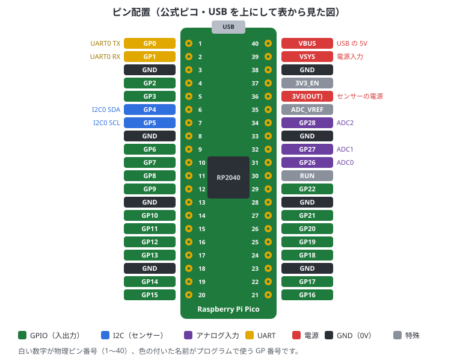
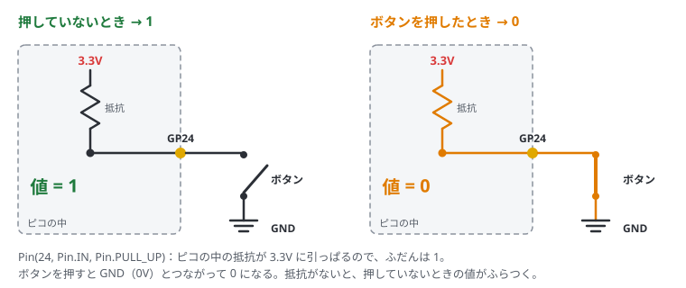
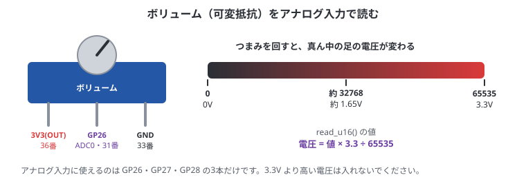

# 4. ピンと電源の基本

## この章でわかること

- ピンの番号の読み方（物理ピン番号と GP 番号）
- 電源ピンの使い分け
- デジタル入出力とプルアップ
- アナログ入力（ADC）で電圧を読む
- PWM で LED の明るさを変える
- 通信用のピン（I2C・SPI・UART）
- 壊さないための注意

## 2種類の番号

ピコのピンには、2つの番号があります。**混同しやすいので注意**してください。

- **物理ピン番号（1〜40）**: ボードの左上から反時計回りに数えた、場所の番号。配線するときに使う
- **GP 番号（GP0〜GP28）**: プログラムで使う番号。`Pin(4)` の 4 はこちら

たとえば GP4 は、物理ピン番号では6番です。「6番の穴に線をさして、プログラムでは `Pin(4)` と書く」となります。

## ピン配置（公式ピコ）

USB を上にして、表から見た図です。



- 白い数字が物理ピン番号、色の付いた名前が GP 番号です
- 多くの互換ボードも同じ配置ですが、念のためボードの印字や説明書を確認してください
- ボードの裏側にも、ピンの名前が印刷されていることが多いです

正確な図は [Pico データシート](https://datasheets.raspberrypi.com/pico/pico-datasheet.pdf) にあります。

## 電源ピン

| ピン | 説明 | 使い道 |
| --- | --- | --- |
| **3V3(OUT)**（36番） | ピコが作る 3.3V | **センサーの電源はここから取る**（合計 300mA 程度まで） |
| **GND**（3, 8, 13, 18, 23, 28, 33, 38番） | 0V | すべての部品の GND をここにつなぐ。どの GND でも同じ |
| **VBUS**（40番） | USB から来る 5V | USB 接続中だけ使える 5V |
| **VSYS**（39番） | ピコの電源入力 | 電池（1.8〜5.5V）をつなぐところ |

> **ピコのピンは 3.3V です。** 5V の信号を GPIO に入れると壊れることがあります。
> センサーを選ぶときは「3.3V 対応」を確認してください。

## デジタル入出力（GPIO）

GP0〜GP28 のどれでも、デジタルの入出力に使えます。デジタルとは「0 か 1 か」の2つだけを扱うことです。

| 使い方 | 書き方 | 動き | 例 |
| --- | --- | --- | --- |
| **出力** | `Pin(n, Pin.OUT)` | 0V（0）か 3.3V（1）を出す | LED、ブザー |
| **入力** | `Pin(n, Pin.IN)` | 電圧が高いか低いかを 1 / 0 で読む | ボタン、スイッチ |

```python run
from machine import Pin

out = Pin(15, Pin.OUT)
out.value(1)        # 3.3V にする（out.on() と同じ）
out.value(0)        # 0V にする（out.off() と同じ）

inp = Pin(14, Pin.IN, Pin.PULL_UP)
print("GP14 の値:", inp.value())    # 何もつないでいなければ 1
```

### プルアップ・プルダウン

ボタンを押していないとき、入力ピンはどこにもつながっていない状態（浮いている状態）になり、値が 0 と 1 の間でふらつきます。
これを防ぐのがプルアップ／プルダウンです。



- `Pin.PULL_UP`: 何もつながっていないとき **1**。ボタンは GPIO と **GND** の間につなぐ（押すと 0）
- `Pin.PULL_DOWN`: 何もつながっていないとき **0**。ボタンは GPIO と **3V3** の間につなぐ（押すと 1）

よく使うのはプルアップです。「押すと 0」になるので、プログラムでは `== 0` で押されたかを調べます。

## アナログ入力（ADC）

**GP26・GP27・GP28** の3本だけ、0〜3.3V の電圧を数値で読めます。
ボリューム（可変抵抗）、照度センサー、アナログ出力のセンサーなどに使います。



### ボリュームをつないで読む

1. USB を抜く
2. ボリュームの3本の足を、左から **3V3(OUT)（36番）・GP26（31番）・GND（33番）** につなぐ
3. USB をつないで、下のコードを実行する
4. つまみを回すと、値が 0〜65535 の間で変わる

```python run
from machine import ADC
import time

adc = ADC(26)            # GP26
for i in range(20):
    raw = adc.read_u16()  # 0〜65535
    volt = raw * 3.3 / 65535
    print("値:", raw, " 電圧: {:.2f} V".format(volt))
    time.sleep(0.5)
```

何もつないでいないと、値はばらばらに変わります（浮いているため）。

> ボリュームの両端（3V3 と GND）を逆にすると、回す向きと値の増え方が逆になるだけで、壊れはしません。
> ただし、真ん中の足を 3V3 や GND に直接つながないでください。

### チップの温度を読む

`ADC(4)` はチップ内蔵の温度センサーです。何もつながなくても試せます。

```python run
from machine import ADC
sensor = ADC(4)
v = sensor.read_u16() * 3.3 / 65535
print("チップの温度: {:.1f} ℃".format(27 - (v - 0.706) / 0.001721))
```

チップ自体の温度なので、部屋の温度より少し高めに出ます。

## PWM で LED の明るさを変える

GPIO は 0V か 3.3V しか出せませんが、**とても速く点けたり消したりする** と、LED が中間の明るさに見えます。これを **PWM** といいます。
「点いている時間の割合」（デューティ比）を変えると、明るさが変わります。

3章の外付け LED（GP15）を使って試します。

```python run
from machine import Pin, PWM
import time

pwm = PWM(Pin(15))
pwm.freq(1000)                 # 1秒に1000回、点けたり消したりする

for i in range(3):
    for d in range(0, 65536, 2048):    # だんだん明るく
        pwm.duty_u16(d)
        time.sleep(0.02)
    for d in range(65535, -1, -2048):  # だんだん暗く
        pwm.duty_u16(d)
        time.sleep(0.02)

pwm.duty_u16(0)
pwm.deinit()                   # PWM をやめる
```

- `duty_u16(0)` で消える、`duty_u16(32768)` で半分、`duty_u16(65535)` で一番明るい
- サーボモーターの角度や、ブザーの音の高さも PWM で決めます

## 通信用のピン

センサーとデータをやり取りするときは、決まった通信方式を使います。

| 方式 | 線の数 | 特徴 | よく使うピン |
| --- | --- | --- | --- |
| **I2C** | 2本（SDA・SCL） | 1組の線に複数のセンサーをつなげる。**一番よく使う** | I2C0: GP4(SDA)・GP5(SCL) |
| **SPI** | 4本 | I2C より速い。SD カードや画面 | SPI0: GP16〜19 |
| **UART** | 2本（TX・RX） | GPS や他のマイコンとの通信 | UART0: GP0(TX)・GP1(RX) |

I2C・SPI・UART は、上の表以外のピンにも割り当てられます。
どのピンが使えるかは [RP2 クイックリファレンス](https://docs.micropython.org/en/latest/rp2/quickref.html) を見てください。
このガイドでは、5章からの I2C センサーで GP4・GP5 を使います。

## 壊さないための注意

- GPIO に **5V を入れない**（3.3V まで）
- 3V3 と GND を直接つながない（ショート）
- 配線を変えるときは、**USB を抜いてから**
- LED は必ず抵抗（220Ω〜1kΩ）と一緒につなぐ
- モーターなど電流が大きいものは、GPIO から直接動かさない（ドライバ回路を使う）
- 配線が終わったら、USB をさす前にもう一度見直す

## まとめ

- プログラムでは GP 番号を使う。物理ピン番号と間違えない
- センサーの電源は 3V3(OUT)、GND は全部共通にする
- ボタンはプルアップで「押すと 0」
- アナログは GP26〜28 で 0〜65535、明るさは PWM で変える
- I2C はまず GP4（SDA）・GP5（SCL）
- ピコは 3.3V。5V を入れない
