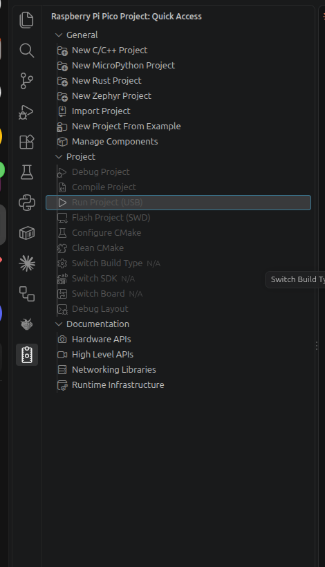

# 4. VS Code の便利な使い方

## この章でわかること

- Quick Access のメニューの一つ一つの意味
- 書くときに助けてくれる機能（補完・定義へ移動・問題の一覧）
- ライブラリの足し方と、ファイルの分け方
- Debug Probe で、行で止めて調べる方法
- git でのバージョン管理
- Pico Studio との使い分け

3章で、プロジェクトを作って Lチカを動かせている前提です。

## Quick Access のメニュー



### General（プロジェクトを作る）

| メニュー | すること |
| --- | --- |
| New C/C++ Project | C / C++ の新しいプロジェクトを作る（3章） |
| New MicroPython Project | MicroPython のプロジェクトを作る。このガイドでは MicroPython は Pico Studio で試すので（付録E）、使わなくてよい |
| New Rust Project | Rust（別の言語）のプロジェクトを作る |
| New Zephyr Project | Zephyr（マイコン用の OS）のプロジェクトを作る |
| Import Project | すでにある CMake のプロジェクトを、拡張機能で使えるようにする |
| New Project From Example | 公式のサンプル集（pico-examples）から選んで、プロジェクトを作る。`blink`、`hello_usb`、`i2c/bus_scan` など |
| Manage Components | `~/.pico-sdk` に入っている SDK・コンパイラなどのバージョンを、足したり消したりする |

### Project（今開いているプロジェクトの操作）

プロジェクトのフォルダを開いていないときは、灰色で押せません。

| メニュー | すること | ふだん使うか |
| --- | --- | --- |
| Debug Project | Debug Probe で書き込んで、デバッグを始める（下の「デバッグ」） | Debug Probe があれば使う |
| Compile Project | ビルドする（3章） | **よく使う** |
| Run Project (USB) | USB で書き込んで、動かす（3章） | **よく使う** |
| Flash Project (SWD) | Debug Probe で書き込む（デバッグはしない） | Debug Probe があれば |
| Configure CMake | `CMakeLists.txt` を読み直す。ファイルを足したときなど | ときどき |
| Clean CMake | `build` を消して、ビルドをやり直す。おかしなエラーが続くとき | ときどき |
| Switch Build Type | Debug（調べやすい）と Release（速く小さい）を切り替える | 製品は Release |
| Switch SDK | SDK のバージョンを変える | まれ |
| Switch Board | ボードの種類を変える（Pico → Pico 2 など） | ボードを変えたとき |
| Debug Layout | デバッグ用の画面の並びにする | デバッグのとき |

### Documentation（説明を見る）

| メニュー | 中身 |
| --- | --- |
| Hardware APIs | `hardware_gpio`、`hardware_i2c` など、ピコの部品を直接動かす関数の説明 |
| High Level APIs | `pico_stdlib`、`pico_multicore` など、使いやすくまとめた関数の説明 |
| Networking Libraries | Pico W の WiFi・Bluetooth の説明 |
| Runtime Infrastructure | 起動のしくみ、`printf` の出力先などの説明 |

関数の使い方で迷ったら、ここから探します（付録Dの「Pico SDK の API ドキュメント」と同じもの）。

## 書くときに助けてくれる機能

| 操作 | すること |
| --- | --- |
| 関数名を打ち始める | 候補が出る（補完）。Tab か Enter で入れる。`gpio_`、`i2c_`、`adc_` などで一覧が出る |
| 関数名の上にマウスを置く | 引数と説明が出る |
| **F12**（または Ctrl + クリック） | その関数の中身（SDK のソース）に飛ぶ。Alt + ← で戻る |
| Shift + F12 | その関数や変数を使っているところの一覧 |
| F2 | 名前をまとめて変える（使っているところも全部） |
| Ctrl + Shift + M | 「問題」の一覧（エラーと警告）。クリックでその行へ |
| Ctrl + P | ファイル名で探して開く |
| Ctrl + Shift + F | フォルダ全体から文字を探す |

> 赤い波線が、正しいコードにまで出ることがあります。一度 Compile すると、補完の設定（`build/compile_commands.json`）ができて直ります。それでも出るときは、Clean CMake → Compile。

## ライブラリを足す

I2C や ADC などを使うときは、`CMakeLists.txt` の `target_link_libraries` にライブラリを足します。

```cmake
target_link_libraries(collar
        pico_stdlib
        hardware_i2c
        hardware_adc)
```

| 使うもの | 足すライブラリ | 使う章 |
| --- | --- | --- |
| GPIO・時間・`printf` | `pico_stdlib`（最初から入っている） | 6章 |
| ADC（アナログ入力、内蔵温度センサー） | `hardware_adc` | 7章 |
| PWM | `hardware_pwm` | 7章 |
| I2C / SPI / UART | `hardware_i2c` / `hardware_spi` / `hardware_uart` | 8・9章 |
| PIO（`ws2812.h` の RGB LED） | `hardware_pio`（と `hardware_clocks`） | 6章 |
| フラッシュに書く | `hardware_flash` | 13・15章 |
| 2つ目のコア | `pico_multicore` | 12章 |
| ウォッチドッグ | `hardware_watchdog` | 15章 |
| CPU のクロックを変える | `hardware_clocks` | 15章 |
| 1台ずつの番号（ユニーク ID） | `pico_unique_id` | 17章 |
| Pico W の LED | `pico_cyw43_arch_none` | 6章 |

足し忘れると、ビルドのときに `fatal error: hardware/i2c.h: No such file or directory` や `undefined reference to ...` が出ます。
保存すると CMake の設定が自動で読み直されます。うまくいかなければ Quick Access の **Configure CMake** を押します。

## ファイルを分ける

プログラムが長くなったら、ファイルを分けます（分け方の考え方は11章）。

```text
~/apps/collar/
├── collar.cpp       main。全体の流れだけ
├── mpu6050.h        センサーのクラス（9章）
├── features.h       特徴量の計算（14・17章）
├── model.h          判定（14章の train.py で作る）
├── radio.h          送信
└── radio.cpp        送信の中身
```

- `.h` だけのファイルは、`#include "features.h"` と書けば使えます。`CMakeLists.txt` を変える必要はありません
- `.cpp` を足したときは、`add_executable` に書き足します

```cmake
add_executable(collar collar.cpp radio.cpp)
```

## デバッグ（Debug Probe があるとき）

Debug Probe（Raspberry Pi の公式の道具）を使うと、プログラムを好きな行で止めて、変数の値を見ながら調べられます。`printf` だけではわからないまちがいを探すときに使います。

### つなぎ方

| Debug Probe | ピコ |
| --- | --- |
| D（SWD）の3本の線 | ピコの下の端の **DEBUG** の3本のピン（SWCLK・GND・SWDIO） |
| USB | PC |

ピコの DEBUG のピンには、ピンヘッダのはんだ付けが必要です（Pico H は最初から付いている）。
Debug Probe がないときは、もう1台のピコを Debug Probe として使うこともできます（[debugprobe](https://github.com/raspberrypi/debugprobe)）。

### 使い方

1. プロジェクトを作るときに、Debugger で **DebugProbe** を選んでおく（そのままの設定）
2. Debug Probe を PC とピコにつなぐ。ピコの USB も、電源と `printf` のためにつないでおく
3. 止めたい行の左の余白をクリックして、赤い丸（ブレークポイント）を付ける
4. Quick Access の **Debug Project** を押す（または **F5**）
5. プログラムが書き込まれ、赤い丸の行で止まる

| キー | すること |
| --- | --- |
| F5 | 次のブレークポイントまで進める |
| F10 | 1行進める（関数の中には入らない） |
| F11 | 1行進める（関数の中に入る） |
| Shift + F5 | デバッグをやめる |

- 止まっている間は、左の「変数」の欄で変数の値が見られます。変数の上にマウスを置いても見られます
- Debug でビルドすると、行と命令の対応がわかりやすくなります（Switch Build Type）。Release だと、行が飛んだように見えることがあります

## Debug と Release

Quick Access の **Switch Build Type** で、ビルドの種類を切り替えます。

| 種類 | 特徴 | 使うとき |
| --- | --- | --- |
| Debug | 行と命令の対応がわかりやすい。少し遅く大きい | デバッグするとき |
| Release | 速く小さい。デバッグでは行が飛んだように見える | ふだんと、製品 |

## git でバージョンを管理する

プロジェクトのフォルダを git で管理しておくと、前の状態に戻したり、どのバージョンを出荷したかを残したりできます。

```bash
cd ~/apps/collar
git init
printf 'build/\n' > .gitignore
git add .
git commit -m "最初のバージョン"
```

- `build/` はビルドするたびに作り直されるので、git に入れません（`.gitignore`）
- `.vscode/` と `CMakeLists.txt`、`pico_sdk_import.cmake` は入れます。別の PC でも同じ設定で開けます
- VS Code の左の **ソース管理**（枝分かれのアイコン）で、変えたところを見たり、コミットしたりできます
- 出荷するバージョンには、`git tag v1.0.0` で印を付けます（17章）

## Pico Studio との使い分け

| やること | 使うもの |
| --- | --- |
| C++ を書く・ビルドする・書き込む | **VS Code** |
| 行で止めて調べる | **VS Code**（Debug Probe） |
| `printf` の出力を見る | VS Code の Serial Monitor か Pico Studio |
| ピコがつながっているか、何が動いているかを確かめる | **Pico Studio**（5章） |
| 開発環境がそろっているかを確かめる | **Pico Studio**（5章） |
| 配線やセンサーを、C++ を書く前に手早く試す | Pico Studio の MicroPython（付録E） |

同じピコを両方から同時には使えません。片方で書き込む前に、もう片方の「切断」や Stop Monitoring をします。

## 困ったとき

| 症状 | 確かめること |
| --- | --- |
| Quick Access の Project のメニューが灰色 | プロジェクトのフォルダ（`CMakeLists.txt` と `.vscode` があるフォルダ）を開いているか。「ファイル」→「フォルダーを開く」 |
| 初めてのプロジェクトがなかなかできない | `~/.pico-sdk` へのダウンロード中。右下の進み具合を見る。インターネットが必要 |
| Run で「デバイスが見つからない」 | MicroPython が動いていないか（BOOT を押しながらつなぐ）。Pico Studio や Serial Monitor がポートを使っていないか |
| Run で「権限がない」 | 2章の手順3の udev ルールを入れて、ピコを抜き差しする |
| 赤い波線が消えない | 一度 Compile する。それでも出るなら、Clean CMake → Compile |
| `printf` が出ない | プロジェクトを作るときに Console over USB に ☑ したか。`CMakeLists.txt` が `pico_enable_stdio_usb(名前 1)` になっているか |
| 機能を足したら `No such file` のエラー | `target_link_libraries` にライブラリ（`hardware_i2c` など）を足したか |

拡張機能のくわしい説明は、[拡張機能のページ](https://marketplace.visualstudio.com/items?itemName=raspberry-pi.raspberry-pi-pico) と [Getting started with Raspberry Pi Pico-series（PDF）](https://datasheets.raspberrypi.com/pico/getting-started-with-pico.pdf) にあります。
ビルドのエラーの読み方は付録B にあります。

## まとめ

- よく使うのは Compile Project と Run Project (USB)。おかしいときは Clean CMake
- F12 で SDK のソースに飛べる。Ctrl + Shift + M で問題の一覧
- 機能を使うときは `target_link_libraries` にライブラリを足す。`.cpp` を足したら `add_executable` に書く
- Debug Probe があれば、F5・F10・F11 で行ごとに調べられる
- プロジェクトは git で管理する。`build/` は入れない
- 書くのは VS Code、つながりの確認は Pico Studio
