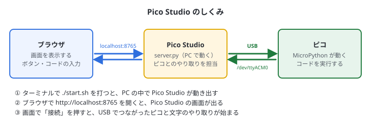
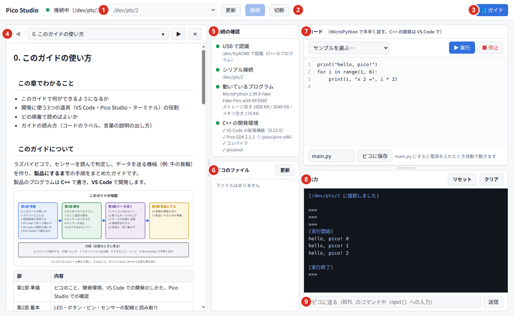
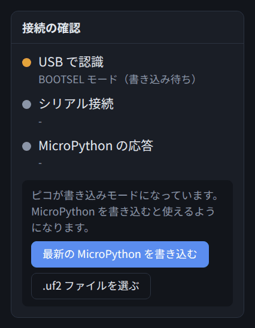
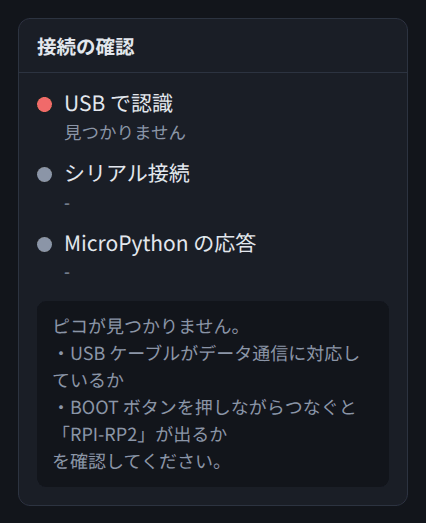
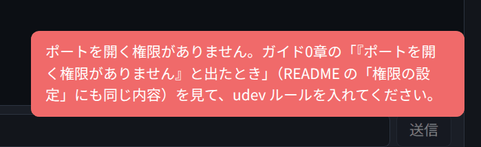

# 5. Pico Studio でつながりを確かめる

## この章でわかること

- Pico Studio の役割と、起動のしかた
- ピコがつながっているか、何が動いているかを確かめる方法
- 開発環境がそろっているかを確かめる方法
- C++ のプログラムの `printf` の出力を見る方法
- うまくつながらないときの直し方

## Pico Studio とは

ピコがきちんとつながっているかを確かめるための、自分の PC で動くツールです。**プログラムの開発は VS Code で行い（3章）、Pico Studio は確かめるときに使います。**

| できること | 使う場面 |
| --- | --- |
| ピコが USB で見えているか、何が動いているか（C++ / MicroPython / 書き込みモード）を見る | VS Code で書き込めないとき、最初につないだとき |
| C++ の開発環境（VS Code の拡張機能・SDK・コンパイラ・picotool）がそろっているかを見る | 開発を始める前、うまくビルドできないとき |
| `printf` の出力を見る | VS Code の Serial Monitor の代わりに |
| `.uf2` を書き込む（MicroPython や、VS Code でビルドしたもの） | Run Project が使えないとき |
| MicroPython のコードをすぐ試す | 配線やセンサーを、C++ を書く前に確かめたいとき（付録E） |
| このガイドを表示する | いつでも |



Pico Studio は、PC の中で動く小さなサーバー（`server.py`）と、その画面を表示するブラウザでできています。インターネットにはつながず、PC の中だけで動きます（MicroPython をダウンロードするときだけ、インターネットを使います）。

使う前に、2章の手順3（pyserial と udev ルール）を済ませておきます。

## 起動する

ターミナル（Ctrl + Alt + T で開く黒い画面）で、次の2行を打ちます。

```bash
cd ~/apps/pico-studio
./start.sh
```

少しするとブラウザが開き、Pico Studio の画面が出ます。
開かないときは、ブラウザで **http://localhost:8765** を開いてください。

- すでに起動しているときに `./start.sh` を打つと、ブラウザで開くだけになります（2つ起動されることはありません）
- ブラウザのタブを閉じても、Pico Studio は動き続けます。もう一度 http://localhost:8765 を開けば戻れます
- **Pico Studio を新しくしたとき**（`git pull` したときなど）は、起動し直します。動いたままのターミナルで Ctrl + C を押して止め、`./start.sh` を打ちます。古いまま動いていると、画面に「サーバーが古いままです」と出ます

### 終わるとき

1. 画面上の「切断」を押す
2. `./start.sh` を打ったターミナルで **Ctrl + C** を押す

ターミナルを閉じても終わります。

## 画面の見方



| 番号 | 場所 | できること |
| --- | --- | --- |
| ① | ポート欄 | ピコがつながっている場所（ポート）を選ぶ。ピコには「(ピコ・C++ のプログラム)」のように、動いているものも出る |
| ② | 更新・接続・切断 | ポートを探し直す・つなぐ・切る |
| ③ | 📘 ガイド | このガイドを表示する・隠す |
| ④ | ガイド | このガイド。目次から章を選ぶ。文字を選ぶと付箋・線・メモを付けられ、🔖 で一覧が開く（0章） |
| ⑤ | 接続の確認 | つながりと開発環境を、4つの項目で表示する（下で説明） |
| ⑥ | ピコのファイル | MicroPython のときだけ。ピコに保存されたファイルの一覧 |
| ⑦ | コード | MicroPython のコードを書いて「▶ 実行」で試す（付録E） |
| ⑧ | 出力 | ピコからの出力（`printf` や `print`）が出る |
| ⑨ | 送信欄 | ピコに1行送る（`getchar()` や `input()` で受け取れる） |

コード欄と出力欄の間の仕切りを上下にドラッグすると、高さの割合を変えられます。

## つないで確かめる

### 手順

1. ピコを USB ケーブルで PC につなぐ
2. **「更新」** を押す（未接続の間は、3秒ごとに自動でも探している）
3. ポート欄で **「(ピコ…)」** と付いたものを選ぶ
4. **「接続」** を押す

### 接続の確認の4つの項目

| 項目 | 緑のとき | 緑にならないとき |
| --- | --- | --- |
| USB で認識 | PC がピコを見つけている。何が動いているかも出る | ケーブル・USB ポートを確かめる（下の「見つかりません」） |
| シリアル接続 | ピコと通信できる状態 | 「接続」を押す。権限のエラーなら下を見る |
| 動いているプログラム | C++ のプログラムなら「C++ のプログラムが動いています」。MicroPython なら、そのバージョンと空き容量 | ほかのソフト（VS Code の Serial Monitor など）がポートを使っていないか |
| C++ の開発環境 | VS Code の拡張機能・Pico SDK・コンパイラ・picotool が、それぞれ ✓ か ✗ で出る | ✗ のものを2章の手順で入れる。SDK とコンパイラは、VS Code で最初のプロジェクトを作ると入る |

点の色の意味は次のとおりです。

| 色 | 意味 |
| --- | --- |
| 緑 | OK |
| 黄 | 注意（書き込みモード、一部だけそろっている、実行中など） |
| 赤 | 問題がある（見つからない、応答がないなど） |
| 灰 | まだ確認していない（未接続など） |

### USB で認識の表示で、何が動いているかわかる

| 表示 | ピコで動いているもの | VS Code の Run Project (USB) で書き込むと |
| --- | --- | --- |
| （C++ のプログラム） | Console over USB ありの C++ のプログラム | そのまま書き込める |
| （MicroPython） | MicroPython | BOOT を押しながらつなぎ直してから書き込む |
| BOOTSEL モード（書き込み待ち） | 書き込みモード | そのまま書き込める |
| 見つかりません | USB を使わないプログラム、止まっている、ケーブルの問題 | BOOT を押しながらつなぎ直す |

## C++ のプログラムの出力を見る

VS Code で書き込んだ C++ のプログラムの `printf` は、Pico Studio の出力欄でも見られます。

1. VS Code で Run Project (USB) で書き込む
2. Pico Studio で「更新」→ ポート（`(ピコ・C++ のプログラム)`）を選んで「接続」
3. 出力欄に `printf` の出力が流れる

- 送信欄に入れた文字は、ピコの `getchar()` などで受け取れます
- C++ のプログラムでは、「▶ 実行」やファイルの操作は使えません（MicroPython 用）
- **VS Code で次に書き込む前に「切断」を押します。** つないだままだと、書き込みのあとにつながらないことがあります

## .uf2 を書き込む

ピコを書き込みモードにすると、「接続の確認」の下にボタンが出ます。

1. ピコの **BOOT** ボタンを押したまま USB でつなぎ、つないだら離す
2. 「USB で認識」に **BOOTSEL モード（書き込み待ち）** と出る



| ボタン | すること |
| --- | --- |
| 最新の MicroPython を書き込む | MicroPython をダウンロードして書き込む（付録E） |
| .uf2 ファイルを選ぶ | 手元の `.uf2` を書き込む。VS Code でビルドした `~/apps/プロジェクト/build/名前.uf2` も選べる |

> 「ドライブがまだ開かれていません」と出たときは、ファイルマネージャーで「RPI-RP2」を開いてから「更新」を押してください。

## うまくつながらないとき

### 「見つかりません」と出たとき



PC がピコを見つけられていません。次の順に試してください。

1. USB ケーブルを、データ通信に対応したものに替える
2. PC の別の USB ポートにさす。USB ハブを使っているなら、PC に直接さす
3. ピコの **BOOT** ボタンを押しながらつなぐ。「BOOTSEL モード」と出れば、ケーブルは大丈夫で、MicroPython が入っていないだけ（上の「.uf2 を書き込む」へ）

コマンドで確かめる方法は付録Bにあります。

### 「ポートを開く権限がありません」と出たとき



Linux では、最初の1回だけ、ピコのポートを使えるようにする設定が必要です。
ターミナルで次を打ちます（途中でパスワードを聞かれます。打っても画面には何も出ませんが、そのまま打って Enter を押します）。

```bash
cd ~/apps/pico-studio
sudo cp 70-pico-studio.rules /etc/udev/rules.d/
sudo udevadm control --reload-rules
```

打ち終わったら、**ピコを一度抜いて、つなぎ直します**。そのあと「更新」→「接続」を押します。

> 以前に `99-pico-studio.rules` を入れていた場合は、番号が大きすぎて効きません。
> 先に `sudo rm /etc/udev/rules.d/99-pico-studio.rules` で消してから、上の手順で入れてください。

設定できたかどうかは、ターミナルで次のコマンドを打つとわかります。

```bash
ls -l /dev/ttyACM0
```

行の最初が `crw-rw----+` のように **`+` 付き**になっていれば成功です。

## まとめ

- Pico Studio は確かめる道具。開発は VS Code
- 「接続の確認」で、USB・シリアル・動いているプログラム・C++ の開発環境の4つがわかる
- C++ のプログラムの `printf` も出力欄で見られる。VS Code で書き込む前に「切断」
- 書き込みモードにすると、MicroPython や `.uf2` を書き込める
- つながらないときは、ケーブル → USB ポート → BOOT を押してつなぐ、の順に試す
