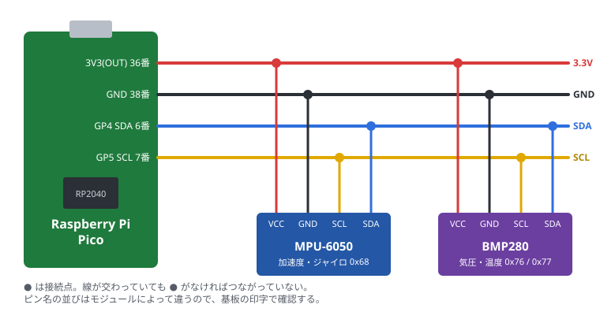

# 5. センサーのつなぎ方

## この章でわかること

- ブレッドボードとジャンパーワイヤーの使い方
- I2C センサーのつなぎ方
- 加速度センサー（MPU-6050）と気圧センサー（BMP280）の配線
- つないだセンサーが見えているかの確認（I2C スキャン）

## 用意するもの

| 部品 | 説明 |
| --- | --- |
| ブレッドボード | 穴に差すだけで配線できる板。はんだ付け不要 |
| ジャンパーワイヤー（オス-オス） | ブレッドボードの穴どうしをつなぐ線 |
| ピンヘッダ | ピコやセンサー基板に付けて、ブレッドボードに差せるようにする（はんだ付けが必要なことが多い） |
| MPU-6050 モジュール | 加速度・ジャイロ（角速度）センサー。GY-521 という名前の基板が多い |
| BMP280 モジュール | 気圧・温度センサー。GY-BMP280 など |

> センサーは「チップ単体」ではなく、**基板に載ったモジュール**を買うと扱いやすいです。
> 3.3V で使えるか、I2C に対応しているかを確認してください。

## ブレッドボードのしくみ

```text
   ＋ ─ ─ ─ ─ ─ ─ ─ ─ ─ ─   ← 横一列がつながっている（電源用）
   － ─ ─ ─ ─ ─ ─ ─ ─ ─ ─
   
   a  ● ● ● ● ● ● ● ●
   b  ● ● ● ● ● ● ● ●     ← 縦（a〜e）の5穴がつながっている
   c  ● ● ● ● ● ● ● ●
   d  ● ● ● ● ● ● ● ●
   e  ● ● ● ● ● ● ● ●
      ─── 溝 ───            ← 溝をまたぐとつながっていない
   f  ● ● ● ● ● ● ● ●
   ...
```

ピコは溝をまたぐように差すと、左右のピンがショートしません。

## I2C のしくみ

I2C は **SDA（データ）** と **SCL（クロック）** の2本の線で通信します。
1組の線に、複数のセンサーを**並べてつなげる**のが特徴です。

センサーごとに **アドレス**（番号）が決まっていて、ピコはアドレスで相手を選びます。

| センサー | I2C アドレス |
| --- | --- |
| MPU-6050 | 0x68（AD0 ピンを 3.3V につなぐと 0x69） |
| BMP280 | 0x76 または 0x77（SDO ピンで変わる） |

アドレスが重ならなければ、同じ線に何個でもつなげます。

## 配線図



| ピコ | MPU-6050 | BMP280 |
| --- | --- | --- |
| 3V3(OUT)（36番） | VCC | VCC |
| GND（38番） | GND | GND |
| GP4 / I2C0 SDA（6番） | SDA | SDA |
| GP5 / I2C0 SCL（7番） | SCL | SCL |

- 電源は必ず **3V3(OUT)** から。VBUS（5V）につなぐと、センサーによっては壊れる
- 線の色を決めておくと間違えにくい（例: 赤=3.3V、黒=GND、青=SDA、黄=SCL）
- BMP280 に CSB ピンがある場合は 3.3V に、SDO ピンは GND（0x76）か 3.3V（0x77）につなぐ（多くのモジュールは基板上で設定済み）

### プルアップ抵抗について

I2C の SDA・SCL には、3.3V への**プルアップ抵抗**（4.7kΩ 前後）が必要です。
多くのセンサーモジュールには最初から付いているので、モジュールを使うなら追加は不要です。

## I2C スキャン（つながっているか確認）

配線したら、まずはセンサーが見えているかを確認します。

```python run
from machine import Pin, I2C

i2c = I2C(0, sda=Pin(4), scl=Pin(5), freq=400000)
found = i2c.scan()

if not found:
    print("センサーが見つかりません。配線を確認してください")
for addr in found:
    name = {0x68: "MPU-6050", 0x69: "MPU-6050 (AD0=1)",
            0x76: "BMP280 / BME280", 0x77: "BMP280 / BME280"}.get(addr, "?")
    print("見つかった: 0x{:02X}  {}".format(addr, name))
```

見つかったアドレスが表示されれば、配線は正しくできています。

### 見つからないときのチェック

1. USB を抜いて、配線をもう一度確認する（SDA と SCL の逆はよくある間違い）
2. センサーの VCC に 3.3V が来ているか（基板の LED が光るものもある）
3. GND がピコとつながっているか
4. ピンヘッダのはんだ付けが浮いていないか
5. `freq=100000` に下げてみる（線が長いときに効く）

## まとめ

- I2C は SDA・SCL の2本に、複数のセンサーを並べてつなぐ
- 電源は 3V3(OUT)、GND は共通、まず GP4(SDA)・GP5(SCL)
- 配線したら I2C スキャンでアドレスが見えるか確認する
