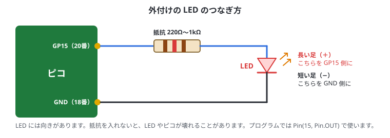

# 6. はじめてのプログラム

## この章でわかること

- はじめての C++ のプログラムを動かして、読めるようになる
- `printf` で結果を PC に出す
- LED を点滅させる（「Lチカ」）。ボードの LED、外付けの LED、RGB LED
- ボタンを読む
- 書き込んだプログラムの止め方と、電源を入れたときの動き

3章で、VS Code のプロジェクトを作って Lチカを書き込めている前提です。
この章のプログラムは、どれも「コピー」して、VS Code のプロジェクトの `.cpp` の中身と置き換え、**Compile Project → Run Project (USB)** で試します。出力は Serial Monitor か Pico Studio で見ます（3章）。

## C++ での進め方

C++ では、いつも次の流れになります。MicroPython のように1行ずつ試す方法（REPL）はありません。

1. プログラム全体を書く
2. ビルドする（Compile Project）
3. 書き込む（Run Project (USB)）。ピコが再起動して、プログラムが動き出す
4. `printf` の結果を見る（Serial Monitor か Pico Studio）

1回のビルドと書き込みは、2回目からは10秒前後です。

## はじめてのプログラム

```cpp run
#include <cstdio>
#include "pico/stdlib.h"

int main() {
    stdio_init_all();
    sleep_ms(1500);            // PC が出力を受け取れるようになるまで待つ

    printf("hello, pico!\n");

    int total = 0;
    for (int i = 1; i <= 10; i++) {
        total += i;
    }
    printf("1から10の合計: %d\n", total);

    while (true) {             // main() は終わらないようにする
        sleep_ms(1000);
    }
}
```

書き込んだら、すぐに Serial Monitor（または Pico Studio の「接続」）で出力を見ます。次のように出れば成功です。

```text
hello, pico!
1から10の合計: 55
```

> 1.5秒のうちに見始めないと、最初の出力を見のがします。見のがしたときは、ピコの RST ボタンを押すか、USB を抜き差しすると、最初からやり直します。

### コードの読み方

| 行 | 意味 |
| --- | --- |
| `#include <cstdio>` | `printf` を使うための部品を読み込む |
| `#include "pico/stdlib.h"` | ピコの基本の部品（ピン・時間・USB の出力など）を読み込む |
| `int main() { ... }` | プログラムは `main` から始まる |
| `stdio_init_all();` | `printf` の出力を USB で PC に送れるようにする |
| `sleep_ms(1500);` | 1.5秒待つ。ピコが再起動してすぐの出力は、PC が受け取る前に消えてしまうため |
| `int total = 0;` | 整数（`int`）の入れ物 `total` を作って、0 を入れる |
| `for (int i = 1; i <= 10; i++) { ... }` | `i` を 1, 2, …, 10 と変えながら、`{ }` の中をくり返す |
| `printf("...%d\n", total);` | 文字を出力する。`%d` のところに `total` の値が入る。`\n` は改行 |
| `while (true) { ... }` | ずっとくり返す。`main` が終わると、ピコは何もしなくなる |

> C++ では、文の終わりに **`;`** が必要です。忘れると、ビルドのときにエラーになります。
> エラーが出たら、VS Code の「問題」の欄（Ctrl + Shift + M）で、エラーをクリックするとその行に飛びます。読み方は付録B。

| `printf` の書き方 | 意味 | 例 |
| --- | --- | --- |
| `%d` | 整数 | `printf("%d", 55)` → `55` |
| `%.2f` | 小数（小数点以下2けた） | `printf("%.2f", 3.14159)` → `3.14` |
| `%s` | 文字列 | `printf("%s", "pico")` → `pico` |
| `%02x` | 16進数（2けた、0 で埋める） | `printf("%02x", 104)` → `68` |
| `\n` | 改行 | |

## LED を点滅させる（Lチカ）

マイコンの最初の一歩は、LED を点滅させること（Lチカ）です。

### ボードの LED

公式ピコでは、ボード上の LED は **GP25** につながっています。

```cpp run
#include <cstdio>
#include "pico/stdlib.h"

constexpr uint LED_PIN = 25;      // GP25

int main() {
    stdio_init_all();
    gpio_init(LED_PIN);
    gpio_set_dir(LED_PIN, GPIO_OUT);   // 出力にする

    for (int i = 0; i < 10; i++) {
        gpio_put(LED_PIN, true);       // 点ける
        sleep_ms(300);
        gpio_put(LED_PIN, false);      // 消す
        sleep_ms(300);
    }
    printf("おわり\n");

    while (true) sleep_ms(1000);
}
```

ボードの小さな LED が10回点滅すれば成功です。

| コード | 意味 |
| --- | --- |
| `constexpr uint LED_PIN = 25;` | ピン番号に名前を付ける。`constexpr` は「変わらない値」、`uint` は符号なし整数 |
| `gpio_init(LED_PIN);` | 25番ピンを使えるようにする |
| `gpio_set_dir(LED_PIN, GPIO_OUT);` | 25番ピンを「出力」にする |
| `gpio_put(LED_PIN, true);` | 3.3V を出す（点く）。`false` で 0V（消える） |
| `sleep_ms(300);` | 300ミリ秒（0.3秒）待つ |

> **Pico W / Pico 2 W** では、LED が無線のチップにつながっているので、書き方が違います。プロジェクトを作るときに Board type で Pico W を選び、次のように書きます。
>
> - `#include "pico/cyw43_arch.h"` を足す
> - 最初に `cyw43_arch_init();` を呼ぶ
> - 点けるのは `cyw43_arch_gpio_put(CYW43_WL_GPIO_LED_PIN, true);`
> - `CMakeLists.txt` の `target_link_libraries` に `pico_cyw43_arch_none` を足す
>
> 互換ボードでは LED のピン番号が違うことがあります。光らなければ、ボードの説明書を確認してください。

### 外付けの LED

ブレッドボードに LED と抵抗をつないで、同じように点滅させてみます。配線は **USB を抜いてから** 行います。



1. USB を抜く
2. ピコの **GP15（20番ピン）** から、抵抗（220Ω〜1kΩ）につなぐ
3. 抵抗のもう片方を、LED の **長い足（＋）** につなぐ
4. LED の **短い足（−）** を、ピコの **GND（18番ピン）** につなぐ
5. USB をつないで、下のプログラムを書き込む

```cpp run
#include "pico/stdlib.h"

constexpr uint LED_PIN = 15;      // GP15

int main() {
    stdio_init_all();
    gpio_init(LED_PIN);
    gpio_set_dir(LED_PIN, GPIO_OUT);

    for (int i = 0; i < 20; i++) {
        gpio_put(LED_PIN, !gpio_get(LED_PIN));   // 今の状態の反対にする（点いていたら消す）
        sleep_ms(200);
    }
    gpio_put(LED_PIN, false);

    while (true) sleep_ms(1000);
}
```

`!` は「反対」という意味です。`gpio_get` で今の状態を読み、反対の値を出しています。

光らないときは、LED の向き（長い足が GP15 側）と、ピン番号（物理ピンの20番 = GP15）を確かめてください。
ピンの番号の読み方は7章、ブレッドボードの使い方は8章で詳しく説明します。

### RGB LED（付いているボードだけ）

RGB LED が付いた互換ボードなら、色を変えて光らせられます。

Pico Studio に入っている `ws2812.h` を使います。中では PIO（ピコの、自由に作れる入出力回路）で RGB LED 用の信号を作っています。

1. `ws2812.h` をプロジェクトのフォルダにコピーする（`cp ~/apps/pico-studio/cpp/include/ws2812.h ~/apps/blink/`）
2. `CMakeLists.txt` の `target_link_libraries` に `hardware_pio` と `hardware_clocks` を足す（4章）
3. 次のプログラムを貼り付けて、Compile → Run

```cpp run
#include "pico/stdlib.h"
#include "ws2812.h"

Ws2812 rgb(23);                   // ピン番号はボードによって違う（例: 23, 16）

int main() {
    stdio_init_all();
    rgb.begin();
    const uint8_t colors[][3] = {{30, 0, 0}, {0, 30, 0}, {0, 0, 30}, {30, 30, 30}, {0, 0, 0}};
    for (auto& c : colors) {      // colors の中身を1つずつ c に入れてくり返す
        rgb.put(c[0], c[1], c[2]);   // 赤, 緑, 青 をそれぞれ 0〜255 で指定
        sleep_ms(500);
    }
    while (true) sleep_ms(1000);
}
```

数字を大きくすると明るくなります。とてもまぶしいので、30 くらいから試してください。

## 止めるとき

C++ のプログラムには「止める」操作がありません。書き込んだプログラムは、**次に別のプログラムを書き込むまで**動き続けます。

- 動きを止めたいときは、何もしないプログラム（下の例）を書き込みます
- USB を抜けば止まりますが、つなぐとまた最初から動きます

```cpp run
#include "pico/stdlib.h"

int main() {
    stdio_init_all();             // USB の出力だけは使えるようにしておく（次の書き込みを自動で行うため）
    while (true) sleep_ms(1000);  // 何もしない
}
```

> **C++ のプログラムでは、いつも最初に `stdio_init_all()` を呼びます。** `printf` を使わないプログラムでも同じです。
> 呼ばないプログラムを書き込むと、次の書き込みのときにピコを自動で書き込みモードにできません。そのときは BOOT を押しながらつなぎ直します。

## 電源を入れたら自動で動く

**書き込んだプログラムが、そのまま電源を入れたときに動くプログラム**になります。

1. 上の「ボードの LED」のコードを、`for` の代わりに `while (true)` でくり返すように直して書き込む
2. USB を抜いて、USB の充電器やモバイルバッテリーにさす → LED が点滅し始める

書いたコードは、VS Code のプロジェクトのフォルダ（`~/apps/blink` など）に残ります。ピコの中には、ビルドしたプログラム（機械語）だけが入ります。

## ボタンを読む

互換ボードの中には、ユーザーボタン（**USR**、多くは **GP24**）が付いているものがあります。下のプログラムを書き込んで USR を押すと「押されている」と出ます。
外付けのボタンなら、ボタンの片側を GPIO（例: GP14）、もう片側を GND につなぎ、コードの `24` を `14` に変えます。

```cpp run
#include <cstdio>
#include "pico/stdlib.h"

constexpr uint BTN_PIN = 24;

int main() {
    stdio_init_all();
    gpio_init(BTN_PIN);
    gpio_set_dir(BTN_PIN, GPIO_IN);
    gpio_pull_up(BTN_PIN);        // 押していないとき 1、押すと 0

    while (true) {
        printf("%s\n", gpio_get(BTN_PIN) == 0 ? "押されている" : "-");
        sleep_ms(200);
    }
}
```

`gpio_pull_up` はピコの中の抵抗を使う設定で、何もつながっていないときの値を 1 に固定します（7章で図を使って説明）。
`条件 ? A : B` は、条件が正しければ A、そうでなければ B になる書き方です。

### ボタンで LED を点ける

2つを組み合わせると、「押している間だけ LED が点く」が作れます。

```cpp run
#include "pico/stdlib.h"

constexpr uint LED_PIN = 25;
constexpr uint BTN_PIN = 24;

int main() {
    stdio_init_all();
    gpio_init(LED_PIN);
    gpio_set_dir(LED_PIN, GPIO_OUT);
    gpio_init(BTN_PIN);
    gpio_set_dir(BTN_PIN, GPIO_IN);
    gpio_pull_up(BTN_PIN);

    while (true) {
        gpio_put(LED_PIN, gpio_get(BTN_PIN) == 0);   // 押されている（0）なら点ける
        sleep_ms(10);
    }
}
```

## やってみよう

少しずつ変えて、動きがどう変わるか試してみましょう。

- Lチカの `sleep_ms(300)` を `50` や `1000` にする
- `i < 10` を `i < 3` にする
- ボタンを押した回数を数えて表示する（ヒント: 前の値を覚えておき、1 から 0 に変わったときに数を増やす）

## まとめ

- プログラム全体を書いて、Compile → Run で書き込む。`printf` の結果は Serial Monitor か Pico Studio で見る
- 最初に `stdio_init_all()` を呼ぶ。起動直後の出力は見のがしやすいので `sleep_ms(1500)` で待つ
- `gpio_init` → `gpio_set_dir` → `gpio_put` / `gpio_get` で LED やボタンを扱う
- 書き込んだプログラムが、そのまま電源オンで動く。止めるには別のプログラムを書き込む

