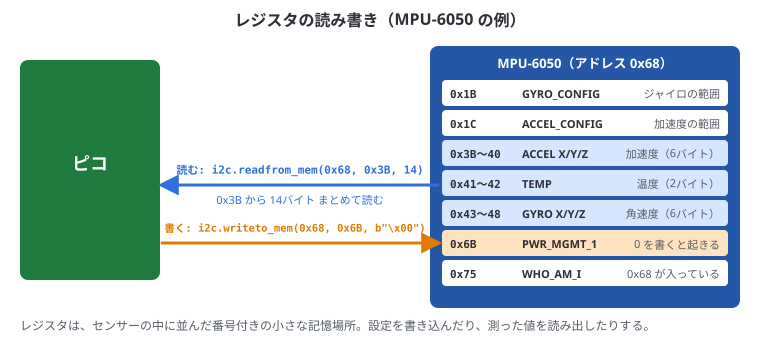
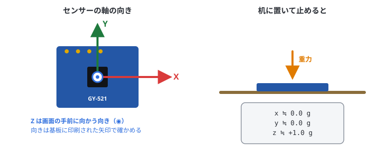
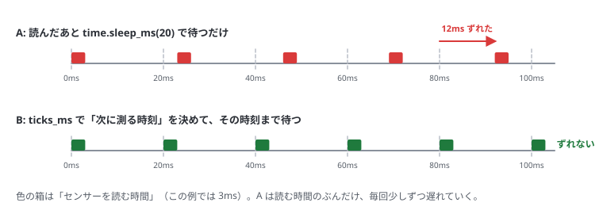

# 6. センサーの操作

## この章でわかること

- I2C でセンサーのレジスタを読み書きする方法
- 読んだバイト列を数値に変える方法
- MPU-6050 で加速度と角速度を読む
- BMP280 で気圧と温度を読む
- 決まった間隔でデータを取る方法

5章の配線と I2C スキャンが済んでいることが前提です。

## レジスタとは

センサーの中には **レジスタ** という小さな記憶場所が並んでいて、それぞれに番号（アドレス）があります。
ロッカーのようなもので、何番のロッカーに何が入っているかは、センサーのデータシート（説明書）に書いてあります。

- 設定用のレジスタに書き込む → センサーの動き方を変える
- データ用のレジスタを読む → 測った値がわかる



MicroPython では、次の2つの関数でレジスタを読み書きします。

```text
i2c.writeto_mem(センサーのアドレス, レジスタ番号, 書き込むバイト列)
i2c.readfrom_mem(センサーのアドレス, レジスタ番号, 読むバイト数)
```

### バイト列を数値に変える

センサーから読んだ値は **バイト列**（0〜255 の数が並んだもの）です。
加速度のような値は、2バイトで1つの数（−32768〜32767）を表しています。これを数値に直すのが `struct.unpack` です。

```text
>>> import struct
>>> struct.unpack(">h", b"\x40\x00")
(16384,)
```

| 書き方 | 意味 |
| --- | --- |
| `>` | ビッグエンディアン（大きい桁が先に来る並び方）。MPU-6050 はこれ |
| `<` | リトルエンディアン（小さい桁が先）。BMP280 の補正係数はこれ |
| `h` | 符号付き 16 ビット整数（−32768〜32767）。C++ の `int16_t` |
| `H` | 符号なし 16 ビット整数（0〜65535） |
| `>hhh` | 符号付き 16 ビットを3つ（x・y・z など） |

## MPU-6050（加速度・ジャイロ）

**加速度** は「どの向きにどれだけ引っぱられているか」、**角速度（ジャイロ）** は「どれだけ速く回っているか」です。
止まっていても重力がかかるので、加速度センサーで「どちらが下か」（傾き）もわかります。

### センサーの軸



- 単位は **g**（重力の大きさ = 1g）
- 机に置いて止めると、真下に重力がかかるので **z ≒ +1.0g**、x・y ≒ 0 になる
- 傾けると、重力が x や y にも分かれて出てくる

### 主なレジスタ

| レジスタ | 番号 | 内容 |
| --- | --- | --- |
| PWR_MGMT_1 | 0x6B | 0 を書くとスリープから起きる。**電源を入れた直後は寝ている** |
| GYRO_CONFIG | 0x1B | ジャイロの範囲（0 = ±250°/s） |
| ACCEL_CONFIG | 0x1C | 加速度の範囲（0 = ±2g） |
| ACCEL_XOUT_H 〜 | 0x3B〜0x48 | 加速度XYZ・温度・ジャイロXYZ（各2バイト、ビッグエンディアン） |
| WHO_AM_I | 0x75 | 0x68 が返ってくれば MPU-6050 |

### 読み取りのコード

```python run
from machine import Pin, I2C
import struct, time

ADDR = 0x68
i2c = I2C(0, sda=Pin(4), scl=Pin(5), freq=400000)

print("WHO_AM_I:", hex(i2c.readfrom_mem(ADDR, 0x75, 1)[0]))

i2c.writeto_mem(ADDR, 0x6B, b"\x00")   # スリープ解除
i2c.writeto_mem(ADDR, 0x1C, b"\x00")   # 加速度 ±2g  → 16384 = 1g
i2c.writeto_mem(ADDR, 0x1B, b"\x00")   # ジャイロ ±250°/s → 131 = 1°/s
time.sleep_ms(100)

def read_mpu():
    data = i2c.readfrom_mem(ADDR, 0x3B, 14)
    ax, ay, az, t, gx, gy, gz = struct.unpack(">hhhhhhh", data)
    return (ax / 16384, ay / 16384, az / 16384,
            gx / 131, gy / 131, gz / 131,
            t / 340 + 36.53)

for i in range(20):
    ax, ay, az, gx, gy, gz, temp = read_mpu()
    print("加速度[g] x={:+.2f} y={:+.2f} z={:+.2f}  角速度[°/s] x={:+6.1f} y={:+6.1f} z={:+6.1f}"
          .format(ax, ay, az, gx, gy, gz))
    time.sleep(0.2)
```

机に置いたまま実行すると、次のように出ます（数値は少しずつ違います）。

```text
WHO_AM_I: 0x68
加速度[g] x=+0.02 y=-0.01 z=+1.01  角速度[°/s] x=  -1.2 y=  +0.8 z=  +0.3
加速度[g] x=+0.02 y=-0.02 z=+1.00  角速度[°/s] x=  -1.1 y=  +0.9 z=  +0.2
```

### コードのポイント

| コード | 意味 |
| --- | --- |
| `readfrom_mem(ADDR, 0x75, 1)[0]` | WHO_AM_I を1バイト読む。0x68 なら正しいセンサー |
| `writeto_mem(ADDR, 0x6B, b"\x00")` | 0x6B に 0 を書いて、スリープから起こす |
| `readfrom_mem(ADDR, 0x3B, 14)` | 0x3B から14バイト（7個 × 2バイト）をまとめて読む |
| `">hhhhhhh"` | 符号付き16ビット整数を7個（加速度3・温度1・ジャイロ3） |
| `/ 16384` | ±2g の設定では、16384 が 1g にあたる |
| `/ 131` | ±250°/s の設定では、131 が 1°/s にあたる |

- 止まっていても角速度が ±数°/s 出るのは、センサーのくせ（オフセット）です
- センサーを傾けたり振ったりして、値が変わるのを確かめましょう

## BMP280（気圧・温度）

BMP280 は、読んだ生の値を**補正計算**して、はじめて正しい気圧・温度になります。
補正に使う係数（キャリブレーション値）は、センサーごとに工場で書き込まれています。

### 主なレジスタ

| レジスタ | 番号 | 内容 |
| --- | --- | --- |
| id | 0xD0 | 0x58 なら BMP280（0x60 なら BME280） |
| calib | 0x88〜0x9F | 補正係数（24バイト） |
| ctrl_meas | 0xF4 | 測定の設定 |
| config | 0xF5 | フィルターなどの設定 |
| press / temp | 0xF7〜0xFC | 生の気圧・温度（各20ビット） |

### 読み取りのコード

```python run
from machine import Pin, I2C
import struct, time

ADDR = 0x76          # 見つからなければ 0x77 にする
i2c = I2C(0, sda=Pin(4), scl=Pin(5), freq=400000)

print("chip id:", hex(i2c.readfrom_mem(ADDR, 0xD0, 1)[0]))

# 補正係数を読む（T1 は符号なし、T2〜T3 は符号あり、P1 は符号なし、P2〜P9 は符号あり）
cal = struct.unpack("<HhhHhhhhhhhh", i2c.readfrom_mem(ADDR, 0x88, 24))
T1, T2, T3, P1, P2, P3, P4, P5, P6, P7, P8, P9 = cal

i2c.writeto_mem(ADDR, 0xF5, b"\x10")   # IIR フィルター x16（値のふらつきを減らす）
i2c.writeto_mem(ADDR, 0xF4, b"\x57")   # 温度 x2、気圧 x16 オーバーサンプリング、連続測定
time.sleep_ms(100)

def read_bmp():
    d = i2c.readfrom_mem(ADDR, 0xF7, 6)
    adc_p = (d[0] << 12) | (d[1] << 4) | (d[2] >> 4)
    adc_t = (d[3] << 12) | (d[4] << 4) | (d[5] >> 4)

    # 温度の補正（データシートの計算式）
    v1 = (adc_t / 16384 - T1 / 1024) * T2
    v2 = (adc_t / 131072 - T1 / 8192) ** 2 * T3
    t_fine = v1 + v2
    temp = t_fine / 5120

    # 気圧の補正
    v1 = t_fine / 2 - 64000
    v2 = v1 * v1 * P6 / 32768 + v1 * P5 * 2
    v2 = v2 / 4 + P4 * 65536
    v1 = (P3 * v1 * v1 / 524288 + P2 * v1) / 524288
    v1 = (1 + v1 / 32768) * P1
    if v1 == 0:
        return temp, 0
    p = 1048576 - adc_p
    p = (p - v2 / 4096) * 6250 / v1
    v1 = P9 * p * p / 2147483648
    v2 = p * P8 / 32768
    p = p + (v1 + v2 + P7) / 16
    return temp, p           # ℃, Pa

for i in range(10):
    temp, pa = read_bmp()
    alt = 44330 * (1 - (pa / 101325) ** (1 / 5.255))   # 気圧から計算したおおよその標高
    print("温度 {:.2f} ℃  気圧 {:.2f} hPa  標高(目安) {:.1f} m".format(temp, pa / 100, alt))
    time.sleep(0.5)
```

実行すると、次のように出ます。

```text
chip id: 0x58
温度 24.31 ℃  気圧 1008.52 hPa  標高(目安) 39.4 m
温度 24.32 ℃  気圧 1008.51 hPa  標高(目安) 39.5 m
```

- 補正の計算式は難しく見えますが、データシートの式をそのまま書き写したものです。中身を理解しなくても使えます
- 気圧は 1m 高くなると約 **0.12hPa** 下がる。これを使うと、センサーを上げ下げしたことがわかる
- 標高の絶対値は天気で変わるので、**変化量**を見るのに使う（例: 牛が頭を下げた・立ち上がった）

> センサーを手で持って、床から机の上まで上げ下げしてみましょう。標高の値が 1m 前後変わるはずです。

## 決まった間隔でデータを取る

機械学習（8章）では、「1秒に25回」のように、**決まった間隔**でデータを取ることが大切です。
`time.sleep(0.02)` だけだと、読み取りにかかる時間のぶん間隔がずれます。



`time.ticks_ms()` を使って、次に測る時刻を決めておくと正確になります（図の B）。

```python run
from machine import Pin, I2C
import struct, time

ADDR = 0x68
i2c = I2C(0, sda=Pin(4), scl=Pin(5), freq=400000)
i2c.writeto_mem(ADDR, 0x6B, b"\x00")

HZ = 50                       # 1秒に50回
interval = 1000 // HZ         # 20ms ごと
next_t = time.ticks_ms()

for n in range(HZ * 3):       # 3秒分
    ax, ay, az = struct.unpack(">hhh", i2c.readfrom_mem(ADDR, 0x3B, 6))
    if n % 10 == 0:
        print(time.ticks_ms(), ax / 16384, ay / 16384, az / 16384)
    next_t = time.ticks_add(next_t, interval)          # 次に測る時刻
    wait = time.ticks_diff(next_t, time.ticks_ms())    # それまでの残り時間
    if wait > 0:
        time.sleep_ms(wait)

print("3秒で", HZ * 3, "回測りました")
```

- `ticks_ms()` は、ピコが起動してからの時間（ミリ秒）
- `ticks_add` / `ticks_diff` は、時刻の数値が一周しても正しく計算できる関数
- 表示（`print`）は時間がかかるので、10回に1回だけにしている
- 数百 Hz 以上が必要なら、`machine.Timer` の割り込みや、C/C++ を検討する

## まとめ

- センサーはレジスタを読み書きして操作する。`readfrom_mem` / `writeto_mem` と `struct.unpack`
- MPU-6050: 0x6B に 0 を書いて起こし、0x3B から14バイト読む。止まっていれば z ≒ 1g
- BMP280: 補正係数を読んで、データシートの式で計算する。高さの変化がわかる
- 一定間隔のサンプリングは `ticks_ms` で次の時刻を決める
