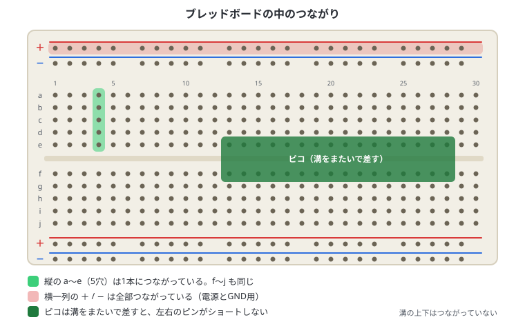
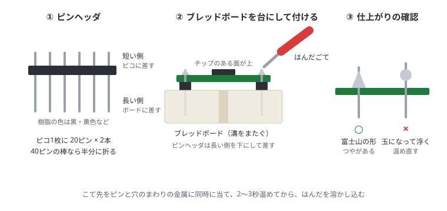
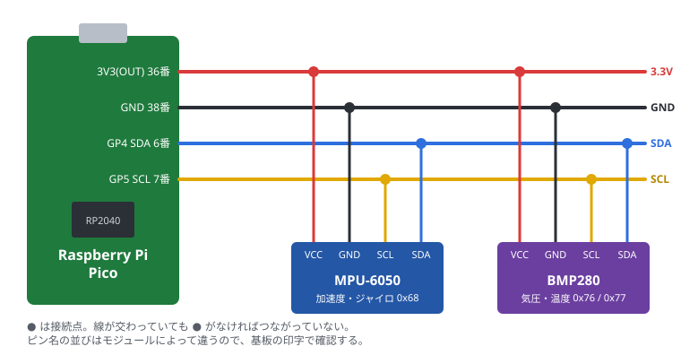

# 6. センサーのつなぎ方

## この章でわかること

- ブレッドボードとジャンパーワイヤーの使い方
- ピンヘッダの付け方（はんだ付け）
- I2C センサーのつなぎ方
- 加速度センサー（MPU-6050）と気圧センサー（BMP280）の配線
- つないだセンサーが見えているかの確認（I2C スキャン）

## 用意するもの

| 部品 | 説明 |
| --- | --- |
| ブレッドボード | 穴に差すだけで配線できる板。はんだ付け不要 |
| ジャンパーワイヤー | ブレッドボードの穴どうしや、モジュールのピンをつなぐ線 |
| ピンヘッダ | ピコやセンサー基板に付けて、ブレッドボードに差せるようにする（はんだ付けが必要なことが多い） |
| MPU-6050 モジュール | 加速度・ジャイロ（角速度）センサー。GY-521 という名前の基板が多い |
| BMP280 モジュール | 気圧・温度センサー。GY-BMP280 など |

> センサーは「チップ単体」ではなく、**基板に載ったモジュール**を買うと扱いやすいです。
> 3.3V で使えるか、I2C に対応しているかを確認してください。

## ブレッドボードのしくみ

ブレッドボードの穴の下には金属の板が入っていて、決まった穴どうしがつながっています。



| 場所 | つながり方 |
| --- | --- |
| 真ん中の a〜e | **縦の5穴**が1本につながっている。f〜j も同じ |
| 真ん中の溝 | 溝の上（a〜e）と下（f〜j）は**つながっていない** |
| 上下の ＋ / − の列 | **横一列**が全部つながっている。電源（3.3V）と GND を配るのに使う |

- ピコは**溝をまたぐように**差します。そうすると、左右のピンがショートしません
- 同じ縦の列（例: 5列の a〜e）に差した部品の足どうしは、線を使わなくてもつながります
- ピコの 3V3(OUT) を ＋ の列に、GND を − の列につないでおくと、センサーの電源を取りやすくなります

## ジャンパーワイヤーの種類

| 種類 | 使うところ |
| --- | --- |
| オス-オス | ブレッドボードの穴どうしをつなぐ（一番よく使う） |
| オス-メス | ブレッドボードと、ピンヘッダが付いたモジュールをつなぐ |
| メス-メス | ピンヘッダどうしを直接つなぐ |

線の色を決めておくと、まちがいが減ります（例: 赤 = 3.3V、黒 = GND、青 = SDA、黄 = SCL）。

## ピンヘッダの付け方

ピンヘッダは、黒や黄色の樹脂の棒に、金属のピンが並んだ部品です。
ピコのふちに並んだ穴（片側20個ずつ）にはんだ付けすると、ブレッドボードに差せるようになります。

- **USB でつないでプログラムを動かすだけなら、なくても大丈夫です。** センサーをつなぐときに必要になります
- 最初からピンヘッダが付いた「Pico H」「Pico WH」というモデルもあります。その場合、この節は飛ばしてください
- ピコの端にある3つの小さな穴（DEBUG）は、このガイドでは使いません。付けなくてよいです



### 用意するもの

| 道具 | 説明 |
| --- | --- |
| はんだごて | 温度調節できるものが使いやすい。330〜350℃ くらい |
| こて台 | 熱いこてを置く台。こて先を拭くスポンジ付きが便利 |
| はんだ | 電子工作用、太さ 0.6〜0.8mm くらい |
| ブレッドボード | ピンをまっすぐ固定する台として使う |
| ニッパー | ピンヘッダを切り分けるときに使う |

### 手順

1. ピンヘッダを **20ピンずつ2本** にする。40ピンの棒なら、真ん中で折るかニッパーで切る
2. ブレッドボードに、ピンヘッダの **長い側を下にして** 差す。2本の間隔はピコの幅に合わせ、真ん中の溝をまたぐようにする
3. その上にピコを、**チップのある面を上にして** 載せる。短い側のピンが、ピコの穴から少し出る
4. まず **対角の角の2本** だけはんだ付けする。ピコが傾いていないか見て、傾いていたらそのピンを温め直して直す
5. 残りのピンを1本ずつはんだ付けする
   - こて先を、**ピンと穴のまわりの金属（パッド）の両方** に当てて 2〜3 秒温める
   - そこへはんだを当てて溶かし込む。量は穴のまわりが埋まるくらい
   - **はんだを先に離して、次にこてを離す**
6. 全部付いたら、ピコをブレッドボードからまっすぐ引き抜く

### できあがりの確認

- ○ 富士山のような形で、つやがある
- × 玉のように丸くなっている、ピンとパッドの間にすき間がある → こてを当てて温め直す
- × 隣のピンとはんだでつながっている（ブリッジ）→ 温めて余分なはんだをこて先で引き取る

付け終わったら USB でつなぎ、「接続の確認」が3つとも緑になるかを見ます。

> **注意**
> - はんだ付けの間は USB を抜いておく
> - こてを長く当てすぎると、ブレッドボードの樹脂が溶けることがある
> - 煙を吸わないように換気する。こて先は 300℃ 以上あるので、こて台に置く
> - センサーモジュールにも同じ要領で付ける。こちらも短い側を基板に、長い側をブレッドボードに向ける

## I2C のしくみ

I2C は **SDA（データ）** と **SCL（クロック = タイミングを合わせる合図）** の2本の線で通信します。
1組の線に、複数のセンサーを**並べてつなげる**のが特徴です。

センサーごとに **アドレス**（番号）が決まっていて、ピコはアドレスで相手を選びます。
学校の出席番号のようなもので、ピコが「0x68 番の人、値を教えて」と呼ぶと、そのセンサーだけが答えます。

| センサー | I2C アドレス |
| --- | --- |
| MPU-6050 | 0x68（AD0 ピンを 3.3V につなぐと 0x69） |
| BMP280 | 0x76 または 0x77（SDO ピンで変わる） |

アドレスが重ならなければ、同じ線に何個でもつなげます。

> `0x68` の `0x` は「16進数」という意味です。10進数では 104 です。

## 配線図



| ピコ | MPU-6050 | BMP280 |
| --- | --- | --- |
| 3V3(OUT)（36番） | VCC | VCC |
| GND（38番） | GND | GND |
| GP4 / I2C0 SDA（6番） | SDA | SDA |
| GP5 / I2C0 SCL（7番） | SCL | SCL |

### 配線の手順

1. **USB を抜く**
2. ピコをブレッドボードに、溝をまたぐように差す
3. ピコの 3V3(OUT)（36番）から ＋ の列へ、GND（38番）から − の列へ線をつなぐ
4. センサーを1つずつブレッドボードに差す
5. センサーの VCC を ＋ の列へ、GND を − の列へつなぐ
6. センサーの SDA をピコの GP4（6番）へ、SCL を GP5（7番）へつなぐ。2つ目のセンサーも同じ GP4・GP5 へ
7. 表と見比べて、**全部の線をもう一度確かめる**
8. USB をつなぐ

- 電源は必ず **3V3(OUT)** から。VBUS（5V）につなぐと、センサーによっては壊れる
- BMP280 に CSB ピンがある場合は 3.3V に、SDO ピンは GND（0x76）か 3.3V（0x77）につなぐ（多くのモジュールは基板上で設定済み）

### プルアップ抵抗について

I2C の SDA・SCL には、3.3V への**プルアップ抵抗**（4.7kΩ 前後）が必要です。
多くのセンサーモジュールには最初から付いているので、モジュールを使うなら追加は不要です。

## I2C スキャン（つながっているか確認）

配線したら、まずはセンサーが見えているかを確認します。

```python run
from machine import Pin, I2C

i2c = I2C(0, sda=Pin(4), scl=Pin(5), freq=400000)
found = i2c.scan()

if not found:
    print("センサーが見つかりません。配線を確認してください")
for addr in found:
    name = {0x68: "MPU-6050", 0x69: "MPU-6050 (AD0=1)",
            0x76: "BMP280 / BME280", 0x77: "BMP280 / BME280"}.get(addr, "?")
    print("見つかった: 0x{:02X}  {}".format(addr, name))
```

2つともつながっていれば、次のように出ます。

```text
見つかった: 0x68  MPU-6050
見つかった: 0x76  BMP280 / BME280
```

見つかったアドレスが表示されれば、配線は正しくできています。

| コード | 意味 |
| --- | --- |
| `I2C(0, ...)` | ピコの2つある I2C のうち、0番を使う |
| `sda=Pin(4), scl=Pin(5)` | SDA を GP4、SCL を GP5 にする |
| `freq=400000` | 通信の速さ（400kHz） |
| `i2c.scan()` | つながっているセンサーのアドレスを一覧で返す |

### 見つからないときのチェック

1. USB を抜いて、配線をもう一度確認する（SDA と SCL の逆はよくある間違い）
2. センサーの VCC に 3.3V が来ているか（基板の LED が光るものもある）
3. GND がピコとつながっているか
4. ピンヘッダのはんだ付けが浮いていないか
5. ジャンパーワイヤーを別のものに替える（中で切れていることがある）
6. `freq=100000` に下げてみる（線が長いときに効く）

## まとめ

- ブレッドボードは縦5穴と、横一列の ＋ / − がつながっている。ピコは溝をまたいで差す
- ピンヘッダは長い側をブレッドボードに差して台にし、上からピコをはんだ付けする
- I2C は SDA・SCL の2本に、複数のセンサーを並べてつなぐ
- 電源は 3V3(OUT)、GND は共通、まず GP4(SDA)・GP5(SCL)
- 配線したら I2C スキャンでアドレスが見えるか確認する
