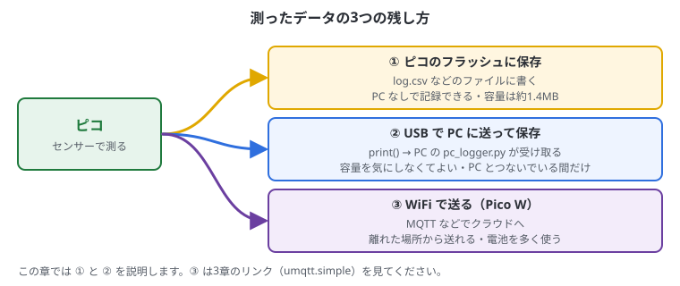
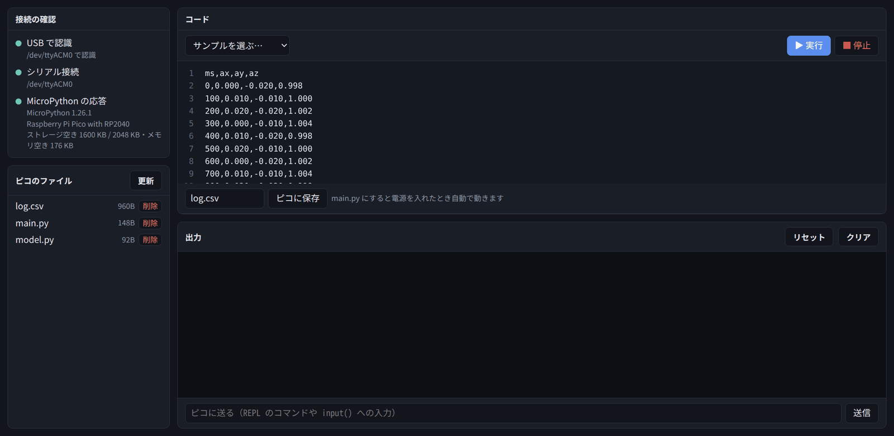

# 8. データの記録と送信

## この章でわかること

- 測ったデータの残し方（3つの方法の比べ方）
- ピコのフラッシュにデータを CSV で保存して、PC に持ってくる
- USB シリアルで PC にデータを送り、PC 側で保存する
- メモリと保存容量の注意点

## 方法の比較



| 方法 | 良いところ | 注意 |
| --- | --- | --- |
| ピコのフラッシュに保存 | PC がなくても記録できる | 容量が小さい（公式ピコで約1.4MB）。書き込み回数に寿命がある |
| USB で PC に送る | 容量を気にしなくてよい | PC とつないでいる間だけ |
| WiFi で送る（Pico W） | 離れた場所から送れる | 電池の消費が大きい |

**CSV** は、値をカンマ（`,`）で区切って1行ずつ並べたテキストファイルです。表計算ソフト（LibreOffice Calc、Excel など）や Python でそのまま読めます。

```text
ms,ax,ay,az
0,0.012,-0.020,0.998
100,0.010,-0.018,1.001
```

## ピコに CSV で保存する

MPU-6050（6・7章の配線）を使って、10秒間の加速度を `log.csv` に保存します。

```python run
from machine import Pin, I2C
import struct, time, os

ADDR = 0x68
i2c = I2C(0, sda=Pin(4), scl=Pin(5), freq=400000)
i2c.writeto_mem(ADDR, 0x6B, b"\x00")

FILE = "log.csv"
with open(FILE, "w") as f:
    f.write("ms,ax,ay,az\n")
    start = time.ticks_ms()
    for i in range(100):                       # 0.1秒ごとに10秒間
        ax, ay, az = struct.unpack(">hhh", i2c.readfrom_mem(ADDR, 0x3B, 6))
        t = time.ticks_diff(time.ticks_ms(), start)
        f.write("{},{:.3f},{:.3f},{:.3f}\n".format(t, ax / 16384, ay / 16384, az / 16384))
        time.sleep_ms(100)

print(FILE, "に保存しました:", os.stat(FILE)[6], "バイト")
s = os.statvfs("/")
print("残り容量:", s[0] * s[3] // 1024, "KB")
```

| コード | 意味 |
| --- | --- |
| `open(FILE, "w")` | ファイルを書き込み用に開く。`"w"` は上書き、`"a"` は最後に追加 |
| `with ... as f:` | ブロックが終わると自動でファイルを閉じる |
| `f.write("...\n")` | 1行書く。`\n` は改行 |
| `"{:.3f}".format(x)` | 小数点以下3けたの文字にする |
| `os.stat(FILE)[6]` | ファイルの大きさ（バイト） |
| `os.statvfs("/")` | 保存領域の大きさと空き |

### PC に持ってくる

1. 「ピコのファイル」の **「更新」** を押す
2. **log.csv** をクリックすると、中身がコード欄に開く



3. コード欄をクリックして、**Ctrl + A**（全部選ぶ）→ **Ctrl + C**（コピー）
4. PC のテキストエディタ（「テキストエディター」アプリなど）を開いて **Ctrl + V**（貼り付け）
5. `log.csv` という名前で保存する
6. LibreOffice Calc などで開くと、表やグラフにできる

> コード欄に開いた CSV を「▶ 実行」しないでください（Python のコードではないので、エラーになります）。
> 別のコードを書く前に、「サンプルを選ぶ」などでコード欄を戻しておくと安心です。

### 長時間記録するときのコツ

- 毎回 `open` / `close` するのではなく、開いたまま書き、ときどき `f.flush()` する
- 1行ずつではなく、ある程度まとめて書くとフラッシュの寿命にやさしい
- 容量が少なくなったら止める（`os.statvfs("/")` で残りを確認）
- 生データではなく、平均や判定結果など**まとめた値**を保存すると、何十倍も長く記録できる
- 電源が急に切れると、最後の数行が消えることがある

## USB で PC に送る

`print()` した内容は、USB シリアルで PC に届いています（Pico Studio の出力欄に出ているのも、これです）。
PC 側で Python のプログラムを動かせば、それを受け取ってファイルに保存できます。

### ピコ側

コードを **main.py** として「ピコに保存」すると、つないだだけで送り始めます。

```python run
from machine import Pin, I2C
import struct, time

ADDR = 0x68
i2c = I2C(0, sda=Pin(4), scl=Pin(5), freq=400000)
i2c.writeto_mem(ADDR, 0x6B, b"\x00")

start = time.ticks_ms()
while True:
    ax, ay, az = struct.unpack(">hhh", i2c.readfrom_mem(ADDR, 0x3B, 6))
    t = time.ticks_diff(time.ticks_ms(), start)
    print("{},{:.3f},{:.3f},{:.3f}".format(t, ax / 16384, ay / 16384, az / 16384))
    time.sleep_ms(50)
```

### PC 側（PC のターミナルで実行する）

> PC 側のプログラムはピコではなく **PC で** 動かします。
> 同じポートは1つのソフトしか使えないので、先に Pico Studio で **「切断」** してください。

```python
# pc_logger.py  ― 使い方: python3 pc_logger.py
import serial, time

PORT = "/dev/ttyACM0"
ser = serial.Serial(PORT, 115200, timeout=1)
ser.write(b"\x04")                    # ソフトリセットして main.py を動かす
time.sleep(1)
ser.reset_input_buffer()

name = time.strftime("log_%Y%m%d_%H%M%S.csv")
with open(name, "w") as f:
    f.write("ms,ax,ay,az\n")
    print(name, "に保存中... Ctrl+C で終了")
    try:
        while True:
            line = ser.readline().decode(errors="replace").strip()
            if line.count(",") == 3:
                f.write(line + "\n")
                print(line)
    except KeyboardInterrupt:
        pass
print("保存しました:", name)
```

### 手順

1. 上のピコ側のコードを **main.py** として「ピコに保存」する
2. Pico Studio で **「切断」** を押す
3. 「コピー」ボタンで PC 側のコードをコピーし、テキストエディタに貼り付けて `pc_logger.py` という名前で保存する（例: ホームフォルダ）
4. ターミナルで、保存した場所に移動して実行する

```bash
cd ~
python3 pc_logger.py
```

5. 画面に数字が流れ、`log_20261105_210000.csv` のような名前のファイルに保存されていく
6. 終わるときは **Ctrl + C**

- `pyserial` が必要です（`sudo apt install python3-serial`）。Pico Studio が動いていれば、すでに入っています
- 「ポートが使われている」というエラーが出たら、Pico Studio で「切断」したか確かめる
- 終わったら、Pico Studio で「更新」→「接続」で、またピコを操作できます

## メモリの注意

ピコの RAM は 264KB しかありません。MicroPython が使う分を引くと、自由に使えるのは **200KB 前後**です。

```python run
import gc
gc.collect()
print("空きメモリ:", gc.mem_free() // 1024, "KB")
```

- 大きなリストにデータを溜め続けると `MemoryError` になる
- 数値をたくさん持つときは、リストより `array.array("f")`（float の配列）の方が小さい
- 一定量たまったら保存・送信して、リストを空にする

> **RAM とフラッシュの違い**: RAM は動いている間の作業場所（約200KB、電源を切ると消える）。
> フラッシュはファイル置き場（約1.4MB、電源を切っても残る）。

## まとめ

- PC なしで記録するならフラッシュに CSV、長時間ならまとめた値を保存
- CSV は「ピコのファイル」で開いて、コピーして PC に貼り付ければ持ってこられる
- PC とつなぐなら `print()` → PC 側の pyserial で受け取って保存。先に Pico Studio で「切断」
- RAM は約200KB。データは溜めすぎず、こまめに書き出す
