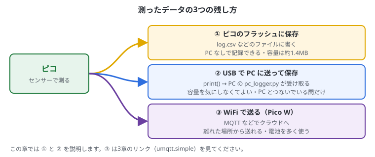
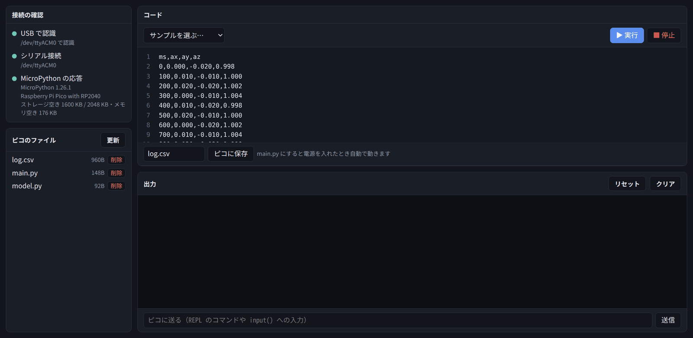

# 9. データの記録と送信

## この章でわかること

- 測ったデータの残し方（3つの方法の比べ方）
- ピコのフラッシュにデータを CSV で保存して、PC に持ってくる（C++ では、フラッシュに数値のまま保存する）
- USB シリアルで PC にデータを送り、PC 側で保存する
- メモリと保存容量の注意点

## 方法の比較



| 方法 | 良いところ | 注意 |
| --- | --- | --- |
| ピコのフラッシュに保存 | PC がなくても記録できる | 容量が小さい（公式ピコで約1.4MB）。書き込み回数に寿命がある |
| USB で PC に送る | 容量を気にしなくてよい | PC とつないでいる間だけ |
| WiFi で送る（Pico W） | 離れた場所から送れる | 電池の消費が大きい |

**CSV** は、値をカンマ（`,`）で区切って1行ずつ並べたテキストファイルです。表計算ソフト（LibreOffice Calc、Excel など）や Python でそのまま読めます。

```text
ms,ax,ay,az
0,0.012,-0.020,0.998
100,0.010,-0.018,1.001
```

<!-- python -->

## ピコに CSV で保存する

MPU-6050（6・7章の配線）を使って、10秒間の加速度を `log.csv` に保存します。

```python run
from machine import Pin, I2C
import struct, time, os

ADDR = 0x68
i2c = I2C(0, sda=Pin(4), scl=Pin(5), freq=400000)
i2c.writeto_mem(ADDR, 0x6B, b"\x00")

FILE = "log.csv"
with open(FILE, "w") as f:
    f.write("ms,ax,ay,az\n")
    start = time.ticks_ms()
    for i in range(100):                       # 0.1秒ごとに10秒間
        ax, ay, az = struct.unpack(">hhh", i2c.readfrom_mem(ADDR, 0x3B, 6))
        t = time.ticks_diff(time.ticks_ms(), start)
        f.write("{},{:.3f},{:.3f},{:.3f}\n".format(t, ax / 16384, ay / 16384, az / 16384))
        time.sleep_ms(100)

print(FILE, "に保存しました:", os.stat(FILE)[6], "バイト")
s = os.statvfs("/")
print("残り容量:", s[0] * s[3] // 1024, "KB")
```

| コード | 意味 |
| --- | --- |
| `open(FILE, "w")` | ファイルを書き込み用に開く。`"w"` は上書き、`"a"` は最後に追加 |
| `with ... as f:` | ブロックが終わると自動でファイルを閉じる |
| `f.write("...\n")` | 1行書く。`\n` は改行 |
| `"{:.3f}".format(x)` | 小数点以下3けたの文字にする |
| `os.stat(FILE)[6]` | ファイルの大きさ（バイト） |
| `os.statvfs("/")` | 保存領域の大きさと空き |

### PC に持ってくる

1. 「ピコのファイル」の **「更新」** を押す
2. **log.csv** をクリックすると、中身がコード欄に開く



3. コード欄をクリックして、**Ctrl + A**（全部選ぶ）→ **Ctrl + C**（コピー）
4. PC のテキストエディタ（「テキストエディター」アプリなど）を開いて **Ctrl + V**（貼り付け）
5. `log.csv` という名前で保存する
6. LibreOffice Calc などで開くと、表やグラフにできる

> コード欄に開いた CSV を「▶ 実行」しないでください（Python のコードではないので、エラーになります）。
> 別のコードを書く前に、「サンプルを選ぶ」などでコード欄を戻しておくと安心です。

### 長時間記録するときのコツ

- 毎回 `open` / `close` するのではなく、開いたまま書き、ときどき `f.flush()` する
- 1行ずつではなく、ある程度まとめて書くとフラッシュの寿命にやさしい
- 容量が少なくなったら止める（`os.statvfs("/")` で残りを確認）
- 生データではなく、平均や判定結果など**まとめた値**を保存すると、何十倍も長く記録できる
- 電源が急に切れると、最後の数行が消えることがある

<!-- /python -->
<!-- cpp -->

## ピコのフラッシュに保存する

C++ には、MicroPython のような「ファイル」のしくみがありません。代わりに、**フラッシュの決まった場所に、数値をそのまま書き込みます**。
CSV のような文字にするより小さく、ファイルのしくみがないぶん速く書けます。

フラッシュには、次の決まりがあります。

| 決まり | 内容 |
| --- | --- |
| 消す単位 | 4096 バイト（セクター）ずつ。消すと全部 `0xFF` になる |
| 書く単位 | 256 バイト（ページ）ずつ。消した場所にしか書けない |
| 寿命 | 1つのセクターを消せるのは、約10万回まで |
| 書いている間 | プログラムが止まる（割り込みも止める必要がある） |

ここでは、フラッシュの**最後の 256KB** を記録用に使います。プログラムは先頭から置かれるので、プログラムが大きくなっても重なりません（2MB のうち 1.75MB まではプログラムに使えます）。

### 記録する

MPU-6050（6・7章の配線）を使って、0.1秒ごとの加速度を記録します。1回分（1レコード）は 16バイトで、1ページに16個入ります。

```cpp run
#include <cstdio>
#include <cstring>
#include "pico/stdlib.h"
#include "hardware/flash.h"
#include "hardware/sync.h"
#include "mpu6050.h"

// 1回分の記録（16バイト）
struct Record {
    uint32_t ms;
    float ax, ay, az;
};

constexpr uint32_t LOG_SIZE = 256 * 1024;                          // 記録に使う大きさ
constexpr uint32_t LOG_OFFSET = PICO_FLASH_SIZE_BYTES - LOG_SIZE;  // フラッシュの最後の 256KB
constexpr int PER_PAGE = FLASH_PAGE_SIZE / sizeof(Record);        // 1ページに入る数（16）

Mpu6050 mpu(i2c0);

// 1ページ（256バイト）を書く。書いている間は割り込みを止める
void write_page(uint32_t offset, const Record* page) {
    uint32_t irq = save_and_disable_interrupts();
    flash_range_program(offset, reinterpret_cast<const uint8_t*>(page), FLASH_PAGE_SIZE);
    restore_interrupts(irq);
}

int main() {
    stdio_init_all();
    sleep_ms(1500);
    mpu.begin(4, 5);

    // 記録の場所を消す。4096 バイトずつ消して、そのたびに割り込みを戻す（USB が切れないように）
    for (uint32_t off = LOG_OFFSET; off < LOG_OFFSET + LOG_SIZE; off += FLASH_SECTOR_SIZE) {
        uint32_t irq = save_and_disable_interrupts();
        flash_range_erase(off, FLASH_SECTOR_SIZE);
        restore_interrupts(irq);
    }
    printf("記録を始めます（10秒）\n");

    Record page[PER_PAGE];
    int n = 0;
    uint32_t offset = LOG_OFFSET;
    uint32_t start = to_ms_since_boot(get_absolute_time());
    for (int i = 0; i < 100; i++) {                                // 0.1秒ごとに10秒間
        Record& r = page[n++];
        r.ms = to_ms_since_boot(get_absolute_time()) - start;
        mpu.read_accel(r.ax, r.ay, r.az);
        if (n == PER_PAGE) {                                       // 1ページたまったら書く
            write_page(offset, page);
            offset += FLASH_PAGE_SIZE;
            n = 0;
        }
        sleep_ms(100);
    }
    if (n > 0) {                                                   // 残りを書く（空きは 0xFF のまま）
        memset(&page[n], 0xFF, sizeof(Record) * (PER_PAGE - n));
        write_page(offset, page);
    }
    printf("記録しました: %d 回分\n", 100);
    while (true) sleep_ms(1000);
}
```

| コード | 意味 |
| --- | --- |
| `struct Record { ... };` | 1回分の記録の形。時刻と加速度3つ |
| `PICO_FLASH_SIZE_BYTES` | フラッシュの大きさ（公式ピコは 2MB）。ボードの設定で決まる |
| `flash_range_erase(場所, 大きさ)` | 消す。場所と大きさは 4096 の倍数 |
| `flash_range_program(場所, データ, 大きさ)` | 書く。大きさは 256 の倍数 |
| `save_and_disable_interrupts()` | 割り込みを止める。フラッシュを書いている間に、ほかの処理がフラッシュを読むと止まってしまうため。長く止めると USB が切れるので、少しずつ行う |

> 2つのコアを使っているときは、もう片方のコアも止める必要があります（`multicore_lockout`、16章）。

### PC に持ってくる

フラッシュの中身は、ピコのアドレス `XIP_BASE + 場所` から、普通のメモリのように読めます。読んで CSV の形で `printf` すれば、出力欄に CSV が出ます。

```cpp run
#include <cstdio>
#include "pico/stdlib.h"
#include "hardware/flash.h"

struct Record {
    uint32_t ms;
    float ax, ay, az;
};

constexpr uint32_t LOG_SIZE = 256 * 1024;
constexpr uint32_t LOG_OFFSET = PICO_FLASH_SIZE_BYTES - LOG_SIZE;

int main() {
    stdio_init_all();
    sleep_ms(2000);
    auto* records = reinterpret_cast<const Record*>(XIP_BASE + LOG_OFFSET);   // フラッシュをそのまま読む
    int count = LOG_SIZE / sizeof(Record);

    printf("ms,ax,ay,az\n");
    for (int i = 0; i < count; i++) {
        if (records[i].ms == 0xFFFFFFFF) break;                   // 消したままの場所 = 記録の終わり
        printf("%u,%.3f,%.3f,%.3f\n", static_cast<unsigned>(records[i].ms),
               records[i].ax, records[i].ay, records[i].az);
    }
    printf("おわり\n");
    while (true) sleep_ms(1000);
}
```

1. 上のコードを「▶ ビルドして書き込む」。出力欄に CSV が出る
2. 出力欄の `ms,ax,ay,az` から `おわり` の前までを選んでコピーし、テキストエディタに貼り付けて `log.csv` として保存する
3. LibreOffice Calc などで開くと、表やグラフにできる

> 記録用のプログラムを書き込み直すと、最初に記録の場所を消すので、前の記録は消えます。

### 長時間記録するときのコツ

- 1ページ（256バイト）たまってから書く。1回分ずつ書くことはできない
- 電源を入れるたびに全部を消すのではなく、「どこまで書いたか」を最初に探して（`0xFF` の場所）、続きから書く
- 生データではなく、平均や判定結果など**まとめた値**を保存すると、何十倍も長く記録できる
- 電源が急に切れると、書いている途中のページは消える。たまる前の分も失う
- 決まった形の記録がたくさん要るなら、SD カード（SPI）を使う方法もある

<!-- /cpp -->

## USB で PC に送る

<!-- python -->

`print()` した内容は、USB シリアルで PC に届いています（Pico Studio の出力欄に出ているのも、これです）。
PC 側で Python のプログラムを動かせば、それを受け取ってファイルに保存できます。

### ピコ側

コードを **main.py** として「ピコに保存」すると、つないだだけで送り始めます。

```python run
from machine import Pin, I2C
import struct, time

ADDR = 0x68
i2c = I2C(0, sda=Pin(4), scl=Pin(5), freq=400000)
i2c.writeto_mem(ADDR, 0x6B, b"\x00")

start = time.ticks_ms()
while True:
    ax, ay, az = struct.unpack(">hhh", i2c.readfrom_mem(ADDR, 0x3B, 6))
    t = time.ticks_diff(time.ticks_ms(), start)
    print("{},{:.3f},{:.3f},{:.3f}".format(t, ax / 16384, ay / 16384, az / 16384))
    time.sleep_ms(50)
```

<!-- /python -->
<!-- cpp -->

`printf()` した内容は、USB シリアルで PC に届いています（Pico Studio の出力欄に出ているのも、これです）。
PC 側で Python のプログラムを動かせば、それを受け取ってファイルに保存できます。

### ピコ側

書き込んだプログラムは電源を入れると動くので、つないだだけで送り始めます。

```cpp run
#include <cstdio>
#include "pico/stdlib.h"
#include "mpu6050.h"

Mpu6050 mpu(i2c0);

int main() {
    stdio_init_all();
    mpu.begin(4, 5);

    uint32_t start = to_ms_since_boot(get_absolute_time());
    absolute_time_t next = get_absolute_time();
    while (true) {
        float ax, ay, az;
        if (mpu.read_accel(ax, ay, az)) {
            unsigned t = to_ms_since_boot(get_absolute_time()) - start;
            printf("%u,%.3f,%.3f,%.3f\n", t, ax, ay, az);
        }
        next = delayed_by_ms(next, 50);
        sleep_until(next);
    }
}
```

<!-- /cpp -->

### PC 側（PC のターミナルで実行する）

> PC 側のプログラムはピコではなく **PC で** 動かします。
> 同じポートは1つのソフトしか使えないので、先に Pico Studio で **「切断」** してください。

```python
# pc_logger.py  ― 使い方: python3 pc_logger.py
import serial, time

PORT = "/dev/ttyACM0"
ser = serial.Serial(PORT, 115200, timeout=1)
ser.write(b"\x04")                    # ソフトリセットして main.py を動かす
time.sleep(1)
ser.reset_input_buffer()

name = time.strftime("log_%Y%m%d_%H%M%S.csv")
with open(name, "w") as f:
    f.write("ms,ax,ay,az\n")
    print(name, "に保存中... Ctrl+C で終了")
    try:
        while True:
            line = ser.readline().decode(errors="replace").strip()
            if line.count(",") == 3:
                f.write(line + "\n")
                print(line)
    except KeyboardInterrupt:
        pass
print("保存しました:", name)
```

### 手順

1. 上のピコ側のコードを、Python なら **main.py** として「ピコに保存」、C++ なら「▶ ビルドして書き込む」
2. Pico Studio で **「切断」** を押す
3. 「コピー」ボタンで PC 側のコードをコピーし、テキストエディタに貼り付けて `pc_logger.py` という名前で保存する（例: ホームフォルダ）
4. ターミナルで、保存した場所に移動して実行する

```bash
cd ~
python3 pc_logger.py
```

5. 画面に数字が流れ、`log_20261105_210000.csv` のような名前のファイルに保存されていく
6. 終わるときは **Ctrl + C**

- `pyserial` が必要です（`sudo apt install python3-serial`）。Pico Studio が動いていれば、すでに入っています
- 「ポートが使われている」というエラーが出たら、Pico Studio で「切断」したか確かめる
- 終わったら、Pico Studio で「更新」→「接続」で、またピコを操作できます

## メモリの注意

<!-- python -->

ピコの RAM は 264KB しかありません。MicroPython が使う分を引くと、自由に使えるのは **200KB 前後**です。

```python run
import gc
gc.collect()
print("空きメモリ:", gc.mem_free() // 1024, "KB")
```

- 大きなリストにデータを溜め続けると `MemoryError` になる
- 数値をたくさん持つときは、リストより `array.array("f")`（float の配列）の方が小さい
- 一定量たまったら保存・送信して、リストを空にする

> **RAM とフラッシュの違い**: RAM は動いている間の作業場所（約200KB、電源を切ると消える）。
> フラッシュはファイル置き場（約1.4MB、電源を切っても残る）。

<!-- /python -->
<!-- cpp -->

ピコの RAM は 264KB です。C++ では MicroPython が使う分がないので、ほとんどを自分のプログラムで使えます。
ビルドの最後に、プログラムが使うメモリの大きさを確かめられます。

| 置き場所 | 何が入るか | 注意 |
| --- | --- | --- |
| 静的（関数の外の変数、`static`） | 大きな配列、センサーのクラス | 大きさがビルドのときに決まる。**大きなデータはここに置く** |
| スタック（関数の中の変数） | 一時的な変数 | 2KB〜4KB と小さい。関数の中に大きな配列を作ると、こわれる（あふれる） |
| ヒープ（`new`、`std::vector`） | あとで大きさが決まるもの | 使ったり返したりをくり返すと、すき間ができて足りなくなる。長く動かすなら避ける |

```cpp
float samples[2000];          // 関数の外: 静的。8KB でも大丈夫

void measure() {
    float tmp[2000];          // 関数の中: スタックがあふれる。やらない
    static float buf[2000];   // static を付ければ静的になる
}
```

- データの数は、最初に大きさを決めた配列（`float samples[N]`）で持つ
- 一定量たまったら保存・送信して、最初から使い直す（リングバッファ、16章）

> **RAM とフラッシュの違い**: RAM は動いている間の作業場所（264KB、電源を切ると消える）。
> フラッシュはプログラムと記録の置き場（2MB、電源を切っても残る）。

<!-- /cpp -->

## まとめ

<!-- python -->

- PC なしで記録するならフラッシュに CSV、長時間ならまとめた値を保存
- CSV は「ピコのファイル」で開いて、コピーして PC に貼り付ければ持ってこられる
- PC とつなぐなら `print()` → PC 側の pyserial で受け取って保存。先に Pico Studio で「切断」
- RAM は約200KB。データは溜めすぎず、こまめに書き出す

<!-- /python -->
<!-- cpp -->

- C++ ではフラッシュの最後の領域に、数値のまま書く。消すのは 4096 バイト、書くのは 256 バイトずつ
- 記録は `printf` で CSV にして出力欄からコピーすれば、PC に持ってこられる
- PC とつなぐなら `printf` → PC 側の pyserial で受け取って保存。先に Pico Studio で「切断」
- 大きな配列は関数の外（静的）に置く。`new` はなるべく使わない

<!-- /cpp -->
