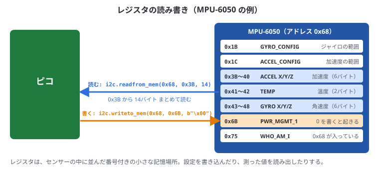
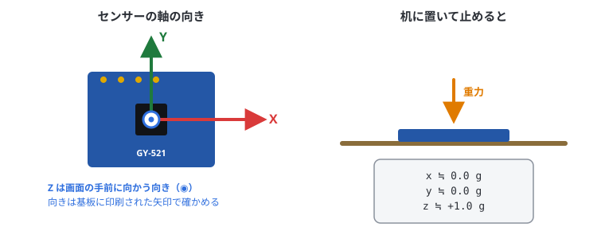
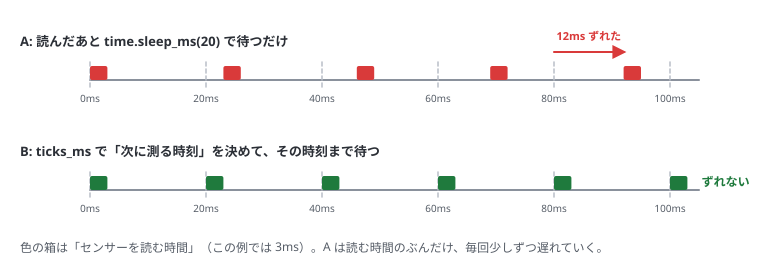

# 9. センサーを読む

## この章でわかること

- I2C でセンサーのレジスタを読み書きする方法
- 読んだバイト列を数値に変える方法
- MPU-6050 で加速度と角速度を読む
- BMP280 で気圧と温度を読む
- 決まった間隔でデータを取る方法

8章の配線と I2C スキャンが済んでいることが前提です。

> この章のプログラムは I2C を使います。`CMakeLists.txt` の `target_link_libraries` に `hardware_i2c` を足してからビルドします（4章）。

## レジスタとは

センサーの中には **レジスタ** という小さな記憶場所が並んでいて、それぞれに番号（アドレス）があります。
ロッカーのようなもので、何番のロッカーに何が入っているかは、センサーのデータシート（説明書）に書いてあります。

- 設定用のレジスタに書き込む → センサーの動き方を変える
- データ用のレジスタを読む → 測った値がわかる



C++ では、`i2c_write_blocking`（送る）と `i2c_read_blocking`（読む）を組み合わせて、レジスタを読み書きします。

```cpp
// 書く: レジスタの番号と値を続けて送る
uint8_t buf[2] = {レジスタ番号, 値};
i2c_write_blocking(i2c0, センサーのアドレス, buf, 2, false);

// 読む: 番号を送ってから（true = 通信を切らずに続ける）、続けて読む
uint8_t reg = レジスタ番号;
uint8_t data[6];
i2c_write_blocking(i2c0, センサーのアドレス, &reg, 1, true);
i2c_read_blocking(i2c0, センサーのアドレス, data, 6, false);
```

### バイト列を数値に変える

センサーから読んだ値は **バイト**（0〜255 の数、`uint8_t`）が並んだものです。
加速度のような値は、2バイトで1つの数（−32768〜32767、`int16_t`）を表しています。
C++ では、ビットをずらして（`<<`）つなげます。

```cpp
uint8_t hi = 0x40, lo = 0x00;                       // センサーから読んだ2バイト
int16_t v = static_cast<int16_t>((hi << 8) | lo);   // → 16384
```

| 書き方 | 意味 |
| --- | --- |
| `hi << 8` | `hi` を8ビット（1バイト）左にずらす。`0x40` → `0x4000` |
| `\|` | ビットを重ねる（OR）。`0x4000 \| 0x00` → `0x4000` |
| `static_cast<int16_t>(...)` | 0〜65535 の数を、符号付き（−32768〜32767）として読み直す |
| 大きい桁が先（ビッグエンディアン） | `(d[0] << 8) \| d[1]`。MPU-6050 はこれ |
| 小さい桁が先（リトルエンディアン） | `(d[1] << 8) \| d[0]`。BMP280 の補正係数はこれ |

## MPU-6050（加速度・ジャイロ）

**加速度** は「どの向きにどれだけ引っぱられているか」、**角速度（ジャイロ）** は「どれだけ速く回っているか」です。
止まっていても重力がかかるので、加速度センサーで「どちらが下か」（傾き）もわかります。

### センサーの軸



- 単位は **g**（重力の大きさ = 1g）
- 机に置いて止めると、真下に重力がかかるので **z ≒ +1.0g**、x・y ≒ 0 になる
- 傾けると、重力が x や y にも分かれて出てくる

### 主なレジスタ

| レジスタ | 番号 | 内容 |
| --- | --- | --- |
| PWR_MGMT_1 | 0x6B | 0 を書くとスリープから起きる。**電源を入れた直後は寝ている** |
| GYRO_CONFIG | 0x1B | ジャイロの範囲（0 = ±250°/s） |
| ACCEL_CONFIG | 0x1C | 加速度の範囲（0 = ±2g） |
| ACCEL_XOUT_H 〜 | 0x3B〜0x48 | 加速度XYZ・温度・ジャイロXYZ（各2バイト、ビッグエンディアン） |
| WHO_AM_I | 0x75 | 0x68 が返ってくれば MPU-6050 |

### 読み取りのコード

読み取りの部分は、このあとの章でも使うので **クラス**（`Mpu6050`）にまとめて、`mpu6050.h` という別のファイルにしてあります。
Pico Studio のフォルダに入っているので、プロジェクトのフォルダにコピーして使います。

```bash
cp ~/apps/pico-studio/cpp/include/mpu6050.h ~/apps/プロジェクト名/
```

あとは `#include "mpu6050.h"` と書くだけです。`CMakeLists.txt` には `hardware_i2c` を足しておきます（4章）。

```cpp run
#include <cstdio>
#include "pico/stdlib.h"
#include "mpu6050.h"

Mpu6050 mpu(i2c0);                     // I2C0 につないだ MPU-6050

int main() {
    stdio_init_all();
    sleep_ms(1500);
    if (!mpu.begin(4, 5)) {            // SDA=GP4, SCL=GP5。スリープ解除と範囲の設定もする
        printf("MPU-6050 が見つかりません。配線を確かめてください\n");
    }
    printf("WHO_AM_I: 0x%02x\n", mpu.who_am_i());

    for (int i = 0; i < 20; i++) {
        float acc[3], gyro[3], temp;
        if (mpu.read_all(acc, gyro, temp)) {
            printf("加速度[g] x=%+.2f y=%+.2f z=%+.2f  角速度[deg/s] x=%+6.1f y=%+6.1f z=%+6.1f\n",
                   acc[0], acc[1], acc[2], gyro[0], gyro[1], gyro[2]);
        }
        sleep_ms(200);
    }
    while (true) sleep_ms(1000);
}
```

机に置いたまま動かすと、次のように出ます（数値は少しずつ違います）。

```text
WHO_AM_I: 0x68
加速度[g] x=+0.02 y=-0.01 z=+1.01  角速度[deg/s] x=  -1.2 y=  +0.8 z=  +0.3
加速度[g] x=+0.02 y=-0.02 z=+1.00  角速度[deg/s] x=  -1.1 y=  +0.9 z=  +0.2
```

### mpu6050.h の中身

クラスの中で、上の「レジスタとは」の読み書きをしています。主なところを抜き出します（全体は `~/apps/pico-studio/cpp/include/mpu6050.h`）。

```cpp
class Mpu6050 {
public:
    explicit Mpu6050(i2c_inst_t* i2c, uint8_t addr = 0x68) : i2c_(i2c), addr_(addr) {}

    bool begin(uint sda, uint scl, uint baud = 400 * 1000) {
        i2c_init(i2c_, baud);
        gpio_set_function(sda, GPIO_FUNC_I2C);
        gpio_set_function(scl, GPIO_FUNC_I2C);
        gpio_pull_up(sda);
        gpio_pull_up(scl);
        bool ok = write_reg(0x6B, 0x00)      // スリープ解除
               && write_reg(0x1C, 0x00)      // 加速度 ±2g     → 16384 = 1g
               && write_reg(0x1B, 0x00);     // ジャイロ ±250°/s → 131 = 1°/s
        sleep_ms(100);
        return ok;
    }

    bool read_all(float acc[3], float gyro[3], float& temp) {
        uint8_t d[14];
        if (!read_regs(0x3B, d, 14)) return false;      // 0x3B から14バイトまとめて読む
        for (int i = 0; i < 3; i++) {
            acc[i] = to_i16(d[i * 2], d[i * 2 + 1]) / 16384.0f;
            gyro[i] = to_i16(d[8 + i * 2], d[9 + i * 2]) / 131.0f;
        }
        temp = to_i16(d[6], d[7]) / 340.0f + 36.53f;
        return true;
    }
    // ……（read_accel、who_am_i、write_reg、read_regs、to_i16）
};
```

| コード | 意味 |
| --- | --- |
| `class Mpu6050 { ... };` | センサーを操作する関数と、使う I2C・アドレスをひとまとめにしたもの |
| `Mpu6050 mpu(i2c0);` | クラスから実物（オブジェクト）を作る。`mpu.begin(...)` のように使う |
| `bool` | 正しく読めたら `true`、だめなら `false` を返す。C++ の SDK はエラーで止まらないので、戻り値で確かめる |
| `float& temp` | `&` は「呼んだ側の変数をそのまま書き換える」という意味。結果を返す入れ物として使う |
| `/ 16384.0f` | ±2g の設定では、16384 が 1g にあたる |
| `/ 131.0f` | ±250°/s の設定では、131 が 1°/s にあたる |

- 止まっていても角速度が ±数°/s 出るのは、センサーのくせ（オフセット）です
- センサーを傾けたり振ったりして、値が変わるのを確かめましょう

## BMP280（気圧・温度）

BMP280 は、読んだ生の値を**補正計算**して、はじめて正しい気圧・温度になります。
補正に使う係数（キャリブレーション値）は、センサーごとに工場で書き込まれています。

### 主なレジスタ

| レジスタ | 番号 | 内容 |
| --- | --- | --- |
| id | 0xD0 | 0x58 なら BMP280（0x60 なら BME280） |
| calib | 0x88〜0x9F | 補正係数（24バイト） |
| ctrl_meas | 0xF4 | 測定の設定 |
| config | 0xF5 | フィルターなどの設定 |
| press / temp | 0xF7〜0xFC | 生の気圧・温度（各20ビット） |

### 読み取りのコード

```cpp run
#include <cmath>
#include <cstdio>
#include "pico/stdlib.h"
#include "hardware/i2c.h"

constexpr uint8_t ADDR = 0x76;         // 見つからなければ 0x77 にする

// 補正係数（T1 と P1 は符号なし、ほかは符号あり）
uint16_t T1, P1;
int16_t T2, T3, P2, P3, P4, P5, P6, P7, P8, P9;

bool write_reg(uint8_t reg, uint8_t value) {
    uint8_t buf[2] = {reg, value};
    return i2c_write_blocking(i2c0, ADDR, buf, 2, false) == 2;
}

bool read_regs(uint8_t reg, uint8_t* dst, size_t len) {
    if (i2c_write_blocking(i2c0, ADDR, &reg, 1, true) != 1) return false;
    return i2c_read_blocking(i2c0, ADDR, dst, len, false) == static_cast<int>(len);
}

// 小さい桁が先の2バイト
uint16_t u16le(const uint8_t* p) { return static_cast<uint16_t>(p[0] | (p[1] << 8)); }
int16_t s16le(const uint8_t* p) { return static_cast<int16_t>(u16le(p)); }

void read_calibration() {
    uint8_t c[24];
    read_regs(0x88, c, 24);
    T1 = u16le(c + 0);  T2 = s16le(c + 2);  T3 = s16le(c + 4);
    P1 = u16le(c + 6);  P2 = s16le(c + 8);  P3 = s16le(c + 10);
    P4 = s16le(c + 12); P5 = s16le(c + 14); P6 = s16le(c + 16);
    P7 = s16le(c + 18); P8 = s16le(c + 20); P9 = s16le(c + 22);
}

// 温度[℃]と気圧[Pa]を読む（データシートの計算式）
bool read_bmp(float& temp, float& pa) {
    uint8_t d[6];
    if (!read_regs(0xF7, d, 6)) return false;
    int32_t adc_p = (d[0] << 12) | (d[1] << 4) | (d[2] >> 4);
    int32_t adc_t = (d[3] << 12) | (d[4] << 4) | (d[5] >> 4);

    double v1 = (adc_t / 16384.0 - T1 / 1024.0) * T2;
    double v2 = (adc_t / 131072.0 - T1 / 8192.0) * (adc_t / 131072.0 - T1 / 8192.0) * T3;
    double t_fine = v1 + v2;
    temp = static_cast<float>(t_fine / 5120.0);

    v1 = t_fine / 2.0 - 64000.0;
    v2 = v1 * v1 * P6 / 32768.0 + v1 * P5 * 2.0;
    v2 = v2 / 4.0 + P4 * 65536.0;
    v1 = (P3 * v1 * v1 / 524288.0 + P2 * v1) / 524288.0;
    v1 = (1.0 + v1 / 32768.0) * P1;
    if (v1 == 0) { pa = 0; return true; }
    double p = 1048576.0 - adc_p;
    p = (p - v2 / 4096.0) * 6250.0 / v1;
    v1 = P9 * p * p / 2147483648.0;
    v2 = p * P8 / 32768.0;
    pa = static_cast<float>(p + (v1 + v2 + P7) / 16.0);
    return true;
}

int main() {
    stdio_init_all();
    sleep_ms(1500);
    i2c_init(i2c0, 400 * 1000);
    gpio_set_function(4, GPIO_FUNC_I2C);
    gpio_set_function(5, GPIO_FUNC_I2C);
    gpio_pull_up(4);
    gpio_pull_up(5);

    uint8_t id = 0;
    read_regs(0xD0, &id, 1);
    printf("chip id: 0x%02x\n", id);

    read_calibration();
    write_reg(0xF5, 0x10);             // IIR フィルター x16（値のふらつきを減らす）
    write_reg(0xF4, 0x57);             // 温度 x2、気圧 x16 オーバーサンプリング、連続測定
    sleep_ms(100);

    while (true) {
        float temp, pa;
        if (read_bmp(temp, pa)) {
            float alt = 44330.0f * (1.0f - powf(pa / 101325.0f, 1.0f / 5.255f));   // 気圧から計算したおおよその標高
            printf("温度 %.2f C  気圧 %.2f hPa  標高(目安) %.1f m\n", temp, pa / 100, alt);
        }
        sleep_ms(500);
    }
}
```

書き込むと、次のように出ます。

```text
chip id: 0x58
温度 24.31 C  気圧 1008.52 hPa  標高(目安) 39.4 m
温度 24.32 C  気圧 1008.51 hPa  標高(目安) 39.5 m
```

- 補正の計算式は難しく見えますが、データシートの式をそのまま書き写したものです。中身を理解しなくても使えます
- この計算は、けたが大きく誤差が出やすいので `double` を使っています。ピコでは `double` の計算は遅いですが、0.5秒に1回なら問題ありません。速くしたいときは、データシートにある整数だけの計算式を使います
- 気圧は 1m 高くなると約 **0.12hPa** 下がる。これを使うと、センサーを上げ下げしたことがわかる
- 標高の絶対値は天気で変わるので、**変化量**を見るのに使う（例: 牛が頭を下げた・立ち上がった）

> センサーを手で持って、床から机の上まで上げ下げしてみましょう。標高の値が 1m 前後変わるはずです。

## 決まった間隔でデータを取る

機械学習（14章）では、「1秒に25回」のように、**決まった間隔**でデータを取ることが大切です。
`time.sleep(0.02)` だけだと、読み取りにかかる時間のぶん間隔がずれます。



C++ では、`delayed_by_ms` で次に測る時刻を決めて、`sleep_until` でその時刻まで待ちます（図の B）。

```cpp run
#include <cstdio>
#include "pico/stdlib.h"
#include "mpu6050.h"

constexpr int HZ = 50;                 // 1秒に50回
constexpr int INTERVAL_MS = 1000 / HZ; // 20ms ごと

Mpu6050 mpu(i2c0);

int main() {
    stdio_init_all();
    sleep_ms(1500);
    mpu.begin(4, 5);

    absolute_time_t next = get_absolute_time();
    for (int n = 0; n < HZ * 3; n++) {             // 3秒分
        float ax, ay, az;
        mpu.read_accel(ax, ay, az);
        if (n % 10 == 0) {
            printf("%u %.3f %.3f %.3f\n", static_cast<unsigned>(to_ms_since_boot(get_absolute_time())), ax, ay, az);
        }
        next = delayed_by_ms(next, INTERVAL_MS);   // 次に測る時刻
        sleep_until(next);                         // その時刻まで待つ
    }
    printf("3秒で %d 回測りました\n", HZ * 3);
    while (true) sleep_ms(1000);
}
```

- `get_absolute_time()` は、ピコが起動してからの時刻。`to_ms_since_boot` でミリ秒の数にできる
- `sleep_until` は、読み取りや `printf` にかかった時間を差し引いて待つので、間隔がずれない
- 表示（`printf`）は時間がかかるので、10回に1回だけにしている
- C++ なら 500Hz くらいまでこの書き方で間に合う。もっと正確にしたいときは、タイマー割り込みを使う（12章）

どのセンサーを買うかは、次の10章にまとめてあります。

## まとめ

- センサーはレジスタを読み書きして操作する。C++ は `i2c_write_blocking` で番号を送り、`i2c_read_blocking` で読む
- 2バイトの値は `(hi << 8) | lo` でつなげて `int16_t` にする
- MPU-6050: 0x6B に 0 を書いて起こし、0x3B から14バイト読む。`mpu6050.h` のクラスで使える
- BMP280: 補正係数を読んで、データシートの式で計算する。高さの変化がわかる
- 一定間隔のサンプリングは `delayed_by_ms` と `sleep_until`

