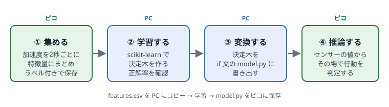
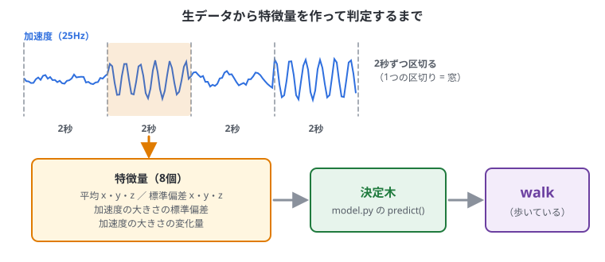
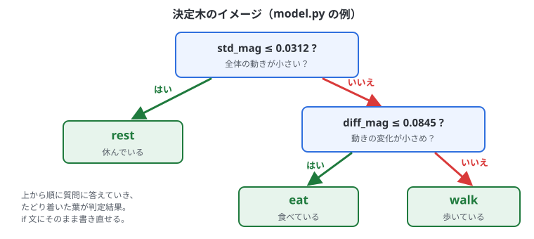

# 10. 機械学習モデルの導入

## この章でわかること

- マイコンで機械学習を動かすときの考え方（TinyML）
- センサーデータから「特徴量」を作る
- データを集めて、PC で学習する
- 学習した決定木を、ピコで動く Python コードに変換して判定する
- もっと大きなモデルを使いたいときの選択肢

6〜9章（MPU-6050 の配線と読み取り、ファイルの保存）が済んでいることが前提です。

## 全体の流れ



1. **集める**: ピコでセンサーのデータを取り、行動の名前（ラベル）を付けて保存する
2. **学習する**: PC で scikit-learn を使ってモデルを作る
3. **変換する**: 学習したモデルを、ピコで動くコードに変換する
4. **推論する**: ピコの上でモデルを動かして、その場で判定する

**学習は PC、推論（判定）だけをマイコン** で行うのが基本です。
ピコの RAM は約200KB しかないので、学習そのものはできませんが、小さなモデルで判定するだけなら十分に動きます。

### 言葉の説明

| 言葉 | 意味 |
| --- | --- |
| ラベル | データに付ける「正解の名前」。例: rest（休む）、walk（歩く）、eat（食べる） |
| 特徴量 | 生データの特徴をまとめた数値。例: 2秒間の平均、ばらつき |
| 窓 | データを区切る単位。この章では2秒 |
| 学習 | データとラベルの組から、判定のルールを作ること |
| 推論 | 作ったルールで、新しいデータのラベルを当てること |
| モデル | 学習で作った判定のルール |

## 生データではなく「特徴量」を使う

加速度を 25Hz で 2秒測ると、3軸 × 50回 = 150個の数値になります。
これをそのままモデルに入れるより、**特徴をよく表す少ない数値（特徴量）** にまとめた方が、小さく正確なモデルになります。



| 特徴量 | 何がわかるか |
| --- | --- |
| 各軸の平均 | 首の向き（頭を上げている・下げている） |
| 各軸の標準偏差 | 各方向の動きの大きさ |
| 加速度の大きさの標準偏差 | 全体の動きの激しさ（歩行は大きい、休息は小さい） |
| 加速度の大きさの変化量の平均 | 細かく速い動き（咀嚼・反芻） |

この例では、2秒ごとに次の **8個** の特徴量を作ります。
`mean_x, mean_y, mean_z, std_x, std_y, std_z, std_mag, diff_mag`

> **標準偏差** は「値がどれくらいばらついているか」です。じっとしていると小さく、激しく動くと大きくなります。

## ステップ1: データを集める（ピコ）

`LABEL` を行動の名前にして実行し、その行動をしている間データを取ります。
ラベルを変えて何回か実行すると、`features.csv` にどんどん追加されます。

```python run
from machine import Pin, I2C
import struct, time, math

LABEL = "rest"        # ← 行動の名前。walk / eat / rest など、変えながら何回か実行する
WINDOWS = 30          # 2秒 × 30回 = 1分間集める
HZ = 25
N = HZ * 2            # 1つの窓のサンプル数

ADDR = 0x68
i2c = I2C(0, sda=Pin(4), scl=Pin(5), freq=400000)
i2c.writeto_mem(ADDR, 0x6B, b"\x00")

def features(xs, ys, zs):
    n = len(xs)
    def mean(a): return sum(a) / n
    def std(a, m): return math.sqrt(sum((v - m) ** 2 for v in a) / n)
    mx, my, mz = mean(xs), mean(ys), mean(zs)
    mag = [math.sqrt(x * x + y * y + z * z) for x, y, z in zip(xs, ys, zs)]
    mm = mean(mag)
    diff = sum(abs(mag[i] - mag[i - 1]) for i in range(1, n)) / (n - 1)
    return [mx, my, mz, std(xs, mx), std(ys, my), std(zs, mz), std(mag, mm), diff]

def window():
    xs, ys, zs = [], [], []
    next_t = time.ticks_ms()
    for _ in range(N):
        ax, ay, az = struct.unpack(">hhh", i2c.readfrom_mem(ADDR, 0x3B, 6))
        xs.append(ax / 16384); ys.append(ay / 16384); zs.append(az / 16384)
        next_t = time.ticks_add(next_t, 1000 // HZ)
        w = time.ticks_diff(next_t, time.ticks_ms())
        if w > 0:
            time.sleep_ms(w)
    return xs, ys, zs

with open("features.csv", "a") as f:
    for i in range(WINDOWS):
        fe = features(*window())
        f.write(",".join("{:.4f}".format(v) for v in fe) + "," + LABEL + "\n")
        print(i + 1, "/", WINDOWS, LABEL, ["{:.2f}".format(v) for v in fe])
print("features.csv に追加しました")
```

### 練習のしかた（牛がいなくても試せる）

センサーを手に持って、自分で動きをまねしてデータを集めてみましょう。

| LABEL | やること |
| --- | --- |
| `rest` | センサーを机に置いて、動かさない |
| `walk` | センサーを持って、ゆっくり歩く（または手で上下に大きく揺らす） |
| `eat` | センサーを持った手を、小さく速く左右に動かす |

1. `LABEL = "rest"` にして「▶ 実行」。1分間、動かさずに待つ
2. `LABEL = "walk"` に書き換えて「▶ 実行」。1分間、歩く動きをする
3. `LABEL = "eat"` に書き換えて「▶ 実行」。1分間、小さく速い動きをする
4. 「ピコのファイル」の「更新」を押すと、**features.csv** が出てくる

集め終わったら、「ピコのファイル」で **features.csv** を開き、中身をコピーして PC に `features.csv` として保存します（手順は9章の「PC に持ってくる」と同じ）。

> **実際の牛のデータでは**: 首輪にセンサーを付けて記録しながら、同じ時間の動画を撮っておき、あとで動画を見て「この2秒は採食」とラベルを付けるのが一般的です。
> 1つの行動につき、少なくとも数十〜数百個の窓を集めると安定します。

> やり直したいときは、「ピコのファイル」で features.csv を「削除」してから集め直します（`"a"` で開いているので、消さない限り追加され続けます）。

## ステップ2: PC で学習する

ここからは **PC で** 動かします。scikit-learn が必要です。

```bash
sudo apt install python3-sklearn
```

決定木（Decision Tree）は、「もし std_mag が 0.05 以下なら…」という **if 文の組み合わせ** で判定するモデルです。
計算が軽く、if 文にそのまま変換できるので、マイコンにとても向いています。



```python
# train.py  ― 使い方: python3 train.py
import csv
from sklearn.tree import DecisionTreeClassifier
from sklearn.model_selection import train_test_split
from sklearn.metrics import classification_report

NAMES = ["mean_x", "mean_y", "mean_z", "std_x", "std_y", "std_z", "std_mag", "diff_mag"]

X, y = [], []
with open("features.csv") as f:
    for row in csv.reader(f):
        if len(row) == 9:
            X.append([float(v) for v in row[:8]])
            y.append(row[8])

X_train, X_test, y_train, y_test = train_test_split(
    X, y, test_size=0.3, random_state=0, stratify=y)

clf = DecisionTreeClassifier(max_depth=4, random_state=0)   # 深さを制限して小さく保つ
clf.fit(X_train, y_train)
print(classification_report(y_test, clf.predict(X_test)))


def export(clf, names):
    """決定木を MicroPython の if 文に変換する"""
    t = clf.tree_
    lines = ["# train.py で自動生成した決定木", "def predict(f):"]

    def walk(node, depth):
        pad = "    " * depth
        if t.feature[node] >= 0:                      # 分岐のノード
            i = t.feature[node]
            lines.append(f"{pad}if f[{i}] <= {t.threshold[node]:.6f}:  # {names[i]}")
            walk(t.children_left[node], depth + 1)
            lines.append(f"{pad}else:")
            walk(t.children_right[node], depth + 1)
        else:                                         # 葉（判定結果）
            label = clf.classes_[t.value[node][0].argmax()]
            lines.append(f"{pad}return {str(label)!r}")

    walk(0, 1)
    return "\n".join(lines) + "\n"


with open("model.py", "w") as f:
    f.write(export(clf, NAMES))
print("model.py を作りました")
```

> コードの中の関数名や引数名（`train_test_split`、`stratify`、`max_depth` など）をクリックすると、意味が出ます（0章）。

### 手順

1. 「コピー」ボタンで上のコードをコピーし、`features.csv` と同じフォルダに `train.py` として保存する
2. ターミナルでそのフォルダに移動して、`python3 train.py` を打つ
3. 成績表が表示され、同じフォルダに `model.py` ができる

### 成績表の読み方

```text
              precision    recall  f1-score   support

         eat       0.89      0.89      0.89         9
        rest       1.00      1.00      1.00         9
        walk       0.89      0.89      0.89         9

    accuracy                           0.93        27
```

| 項目 | 意味 |
| --- | --- |
| precision | 「eat」と判定したもののうち、本当に eat だった割合 |
| recall | 本当の eat のうち、ちゃんと eat と判定できた割合 |
| f1-score | precision と recall のバランス。1.00 が満点 |
| support | テストに使ったデータの数 |
| accuracy | 全体の正解率 |

- 学習に使っていないデータ（全体の30%）で成績を測っています
- 正解率が低いときは、データを増やす・特徴量を増やす・`max_depth` を変える

できた `model.py` は、たとえばこんな中身になります。

```python
def predict(f):
    if f[6] <= 0.031200:  # std_mag
        return 'rest'
    else:
        if f[7] <= 0.084500:  # diff_mag
            return 'eat'
        else:
            return 'walk'
```

上の図の決定木を、そのまま if 文にしたものです。`f[6]` は8個の特徴量のうち7番目（std_mag）です（0から数えます）。

## ステップ3: ピコで判定する

1. PC の `model.py` をテキストエディタで開き、中身をコピーする
2. Pico Studio のコード欄に貼り付け、ファイル名を **model.py** にして「ピコに保存」
3. 次のコードを実行する（main.py として保存すれば、電源オンで判定を続ける）

```python run
from machine import Pin, I2C
import struct, time, math
from model import predict     # ピコに保存した model.py

HZ = 25
N = HZ * 2
ADDR = 0x68
i2c = I2C(0, sda=Pin(4), scl=Pin(5), freq=400000)
i2c.writeto_mem(ADDR, 0x6B, b"\x00")

def features(xs, ys, zs):
    n = len(xs)
    def mean(a): return sum(a) / n
    def std(a, m): return math.sqrt(sum((v - m) ** 2 for v in a) / n)
    mx, my, mz = mean(xs), mean(ys), mean(zs)
    mag = [math.sqrt(x * x + y * y + z * z) for x, y, z in zip(xs, ys, zs)]
    mm = mean(mag)
    diff = sum(abs(mag[i] - mag[i - 1]) for i in range(1, n)) / (n - 1)
    return [mx, my, mz, std(xs, mx), std(ys, my), std(zs, mz), std(mag, mm), diff]

def window():
    xs, ys, zs = [], [], []
    next_t = time.ticks_ms()
    for _ in range(N):
        ax, ay, az = struct.unpack(">hhh", i2c.readfrom_mem(ADDR, 0x3B, 6))
        xs.append(ax / 16384); ys.append(ay / 16384); zs.append(az / 16384)
        next_t = time.ticks_add(next_t, 1000 // HZ)
        w = time.ticks_diff(next_t, time.ticks_ms())
        if w > 0:
            time.sleep_ms(w)
    return xs, ys, zs

while True:
    fe = features(*window())
    t0 = time.ticks_us()
    label = predict(fe)
    us = time.ticks_diff(time.ticks_us(), t0)
    print("判定:", label, " （判定にかかった時間 {} µs）".format(us))
```

2秒ごとに、次のように判定結果が出ます。センサーを動かして、判定が変わるか確かめましょう。止めるときは「■ 停止」です。

```text
判定: rest  （判定にかかった時間 85 µs）
判定: walk  （判定にかかった時間 92 µs）
```

> 特徴量を作る `features()` は、**集めたときと必ず同じ計算**にしてください。
> 少しでも違うと、PC で測った正解率が出ません。

> `ImportError: no module named 'model'` と出たら、model.py がピコに保存されていません。「ピコのファイル」で確かめてください。

決定木の判定は数十〜数百マイクロ秒（1秒の1万分の1くらい）で終わるので、ピコでも余裕を持って動きます。
同じ決定木を C++ で動かす方法は14章にあります（`train.py` から `model.h` を書き出します）。

## もっと大きなモデルを使いたいとき

| 方法 | 向いているもの | 言語 |
| --- | --- | --- |
| 決定木を if 文に変換（この章） | 少ない特徴量でのシンプルな分類 | MicroPython |
| [emlearn](https://github.com/emlearn/emlearn) | ランダムフォレスト・小さなニューラルネットなど scikit-learn のモデル | C（[MicroPython 版](https://github.com/emlearn/emlearn-micropython)もある） |
| [LiteRT for Microcontrollers](https://ai.google.dev/edge/litert/microcontrollers/overview) / [pico-tflmicro](https://github.com/raspberrypi/pico-tflmicro) | TensorFlow / Keras で作ったニューラルネット（音声や生データを直接使う） | C++ |
| [Edge Impulse](https://edgeimpulse.com/) | データ集め・ラベル付け・学習・書き出しをブラウザでまとめてやりたい | C++ に書き出し |

**選び方の目安**

- まずは決定木で試す。行動がある程度分けられるかを確認するのに十分
- 精度が足りなければ、ランダムフォレスト（emlearn）
- 生の波形から直接学習したい、音も使いたいなら、ニューラルネット（LiteRT / Edge Impulse、C++）

### モデルを小さくするコツ

- 決定木は `max_depth` を 4〜8 くらいに抑える
- ニューラルネットは **int8 量子化** すると、サイズが約1/4になり速くなる
- 特徴量を減らす（効いていないものは `clf.feature_importances_` でわかる）

## まとめ

- 学習は PC、判定だけをピコで行う
- 生データを2秒ごとの特徴量にまとめてから、モデルに入れる
- 決定木は if 文に変換でき、MicroPython でそのまま動く
- 大きなモデルは emlearn・LiteRT・Edge Impulse（C/C++）を使う
