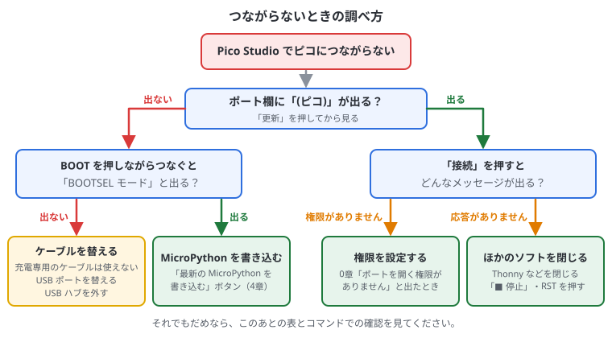
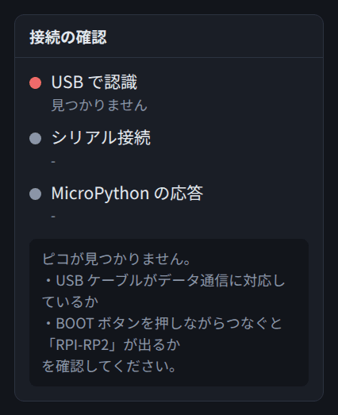
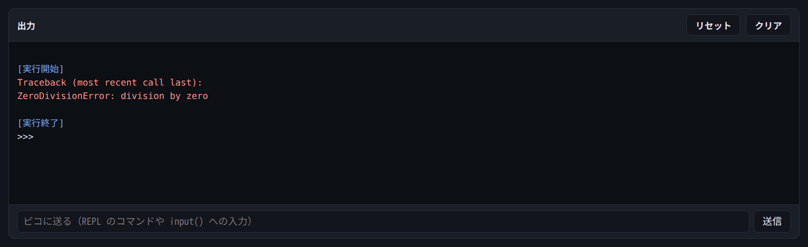

# 11. 困ったとき

## この章でわかること

- つながらないときの調べ方（流れ図）
- 接続・エラー・動作のトラブルと直し方
- PC がピコを認識しているかを、コマンドで確かめる方法
- ピコを初期状態に戻す方法
- 調べるときのコツ

## つながらないとき

まずは次の流れ図にそって確かめてください。



### 接続のトラブル

| 症状 | 原因と対処 |
| --- | --- |
| 「見つかりません」と出る・ポートが出ない | USB ケーブルが充電専用かもしれない。BOOT ボタンを押しながらつないで「BOOTSEL モード」と出るか確認する |
| 「BOOTSEL モード」は出るがポートは出ない | MicroPython が入っていない。0章・4章の手順で書き込む |
| 「ポートを開く権限がありません」 | 0章の「『ポートを開く権限がありません』と出たとき」の設定をする |
| 「MicroPython の応答がありません」 | Thonny や mpremote、pc_logger.py など、別のソフトが同じポートを使っていないか確認する。プログラムが動いたままなら「■ 停止」か RST |
| 「サーバーに接続できません」（左上） | Pico Studio が止まっている。ターミナルで `./start.sh` を打ち直す |
| ピコが反応しない・固まった | RST ボタンを押して再起動する。だめなら BOOT を押したまま RST を押して書き込みモードにし、MicroPython を入れ直す |
| USR ボタンを押しても反応しない | ボードによってつながっているピンが違う。ボードの説明書や裏面の印字で GP 番号を確かめる |
| 接続してもすぐ切れる | ケーブルや USB ポートを替える。USB ハブを使っているなら PC に直接つなぐ |



## PC がピコを認識しているか、コマンドで確かめる

Pico Studio の「接続の確認」でもわかりますが、ターミナルでも確かめられます。

```bash
lsusb | grep 2e8a       # USB 機器の一覧から、ラズパイ（ID 2e8a）の行を探す
ls /dev/ttyACM*         # シリアルポートを探す
lsblk -o NAME,LABEL | grep RP2   # 書き込みモードのドライブを探す
```

| 結果 | 状態 |
| --- | --- |
| `ID 2e8a:0005 MicroPython Board in FS mode` と出て、`/dev/ttyACM0` がある | **MicroPython で動いている**。Pico Studio で接続できる |
| `ID 2e8a:0003 Raspberry Pi RP2 Boot`（Pico 2 は `2e8a:000f`）と出て、`RPI-RP2`（Pico 2 は `RP2350`）がある | **書き込みモード（BOOTSEL）**。MicroPython を書き込める |
| `2e8a` の行が何も出ない | **認識されていない**。ケーブルが充電専用、差し込みが浅い、USB ポートの不調などを疑う |

`lsusb` は、ピコを抜き差ししながら2回打って、行が増えたり減ったりするかを見るとわかりやすいです。
つないだ瞬間のログは `sudo dmesg -w` で見られます（止めるときは Ctrl+C）。

権限が設定できているかは、`ls -l /dev/ttyACM0` で確かめます。行の最初が `crw-rw----+` のように `+` 付きなら OK です。

## プログラムのエラー

エラーが出ると、出力欄に赤い文字で `Traceback` が表示されます。**最後の行**が一番大事です。



エラーの読み方:

```text
Traceback (most recent call last):
  File "<stdin>", line 3, in <module>
ZeroDivisionError: division by zero
```

- `line 3` … 3行目でエラーが起きた（コード欄の左の行番号と同じ）
- `ZeroDivisionError` … エラーの種類
- `division by zero` … くわしい説明（この例では「0 で割った」）

### よくあるエラー

| エラー | 意味と対処 |
| --- | --- |
| `SyntaxError: invalid syntax` | 文法のまちがい。`:` の付け忘れ、かっこの閉じ忘れ、全角の記号（`（` `：` など）を探す |
| `IndentationError` | インデント（字下げ）がずれている。スペース4つに揃える |
| `NameError: name 'xxx' isn't defined` | その名前の変数や関数がない。つづりのまちがいか、`import` を忘れていないか |
| `ImportError: no module named 'xxx'` | そのライブラリが MicroPython に入っていない。PC 用のライブラリ（numpy など）はそのままでは使えない。自分で作ったファイルなら、ピコに保存されているか |
| `TypeError` | 型（数・文字など）の組み合わせがおかしい。例: 文字と数を `+` でつないだ → `str(数)` にする |
| `OSError: [Errno 5] EIO` | I2C の通信に失敗した。配線・アドレス・電源を確認し、6章の I2C スキャンをする |
| `OSError: [Errno 110] ETIMEDOUT` | センサーが応答しない。配線を確認、`freq=100000` に下げる |
| `OSError: [Errno 2] ENOENT` | そのファイルがない。ファイル名のつづりと、「ピコのファイル」の一覧を確かめる |
| `MemoryError` | メモリ不足。リストを小さくする、`array` を使う、こまめに保存する（9章） |
| `KeyboardInterrupt` | 「■ 停止」で止めたときに出る。エラーではない |

## 動きがおかしい

| 症状 | 対処 |
| --- | --- |
| LED が光らない | ピン番号を確認（公式ピコは 25、Pico W は "LED"、互換ボードは説明書を見る）。外付けなら LED の向き（長い足が＋）と抵抗 |
| センサーの値がずっと 0 や同じ値 | センサーを起こす設定（MPU-6050 なら 0x6B に 0）を忘れていないか |
| 値が大きくふらつく | 配線を短くする、GND を確実につなぐ、平均を取る |
| ボタンの値がふらつく | `Pin.PULL_UP` を付け忘れていないか（5章） |
| main.py が勝手に動いて操作できない | Pico Studio で接続すると止まる。止まらなければ「■ 停止」、それでもだめなら main.py を削除 |
| 「▶ 実行」が押せない | 未接続か、別のプログラムが実行中。「接続」するか「■ 停止」を押す |
| ガイドが表示されない | 右上の「📘 ガイド」を押す。それでも出なければ、ブラウザで再読み込み（F5） |

## 最後の手段: ピコを初期状態に戻す

ファイルをすべて消して、まっさらにしたいとき。

1. [flash_nuke.uf2](https://datasheets.raspberrypi.com/soft/flash_nuke.uf2) をダウンロードする
2. BOOT ボタンを押しながらつなぎ、「RPI-RP2」に flash_nuke.uf2 をコピーする（Pico Studio の「.uf2 ファイルを選ぶ」でもよい）
3. フラッシュがすべて消える。もう一度 MicroPython を書き込む

> ファイルが全部消えるので、残したいものは先にコピーしておいてください（9章の「PC に持ってくる」）。

## 調べるときのコツ

- エラーの最後の行をそのまま検索する
- 「MicroPython」「Pico」「センサーの型番」を組み合わせて検索する
- 関数や引数の意味は、コードの単語をクリックすると出る（0章）
- 3章の [RP2 クイックリファレンス](https://docs.micropython.org/en/latest/rp2/quickref.html) と [Random Nerd Tutorials](https://randomnerdtutorials.com/projects-raspberry-pi-pico/) は、たいていの疑問に答えがある
