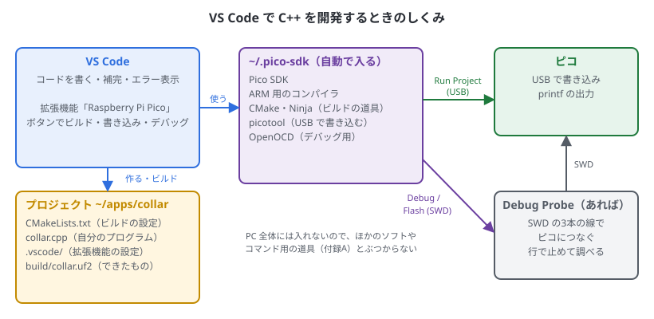
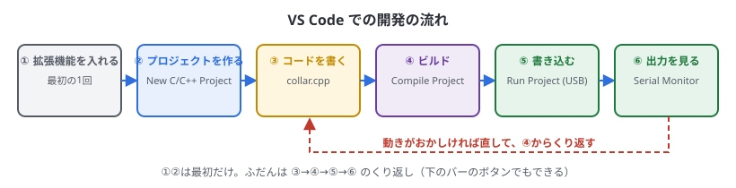
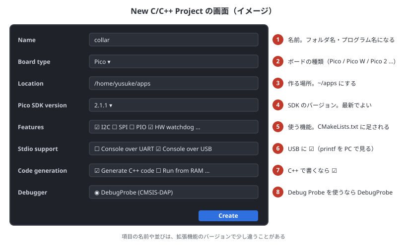
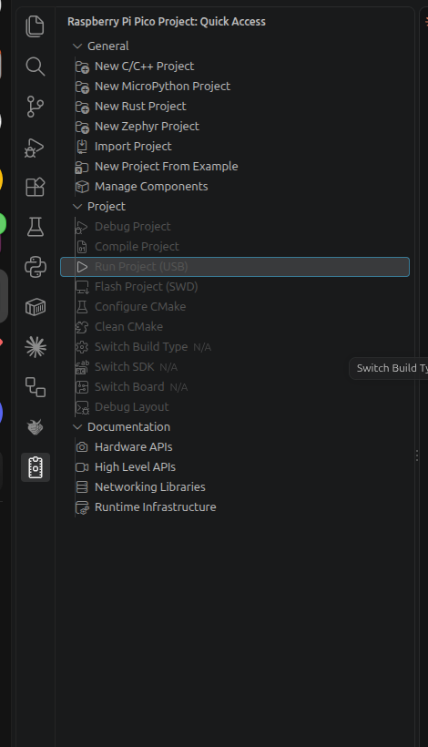

# 19. VS Code で C++ を開発する

## この章でわかること

- VS Code の公式の拡張機能「Raspberry Pi Pico」でできること
- 拡張機能の入れ方と、最初に自動で入るもの
- 新しいプロジェクトの作り方と、できるファイルの意味
- ビルド・書き込み・出力を見るまでの流れ
- 拡張機能のメニュー（Quick Access）の一つ一つの意味
- Debug Probe で、行で止めて調べる方法
- Pico Studio との使い分け

14章の C++ の基本がわかっている前提です。製品のプログラムを、ファイルを分けて書いたり git で管理したりするときは、Pico Studio より VS Code が向いています。

## しくみ



- VS Code に拡張機能「**Raspberry Pi Pico**」を入れると、ビルド・書き込み・デバッグがボタンでできるようになります
- 拡張機能は、自分用の Pico SDK・コンパイラ・CMake・picotool などを **`~/.pico-sdk`** に自動で入れて使います。14章で入れた `~/pico/pico-sdk`（Pico Studio とコマンド用）とは別ですが、ぶつかりはしません
- プロジェクトは1つのフォルダです。1つのプロジェクトが1つのプログラムになります

## 開発の流れ



①と②は最初だけです。ふだんは「書く → ビルド → 書き込む → 出力を見る」をくり返します。

## ① 拡張機能を入れる

1. VS Code の左の **拡張機能**（四角が4つのアイコン）を開く
2. 検索欄に `Raspberry Pi Pico` と入れる
3. 作者が **Raspberry Pi** のものを選んで「インストール」を押す
4. 左に **ピコの形のアイコン** が出る。押すと、下の「Quick Access」のメニューが開く

拡張機能が使う git・tar・python3 などは、14章の `setup-sdk.sh` で入っています。

> Linux では、`printf` の出力を見るための **Serial Monitor**（作者: Microsoft）の拡張機能も一緒に入れておきます。

## ② 新しいプロジェクトを作る

Quick Access の **New C/C++ Project** を押すと、プロジェクトを作る画面が開きます。



| 番号 | 項目 | 選ぶもの |
| --- | --- | --- |
| ① | Name | プロジェクトの名前（例: `collar`）。フォルダとプログラムの名前になる。英数字と `_` だけにする |
| ② | Board type | ボードの種類。公式ピコなら **Pico**、Pico 2 なら **Pico 2** |
| ③ | Location | 作る場所。**`/home/ユーザー名/apps`** にすると、`~/apps/collar` ができる |
| ④ | Pico SDK version | SDK のバージョン。いちばん新しいものでよい |
| ⑤ | Features | 使う機能。I2C のセンサーを使うなら **I2C**、ウォッチドッグを使うなら **HW watchdog** など。あとから足すこともできる |
| ⑥ | Stdio support | **Console over USB に ☑**。`printf` が USB で PC に届く。UART の ☑ は外してよい |
| ⑦ | Code generation | **C++ のコードを作る項目に ☑**（`.cpp` ができる） |
| ⑧ | Debugger | Debug Probe を使うなら **DebugProbe** |

最後に **Create** を押します。

- **初めてのときは、`~/.pico-sdk` に SDK やコンパイラをダウンロードするので、数分かかります**（右下に進み具合が出ます）
- 項目の名前や並びは、拡張機能のバージョンで少し違うことがあります
- **⑥の Console over USB は、Pico Studio でも大事です。** USB の出力がないプログラムは、次の書き込みのときに、自動で書き込みモードにできません（4章）

### できるファイル

```text
~/apps/collar/
├── CMakeLists.txt          ビルドの設定（下で説明）
├── collar.cpp              自分のプログラム。ここに書く
├── pico_sdk_import.cmake   SDK を読み込む
├── .vscode/                拡張機能の設定（ふつうは触らない）
│   ├── settings.json
│   ├── tasks.json          Compile や Run の中身
│   ├── launch.json         デバッグの設定
│   └── c_cpp_properties.json   補完の設定
└── build/                  ビルドしてできたもの（collar.uf2 など）
```

`CMakeLists.txt` の中心は、14章と同じ形です。

```cmake
# == DO NOT EDIT THE FOLLOWING LINES for the Raspberry Pi Pico VS Code Extension to work ==
# （拡張機能が使う行。消したり書き換えたりしない）
# ……

add_executable(collar collar.cpp)

pico_enable_stdio_uart(collar 0)
pico_enable_stdio_usb(collar 1)

target_link_libraries(collar
        pico_stdlib
        hardware_i2c)
```

- `DO NOT EDIT` と書かれた部分は、拡張機能が SDK の場所を決めるための行です。触らないでください
- あとから機能を足すときは、`target_link_libraries` にライブラリを足します（14章の「プログラムを足す」の表）
- ファイルを分けたとき（15章）は、`add_executable(collar collar.cpp sensor.cpp)` のように足します

### Pico Studio のヘッダーを使う

7章の `mpu6050.h` などを使うときは、プロジェクトのフォルダにコピーします。

```bash
cp ~/apps/pico-studio/cpp/include/*.h ~/apps/collar/
```

## ③〜⑥ 書く・ビルド・書き込む・出力を見る

### ③ 書く

`collar.cpp` を開いて書きます。4〜18章の C++ のコードを、そのまま貼り付けて試せます。

- 関数名を打ち始めると、候補が出ます（補完）。`gpio_` まで打つと、GPIO の関数の一覧が出ます
- まちがいがあると、**ビルドする前に**赤い波線が出ます
- 関数名の上にマウスを置くと、説明が出ます。**F12** でその関数の中身（SDK のソース）に飛べます

> 赤い波線が、正しいコードにまで出ることがあります。最初のビルドが終わると、補完の設定（`compile_commands.json`）ができて直ります。

### ④ ビルド

Quick Access の **Compile Project** を押します（下のバーの **Compile** でも同じ）。
下の「ターミナル」に進み具合が出て、`build/collar.uf2` ができます。エラーは「問題」の欄にも一覧で出て、クリックするとその行に飛びます。

### ⑤ 書き込む

ピコを USB でつないで、Quick Access の **Run Project (USB)** を押します（下のバーの **Run** でも同じ）。
picotool で書き込みモードにして書き込み、ピコが再起動してプログラムが動き出します。

| ピコで動いているもの | Run Project (USB) で |
| --- | --- |
| C++ のプログラム（USB の出力あり） | そのまま書き込める（BOOT は要らない） |
| MicroPython | 書き込みモードにできない。先に BOOT を押しながら USB をつなぐ（または `mpremote bootloader`） |
| 書き込みモード（RPI-RP2 が見えている） | そのまま書き込める |

> 「書き込みモードのデバイスが見つからない」「権限がない」と出たら、picotool の udev ルールが入っているか確かめます（14章の `setup-sdk.sh` の 5/5）。入れたあとは、ピコを一度抜き差しします。

### ⑥ 出力を見る

`printf` の出力は、次のどちらかで見ます。

- **Serial Monitor**: 下の欄の「SERIAL MONITOR」タブを開き、ポート `/dev/ttyACM0`、ボーレート `115200` を選んで **Start Monitoring**
- **Pico Studio**: コード欄で C++ を選んで「接続」

どちらも、**書き込む前に止めて（切断して）おきます**。ポートは1つのソフトでしか使えないので、開いたままだと書き込みのあとにつながりません。

## Quick Access のメニュー



### General（プロジェクトを作る）

| メニュー | すること |
| --- | --- |
| New C/C++ Project | C / C++ の新しいプロジェクトを作る（この章の②） |
| New MicroPython Project | MicroPython のプロジェクトを作る。このガイドの Python は Pico Studio で行うので、使わなくてよい |
| New Rust Project | Rust（別の言語）のプロジェクトを作る |
| New Zephyr Project | Zephyr（マイコン用の OS）のプロジェクトを作る |
| Import Project | すでにある CMake のプロジェクトを、拡張機能で使えるようにする |
| New Project From Example | 公式のサンプル集（pico-examples）から選んで、プロジェクトを作る。`blink`、`hello_usb`、`i2c/bus_scan` など |
| Manage Components | `~/.pico-sdk` に入っている SDK・コンパイラなどのバージョンを、足したり消したりする |

### Project（今開いているプロジェクトの操作）

プロジェクトのフォルダを開いていないときは、灰色で押せません。

| メニュー | すること | ふだん使うか |
| --- | --- | --- |
| Debug Project | Debug Probe で書き込んで、デバッグを始める（下の「デバッグ」） | Debug Probe があれば使う |
| Compile Project | ビルドする（④） | **よく使う** |
| Run Project (USB) | USB で書き込んで、動かす（⑤） | **よく使う** |
| Flash Project (SWD) | Debug Probe で書き込む（デバッグはしない） | Debug Probe があれば |
| Configure CMake | `CMakeLists.txt` を読み直す。ファイルを足したときなど | ときどき |
| Clean CMake | `build` を消して、ビルドをやり直す。おかしなエラーが続くとき | ときどき |
| Switch Build Type | Debug（調べやすい）と Release（速く小さい）を切り替える | 製品は Release |
| Switch SDK | SDK のバージョンを変える | まれ |
| Switch Board | ボードの種類を変える（Pico → Pico 2 など） | ボードを変えたとき |
| Debug Layout | デバッグ用の画面の並びにする | デバッグのとき |

### Documentation（説明を見る）

| メニュー | 中身 |
| --- | --- |
| Hardware APIs | `hardware_gpio`、`hardware_i2c` など、ピコの部品を直接動かす関数の説明 |
| High Level APIs | `pico_stdlib`、`pico_multicore` など、使いやすくまとめた関数の説明 |
| Networking Libraries | Pico W の WiFi・Bluetooth の説明 |
| Runtime Infrastructure | 起動のしくみ、`printf` の出力先などの説明 |

関数の使い方で迷ったら、ここから探します（3章の「Pico SDK の API ドキュメント」と同じもの）。

## デバッグ（Debug Probe があるとき）

18章の gdb を、VS Code の画面で行います。配線は18章の「つなぎ方」と同じです。

1. プロジェクトを作るときに、Debugger で **DebugProbe** を選んでおく
2. Debug Probe を PC とピコにつなぐ
3. 止めたい行の左の余白をクリックして、赤い丸（ブレークポイント）を付ける
4. Quick Access の **Debug Project** を押す（または **F5**）
5. プログラムが書き込まれ、赤い丸の行で止まる

| キー | すること |
| --- | --- |
| F5 | 次のブレークポイントまで進める |
| F10 | 1行進める（関数の中には入らない） |
| F11 | 1行進める（関数の中に入る） |
| Shift + F5 | デバッグをやめる |

- 止まっている間は、左の「変数」の欄で変数の値が見られます。変数の上にマウスを置いても見られます
- Debug でビルドすると、行と命令の対応がわかりやすくなります（Switch Build Type）。Release だと、行が飛んだように見えることがあります

## Pico Studio との使い分け

| やること | 向いているもの |
| --- | --- |
| ガイドを見ながら試す、サンプルを動かす | Pico Studio |
| MicroPython で試す | Pico Studio |
| センサーの値をちょっと確かめる | Pico Studio（C++ を選んで「▶ ビルドして書き込む」） |
| 製品のプログラムを、ファイルを分けて書く・git で管理する | **VS Code** |
| 補完やエラー表示に助けてもらいながら書く | **VS Code** |
| 行で止めて調べる | **VS Code**（Debug Probe） |

- 同じピコを両方から同時には使えません。片方で書き込む前に、もう片方の「切断」や Serial Monitor の停止をします
- Pico Studio の `~/apps/pico-cpp` は、VS Code で開いてコードを書くこともできます。ただし `.cpp` ごとにプログラムができる形なので、拡張機能の Run ボタンとは合いません。製品のプログラムは、この章の②で新しくプロジェクトを作るのが素直です

## 困ったとき

| 症状 | 確かめること |
| --- | --- |
| Quick Access の Project のメニューが灰色 | プロジェクトのフォルダ（`CMakeLists.txt` と `.vscode` があるフォルダ）を開いているか。「ファイル」→「フォルダーを開く」 |
| 初めてのプロジェクトがなかなかできない | `~/.pico-sdk` へのダウンロード中。右下の進み具合を見る。インターネットが必要 |
| Run で「デバイスが見つからない」 | MicroPython が動いていないか（BOOT を押しながらつなぐ）。Pico Studio や Serial Monitor がポートを使っていないか |
| Run で「権限がない」 | picotool の udev ルール（14章の `setup-sdk.sh` の 5/5）。ピコを抜き差しする |
| 赤い波線が消えない | 一度 Compile する。それでも出るなら、Clean CMake → Compile |
| `printf` が出ない | プロジェクトを作るときに Console over USB に ☑ したか。`CMakeLists.txt` が `pico_enable_stdio_usb(名前 1)` になっているか |
| 機能を足したら `No such file` のエラー | `target_link_libraries` にライブラリ（`hardware_i2c` など）を足したか |

拡張機能のくわしい説明は、[拡張機能のページ](https://marketplace.visualstudio.com/items?itemName=raspberry-pi.raspberry-pi-pico) と [Getting started with Raspberry Pi Pico-series（PDF）](https://datasheets.raspberrypi.com/pico/getting-started-with-pico.pdf) にあります。

## まとめ

- VS Code の拡張機能「Raspberry Pi Pico」で、作る・ビルド・書き込み・デバッグがボタンでできる
- 拡張機能は `~/.pico-sdk` に自分用の SDK などを入れる。Pico Studio 用の `~/pico/pico-sdk` とは別
- New C/C++ Project では、場所を `~/apps`、Console over USB に ☑、C++ のコードを作る項目に ☑
- ふだんは「書く → Compile → Run (USB) → Serial Monitor」のくり返し
- MicroPython が動いているピコには、最初だけ BOOT を押して書き込む
- 試すのは Pico Studio、製品のプログラムは VS Code、と使い分ける
