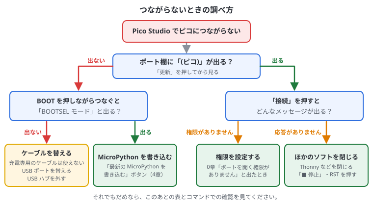

# 付録B. 困ったとき

## この付録でわかること

- VS Code で書き込めないときの調べ方（流れ図）
- ビルドのエラーの読み方と、よくあるエラー
- 書き込んだあとに動きがおかしいときの直し方
- Pico Studio でつながらないとき
- ピコを初期状態に戻す方法
- 調べるときのコツ

## VS Code で書き込めないとき

まずは次の流れ図にそって確かめてください。



| 症状 | 原因と対処 |
| --- | --- |
| Quick Access の Project のメニューが灰色 | プロジェクトのフォルダ（`CMakeLists.txt` と `.vscode` があるフォルダ）を開いていない。「ファイル」→「フォルダーを開く」 |
| 初めてのプロジェクトがなかなかできない | `~/.pico-sdk` へのダウンロード中。右下の進み具合を見る。インターネットが必要 |
| `No accessible RP-series devices in BOOTSEL mode were found` | ピコが書き込みモードでなく、自動でも切り替えられなかった。MicroPython や USB を使わないプログラムが動いているときに出る。BOOT を押しながらつなぎ直してから Run |
| `LIBUSB_ERROR_ACCESS`・権限がない | udev ルールがない。2章の手順3を行い、ピコを抜き差し |
| 書き込みはできたが、ポートが出てこない | プログラムに Console over USB（`pico_enable_stdio_usb`）がない。または `stdio_init_all()` を呼んでいない |
| 書き込みのあと、Serial Monitor がつながらない | ピコの再起動でポートが一度消えた。Stop → Start Monitoring し直す |

## ビルドのエラー

C++ では、まちがいは2種類あります。

| 種類 | いつわかるか | 例 |
| --- | --- | --- |
| ビルドのエラー | Compile Project を押したとき。VS Code の「問題」の欄と、下のターミナルに出る | `;` の付け忘れ、関数名のまちがい |
| 動いているときのまちがい | 書き込んだあと。**エラーは出ず**、止まったり、おかしな値になったりする | 配列の外を読む、センサーの戻り値を確かめない |

### ビルドのエラーの読み方

```text
main.cpp:12:5: error: 'prinf' was not declared in this scope; did you mean 'printf'?
```

- `main.cpp:12:5` … 12行目の5文字目。VS Code では「問題」の欄（Ctrl + Shift + M）でクリックすると、その行に飛ぶ
- `error:` … ビルドが止まるまちがい。`warning:`（警告）はビルドは通るが、まちがいのことが多いので直す
- 最後の部分 … くわしい説明。`did you mean` は「もしかして」という意味

エラーがたくさん出たときは、**一番上のエラーから**直します。

### よくあるビルドのエラー

| エラー | 意味と対処 |
| --- | --- |
| `expected ';' before ...` | `;` を付け忘れた。**表示された行の1つ前の行**を見る |
| `'xxx' was not declared in this scope` | その名前がない。つづりのまちがいか、`#include` を忘れていないか |
| `fatal error: xxx.h: No such file or directory` | そのヘッダーがない。自分で作った `.h` なら、プロジェクトのフォルダにあるか。SDK のヘッダーなら、`target_link_libraries` にライブラリ（`hardware_i2c` など）を足したか（4章） |
| `undefined reference to 'xxx'` | 関数の宣言はあるが中身がない。`target_link_libraries` にライブラリ（`pico_multicore` など）を足したか（4章） |
| `expected '}' at end of input` | `{` と `}` の数が合っていない |
| `invalid conversion from 'const char*' to 'char*'` | 型が合っていない。`const` を付ける |
| `narrowing conversion` | `{}` で初期化するとき、型が合わない。`static_cast<型>(値)` で変える |
| `region 'RAM' overflowed` | メモリが足りない。大きな配列を小さくする（13章・11章） |
| Pico Studio の「C++ の開発環境」に ✗ がある | 足りないものを入れる（2章）。SDK とコンパイラは、VS Code で最初のプロジェクトを作ると入る |

### 書き込んだあとに動きがおかしいとき

| 症状 | 対処 |
| --- | --- |
| 出力欄に何も出ない | `stdio_init_all()` を呼んでいるか。起動直後の出力は消えるので、最初に `sleep_ms(1500)` を入れる |
| 途中で止まる・ピコが反応しない | 配列の外に書いていないか、関数の中に大きな配列を作っていないか（スタックがあふれる。13章）。ウォッチドッグを入れると、止まったときに自動で再起動する（15章） |
| 次の書き込みが自動でできない | 前のプログラムが `stdio_init_all()` を呼んでいないか、止まっている。BOOT を押しながら USB をつなぎ直す |
| センサーの値がずっと 0 | 戻り値を確かめる（`i2c_read_blocking` が負の数ならエラー）。配線と I2C スキャン（8章） |
| 小数の計算が遅い | `double` ではなく `float` を使う。数に `f` を付ける（`3.3f`）。`sqrt` ではなく `sqrtf` |
| LED が光らない | ピン番号を確かめる（公式ピコは 25、互換ボードは説明書）。Pico W は `cyw43_arch_gpio_put`（6章）。外付けなら LED の向き（長い足が＋）と抵抗 |
| センサーの値がずっと同じ | センサーを起こす設定（MPU-6050 なら 0x6B に 0）を忘れていないか |
| 値が大きくふらつく | 配線を短くする、GND を確実につなぐ、何回か読んで平均を取る |
| ボタンの値がふらつく | `gpio_pull_up` を付け忘れていないか（7章） |

> 原因がわからないときは、Debug Probe で止めて調べると早いです（4章）。

## Pico Studio でつながらないとき

| 症状 | 原因と対処 |
| --- | --- |
| 「見つかりません」と出る・ポートが出ない | ケーブルが充電専用かもしれない。BOOT を押しながらつないで「BOOTSEL モード」と出るか確かめる。USB を使わないプログラムが動いていても出ない |
| 「ポートを開く権限がありません」 | 2章の手順3の udev ルール（5章の「ポートを開く権限がありません」） |
| つながるが、何も出ない | VS Code の Serial Monitor など、別のソフトが同じポートを使っていないか。プログラムが `printf` しているか |
| 「MicroPython の応答がありません」 | ピコで C++ のプログラムが動いている（「動いているプログラム」で確かめる）。または別のソフトがポートを使っている |
| 「サーバーに接続できません」（左上） | Pico Studio が止まっている。ターミナルで `./start.sh` を打ち直す |
| 「サーバーが古いままです」 | Pico Studio を更新したのに、古いサーバーが動いている。Ctrl + C で止めて `./start.sh` |
| 接続してもすぐ切れる | ケーブルや USB ポートを替える。USB ハブを使っているなら PC に直接つなぐ |

## PC がピコを認識しているか、コマンドで確かめる

Pico Studio の「接続の確認」でもわかりますが、ターミナルでも確かめられます。

```bash
lsusb | grep 2e8a       # USB 機器の一覧から、ラズパイ（ID 2e8a）の行を探す
ls /dev/ttyACM*         # シリアルポートを探す
lsblk -o NAME,LABEL | grep RP2   # 書き込みモードのドライブを探す
```

| 結果 | 状態 |
| --- | --- |
| `ID 2e8a:000a Raspberry Pi Pico` と出て、`/dev/ttyACM0` がある | **C++ のプログラム**（Console over USB あり）が動いている |
| `ID 2e8a:0005 MicroPython Board in FS mode` と出て、`/dev/ttyACM0` がある | **MicroPython** が動いている |
| `ID 2e8a:0003 Raspberry Pi RP2 Boot`（Pico 2 は `2e8a:000f`）と出て、`RPI-RP2`（Pico 2 は `RP2350`）がある | **書き込みモード（BOOTSEL）**。VS Code の Run でそのまま書き込める |
| `2e8a` の行が何も出ない | **認識されていない**。USB を使わないプログラムが動いているか、ケーブル・差し込み・USB ポートの問題 |

`lsusb` は、ピコを抜き差ししながら2回打って、行が増えたり減ったりするかを見るとわかりやすいです。
つないだ瞬間のログは `sudo dmesg -w` で見られます（止めるときは Ctrl+C）。

権限が設定できているかは、`ls -l /dev/ttyACM0` で確かめます。行の最初が `crw-rw----+` のように `+` 付きなら OK です。

## 最後の手段: ピコを初期状態に戻す

フラッシュをすべて消して、まっさらにしたいとき（設定や記録が壊れて、起動のたびに止まるときなど）。

1. [flash_nuke.uf2](https://datasheets.raspberrypi.com/soft/flash_nuke.uf2) をダウンロードする
2. BOOT ボタンを押しながらつなぎ、「RPI-RP2」に flash_nuke.uf2 をコピーする（Pico Studio の「.uf2 ファイルを選ぶ」でもよい）
3. フラッシュがすべて消える（13・15章のフラッシュの記録や設定も消える）
4. VS Code の Run Project (USB) で、プログラムを書き込み直す

## 調べるときのコツ

- エラーの言葉（`error:` のあとの部分）をそのまま検索する
- 「pico sdk」と関数名やエラーの言葉を組み合わせて検索する
- 関数の使い方は [Pico SDK の API ドキュメント](https://www.raspberrypi.com/documentation/pico-sdk/) で関数名を探す
- 書き方の例は [pico-examples](https://github.com/raspberrypi/pico-examples) で、使いたい機能（i2c、adc、pwm など）のフォルダを見る
- 関数や引数の意味は、コードの単語をクリックすると出る（0章）
