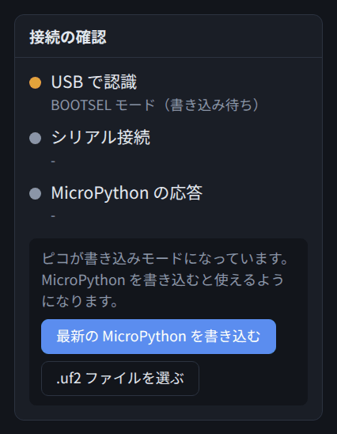
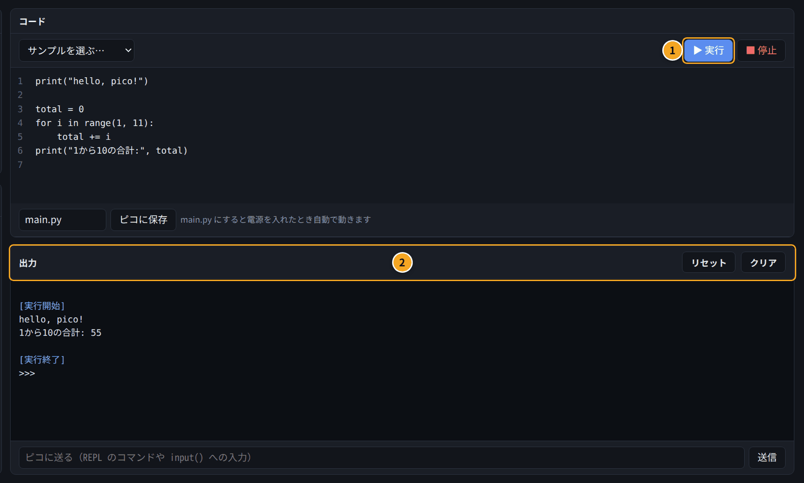
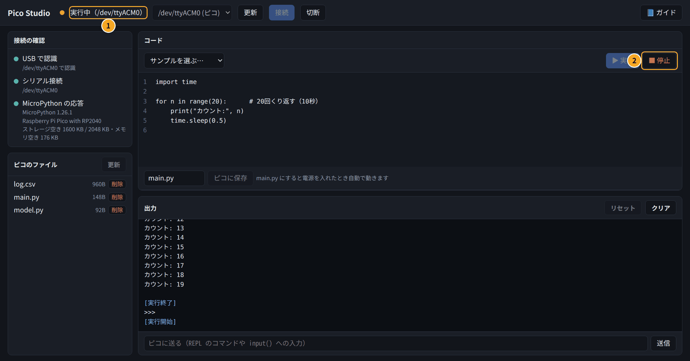
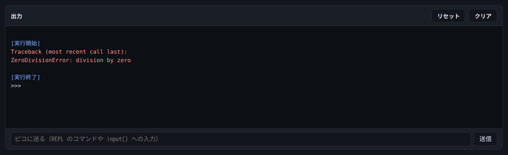
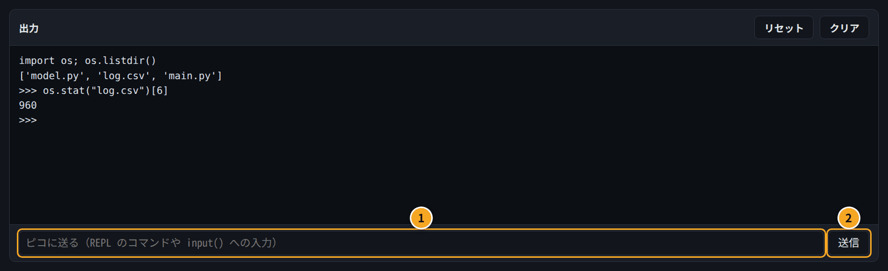
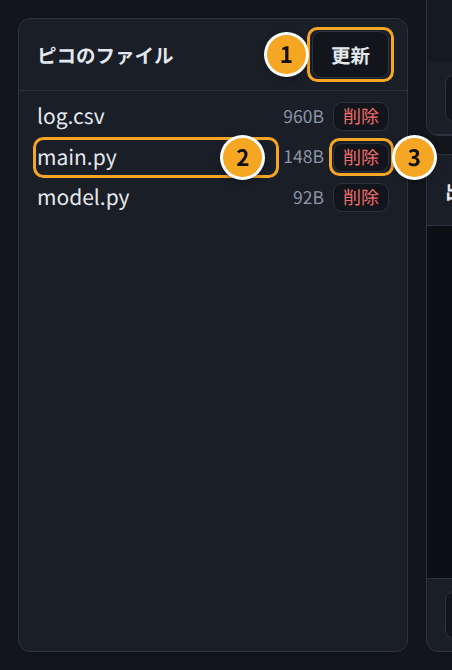
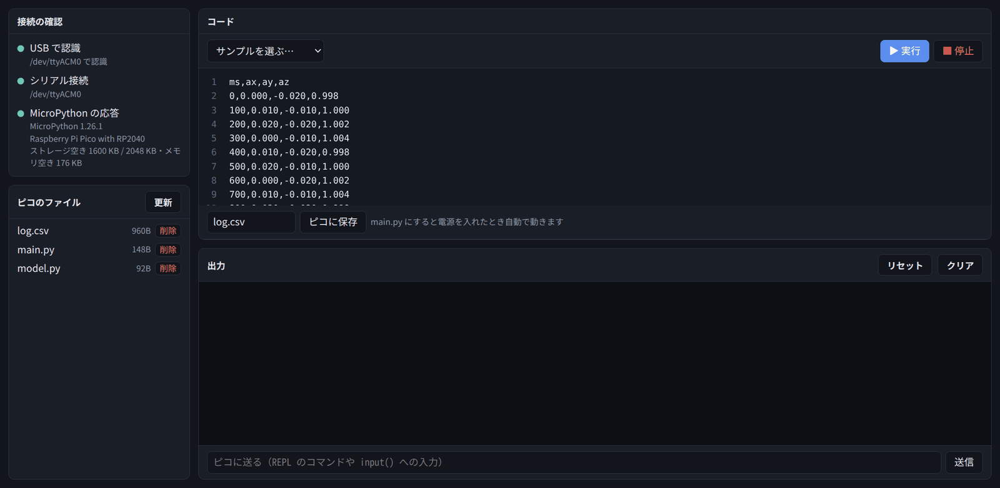

# 付録E. MicroPython で手早く試す

## この付録でわかること

- MicroPython を使うとよい場面
- ピコに MicroPython を書き込む方法
- Pico Studio でコードを実行する・止める・保存する方法
- よく使う書き方（LED・ボタン・ADC・I2C・MPU-6050）
- MicroPython と C++ の書き方の対応
- コマンド（mpremote）での操作
- C++ のプログラムに戻す方法

## MicroPython を使うとよい場面

**MicroPython** は、マイコン向けに小さくした Python です。書いたコードを送るとすぐ動くので、ビルドと書き込みを待たずに試せます。

| 場面 | 使うもの |
| --- | --- |
| 配線が正しいか、センサーが返事をするかを、すぐ確かめたい | **MicroPython**（この付録） |
| レジスタの値を1つずつ読んでみたい（REPL で1行ずつ） | **MicroPython** |
| 製品のプログラム、速さ・省電力・長く動かすことが大事なもの | **C++**（3章から） |

製品のプログラムは C++ で書きます。MicroPython は、**C++ を書く前の下調べ**に使うと便利です。

> MicroPython を書き込むと、ピコの中の C++ のプログラムは消えます（あとで VS Code から書き込み直せば戻ります）。

## MicroPython がまだ入っていないとき

買ったばかりのピコには、MicroPython が入っていないことがあります。

1. ピコの **BOOT** ボタンを押したまま、USB ケーブルで PC につなぐ（くわしくは1章の図）
2. つないだらボタンを離す
3. 「接続の確認」に **BOOTSEL モード（書き込み待ち）** と出る



4. **「最新の MicroPython を書き込む」** を押す。インターネットから最新版をダウンロードして、自動で書き込みます
5. 数秒でピコが再起動するので、「更新」→「接続」を押す

手元にある .uf2 ファイル（ピコに書き込むソフトのファイル）を使いたいときは、「.uf2 ファイルを選ぶ」を押します。

> 「ドライブがまだ開かれていません」と出たときは、ファイルマネージャーで「RPI-RP2」を開いてから「更新」を押してください。

## コードを書いて実行する

### 実行のしかた

1. 真ん中の「コード」欄にコードを書く
2. **「▶ 実行」** を押す（または **Ctrl + Enter**）
3. 下の「出力」欄に結果が出る



出力欄の青い文字は、Pico Studio からのお知らせです。

| 表示 | 意味 |
| --- | --- |
| `[実行開始]` | ピコがコードを受け取って、動かし始めた |
| `[実行終了]` | 最後まで動いた（または止めた） |
| `>>>` | ピコが次の命令を待っている |

### コード欄の便利な機能

| 操作 | 動き |
| --- | --- |
| Tab | 字下げ（スペース4つ）を入れる。複数行を選んで押すと、まとめて字下げ |
| Shift + Tab | 字下げを1段戻す |
| Enter | 前の行と同じだけ字下げした改行。`:`（C++ は `{`）で終わる行のあとは、1段深く字下げする |
| Ctrl + Enter | 実行 |
| Ctrl + S | ピコに保存 |

書いたコードはブラウザに自動で残るので、画面を閉じても次に開いたときに戻ります。

### サンプルを使う

「サンプルを選ぶ」から、すぐ試せるコードを読み込めます。

| サンプル | 内容 |
| --- | --- |
| hello: 文字と計算 | 文字を表示して、簡単な計算をする |
| LED を点滅させる | ボードの LED をチカチカさせる |
| RGB LED を光らせる | RGB LED が付いたボードで、赤・緑・青に光らせる |
| 内蔵の温度センサー | ピコのチップの温度を読む |
| PC と送受信する | 送信欄に入れた数字を2倍にして返す |

> 今のコードは、確認なしでサンプルに置き換わります。間違えたときは、コード欄で **Ctrl + Z** を押すと前のコードに戻ります。ガイドの「エディタに入れる」も同じです。

### 実行を止める

ずっとくり返すプログラムは、自分では終わりません。止めるときは **「■ 停止」** を押します。



- 実行中は、上のバーに **「実行中」**（①）と出て、「▶ 実行」が押せなくなります
- 「■ 停止」（②）を押すと、ピコに Ctrl-C を送って止めます
- 止めると出力欄に `KeyboardInterrupt` と出ることがありますが、エラーではありません

### エラーが出たとき

コードにまちがいがあると、出力欄に **赤い文字** でエラーが出ます。



エラーは **最後の行** が一番大事です。上の例の `ZeroDivisionError: division by zero` は「0 で割り算した」という意味です。
よくあるエラーと直し方は、この付録の最後の「よくあるエラー」にまとめてあります。

## 出力欄と REPL

出力欄の下の送信欄に、Python を1行打って **「送信」**（または Enter）を押すと、ピコがその場で実行して結果を返します。これを **REPL**（対話モード）といいます。



| 番号 | 場所 | 役割 |
| --- | --- | --- |
| ① | 送信欄 | 1行の命令を打つ。プログラムの `input()` への入力にも使う |
| ② | 送信 | ピコに送る（Enter でも同じ） |

- 前に打った変数や `import` は覚えているので、続けて使えます
- ちょっとした確認は REPL、まとまったプログラムはコード欄、と使い分けると便利です
- 出力欄の右上の **「クリア」** で表示を消せます
- **「リセット」** はピコを再起動します（ソフトリセット）。main.py があれば、それが動き始めます

## ピコに保存する

コード欄のコードを、ピコの中にファイルとして保存できます。


1. ファイル名の欄（①）に名前を入れる。名前は `.py` で終わるようにする（例: `blink.py`）
2. **「ピコに保存」**（②）を押す（または **Ctrl + S**）
3. 「ピコのファイル」の一覧に出てくる

### 電源を入れたら自動で動かす（main.py）

名前を **main.py** にして保存すると、ピコの電源を入れたときに自動で動きます。
PC につながなくても、USB の充電器やモバイルバッテリーにさすだけで動くようになります。

- main.py が動いていても、Pico Studio で「接続」すると自動で止まります
- もう一度動かしたいときは、出力欄の「リセット」を押す
- 自動で動かしたくなくなったら、ファイル一覧で main.py を「削除」する

### おすすめの流れ

プログラムは、次の順番で作ると進めやすくなります。

1. コード欄にコードを書く
2. **「▶ 実行」** で試す（ピコには保存されません）
3. 直して、もう一度試す
4. 完成したら、名前を **main.py** にして **「ピコに保存」** を押す
5. 出力欄の「リセット」を押して、自動で動くか確かめる

コマンドで同じことをする方法は、この付録の「コマンドで操作する」にあります。

## ピコに保存したファイルを確認する

### 「ピコのファイル」で見る（おすすめ）

ピコに接続すると、左の **「ピコのファイル」** に、ピコに保存されているファイルの一覧が出ます。



| 番号 | 場所 | 役割 |
| --- | --- | --- |
| ① | 更新 | 一覧を読み直す。保存したあとや、プログラムがファイルを作ったあとに押す |
| ② | ファイル名 | クリックすると、中身がコード欄に開く |
| ③ | 削除 | ピコからファイルを消す（元に戻せないので注意） |

- 名前の横の数字は、ファイルの大きさです（B はバイト）
- 📁 が付いているのはフォルダです。この一覧ではフォルダの中までは開けないので、下の REPL の方法で確かめます
- ストレージの空きは、「接続の確認」の「MicroPython の応答」の下に出ます

ファイル名をクリックすると、コード欄に中身が開き、ファイル名の欄にもその名前が入ります。



開いたファイルを書き直して「ピコに保存」すると、同じ名前で上書きされます。
ファイルの中身は、コード欄に開いて Ctrl + A → Ctrl + C でコピーし、PC のテキストエディタに貼り付ければ持ってこられます。

### REPL で調べる

送信欄に次のように打つと、ファイルの一覧や大きさを調べられます。

```text
>>> import os; os.listdir()
['model.py', 'log.csv', 'main.py']
>>> os.stat("log.csv")[6]
960
```

| 打つもの | わかること |
| --- | --- |
| `import os; os.listdir()` | ファイルの一覧 |
| `os.listdir("フォルダ名")` | フォルダの中身 |
| `os.stat("log.csv")[6]` | ファイルの大きさ（バイト） |
| `print(open("log.csv").read())` | ファイルの中身を表示する |

## よく使う書き方

「エディタに入れる」→「▶ 実行」で、そのまま試せます。くわしい説明は、同じことを C++ で書いた章にあります。

### LED を点滅させる（6章）

```python run
from machine import Pin
import time

led = Pin(25, Pin.OUT)   # GP25 を出力にする

for i in range(10):
    led.on()
    time.sleep(0.3)
    led.off()
    time.sleep(0.3)

print("おわり")
```

### ボタンを読む（6章）

```python run
from machine import Pin
import time

button = Pin(24, Pin.IN, Pin.PULL_UP)   # 押していないとき 1、押すと 0

for i in range(50):
    print("押されている" if button.value() == 0 else "-")
    time.sleep(0.2)
```

### アナログ入力（7章）

```python run
from machine import ADC
import time

adc = ADC(26)            # GP26
for i in range(20):
    raw = adc.read_u16()  # 0〜65535
    volt = raw * 3.3 / 65535
    print("値:", raw, " 電圧: {:.2f} V".format(volt))
    time.sleep(0.5)
```

### I2C スキャン（8章）

```python run
from machine import Pin, I2C

i2c = I2C(0, sda=Pin(4), scl=Pin(5), freq=400000)
found = i2c.scan()

if not found:
    print("センサーが見つかりません。配線を確認してください")
for addr in found:
    name = {0x68: "MPU-6050", 0x69: "MPU-6050 (AD0=1)",
            0x76: "BMP280 / BME280", 0x77: "BMP280 / BME280",
            0x44: "SHT31", 0x45: "SHT31"}.get(addr, "?")
    print("見つかった: 0x{:02X}  {}".format(addr, name))
```

### MPU-6050 を読む（9章）

```python run
from machine import Pin, I2C
import struct, time

ADDR = 0x68
i2c = I2C(0, sda=Pin(4), scl=Pin(5), freq=400000)

print("WHO_AM_I:", hex(i2c.readfrom_mem(ADDR, 0x75, 1)[0]))

i2c.writeto_mem(ADDR, 0x6B, b"\x00")   # スリープ解除
i2c.writeto_mem(ADDR, 0x1C, b"\x00")   # 加速度 ±2g  → 16384 = 1g
i2c.writeto_mem(ADDR, 0x1B, b"\x00")   # ジャイロ ±250°/s → 131 = 1°/s
time.sleep_ms(100)

def read_mpu():
    data = i2c.readfrom_mem(ADDR, 0x3B, 14)
    ax, ay, az, t, gx, gy, gz = struct.unpack(">hhhhhhh", data)
    return (ax / 16384, ay / 16384, az / 16384,
            gx / 131, gy / 131, gz / 131,
            t / 340 + 36.53)

for i in range(20):
    ax, ay, az, gx, gy, gz, temp = read_mpu()
    print("加速度[g] x={:+.2f} y={:+.2f} z={:+.2f}  角速度[°/s] x={:+6.1f} y={:+6.1f} z={:+6.1f}"
          .format(ax, ay, az, gx, gy, gz))
    time.sleep(0.2)
```

## MicroPython と C++ の書き方の対応

MicroPython で試したコードを C++ に書き直すときの対応です。
`CMakeLists.txt` の列は、`target_link_libraries` に足すライブラリです（4章）。

| やること | MicroPython | C++（Pico SDK） | CMakeLists.txt |
| --- | --- | --- | --- |
| 出力にする | `Pin(25, Pin.OUT)` | `gpio_init(25); gpio_set_dir(25, GPIO_OUT);` | |
| 出す | `led.value(1)` | `gpio_put(25, true);` | |
| プルアップ付きの入力 | `Pin(24, Pin.IN, Pin.PULL_UP)` | `gpio_init(24); gpio_set_dir(24, GPIO_IN); gpio_pull_up(24);` | |
| 読む | `btn.value()` | `gpio_get(24)` | |
| 待つ | `time.sleep_ms(20)` | `sleep_ms(20);` | |
| 起動してからの時間 | `time.ticks_ms()` / `ticks_us()` | `to_ms_since_boot(get_absolute_time())` / `time_us_64()` | |
| アナログ入力 | `ADC(26).read_u16()`（0〜65535） | `adc_gpio_init(26); adc_select_input(0); adc_read()`（0〜4095） | `hardware_adc` |
| I2C の準備 | `I2C(0, sda=Pin(4), scl=Pin(5), freq=400000)` | `i2c_init(i2c0, 400000);` と `gpio_set_function(4, GPIO_FUNC_I2C);` など | `hardware_i2c` |
| レジスタを読む | `i2c.readfrom_mem(addr, reg, n)` | `i2c_write_blocking(...)` で番号を送ってから `i2c_read_blocking(...)` | `hardware_i2c` |
| レジスタに書く | `i2c.writeto_mem(addr, reg, b"\x00")` | `i2c_write_blocking(...)` で番号と値を続けて送る | `hardware_i2c` |
| PWM | `PWM(Pin(15))` | `gpio_set_function(15, GPIO_FUNC_PWM);` と `pwm_set_wrap` など | `hardware_pwm` |
| 2バイトを数にする | `struct.unpack(">h", d)` | `int16_t v = (d[0] << 8) + d[1];` | |
| タイマー割り込み | `machine.Timer` | `add_repeating_timer_ms(...)` | |
| 2つ目のコア | `_thread` | `multicore_launch_core1(...)` | `pico_multicore` |
| ウォッチドッグ | `machine.WDT(timeout=2000)` | `watchdog_enable(2000, true);` と `watchdog_update();` | `hardware_watchdog` |
| ファイルに保存 | `open("log.csv", "a")` | なし。USB で PC に送る | |

- ADC の値の範囲が違います。MicroPython の `read_u16()` は 0〜65535 に広げた値、C++ の `adc_read()` はそのままの 12 ビット（0〜4095）です
- ADC の番号は、GP26 が 0、GP27 が 1、GP28 が 2、内蔵温度センサーが 4 です

## コマンドで操作する（mpremote）

Pico Studio を使わずに、ターミナルのコマンドで同じことができます。MicroPython の公式ツール **mpremote** を使います。

```bash
sudo apt install pipx
pipx install mpremote
pipx ensurepath
```

### コマンドの一覧

上から順に進めます。2回目からは手順2から始めて、MicroPython が入っていれば手順3は飛ばします。

| 順番 | やること | コマンド |
| --- | --- | --- |
| 1 | mpremote を入れる（最初の1回だけ） | `pipx install mpremote` |
| 2 | USB で認識しているか確かめる | `lsusb -d 2e8a:` |
| 3 | MicroPython を書き込む（BOOTSEL モードのときだけ） | `cp RPI_PICO-*.uf2 /run/media/$USER/RPI-RP2/` |
| 4 | シリアルポートを確かめる | `ls -l /dev/ttyACM0` |
| 5 | MicroPython の応答を確かめる | `mpremote exec "import os; print(os.uname())"` |
| 6 | コードを実行する | `mpremote run hello.py` |
| 7 | 実行を止める | Ctrl + C のあと `mpremote soft-reset` |
| 8 | ピコに保存する | `mpremote cp hello.py :hello.py` |
| 9 | 保存したファイルを確認する | `mpremote ls` |
| 10 | REPL で1行ずつ試す（必要なとき） | `mpremote repl` |
| 11 | ピコを再起動する（必要なとき） | `mpremote reset` |

> **Pico Studio と同時には使えません。** 1つのポートを2つのソフトで使うと、やり取りが混ざって動かなくなります。
> コマンドを使う前に、Pico Studio で「切断」を押してください。

## よくあるエラー

| エラー | 意味と対処 |
| --- | --- |
| `SyntaxError: invalid syntax` | 文法のまちがい。`:` の付け忘れ、かっこの閉じ忘れ、全角の記号（`（` `：` など）を探す |
| `IndentationError` | インデント（字下げ）がずれている。スペース4つに揃える |
| `NameError: name 'xxx' isn't defined` | その名前の変数や関数がない。つづりのまちがいか、`import` を忘れていないか |
| `ImportError: no module named 'xxx'` | そのライブラリが MicroPython に入っていない。PC 用のライブラリ（numpy など）はそのままでは使えない。自分で作ったファイルなら、ピコに保存されているか |
| `TypeError` | 型（数・文字など）の組み合わせがおかしい。例: 文字と数を `+` でつないだ → `str(数)` にする |
| `OSError: [Errno 5] EIO` | I2C の通信に失敗した。配線・アドレス・電源を確認し、8章の I2C スキャンをする |
| `OSError: [Errno 110] ETIMEDOUT` | センサーが応答しない。配線を確認、`freq=100000` に下げる |
| `OSError: [Errno 2] ENOENT` | そのファイルがない。ファイル名のつづりと、「ピコのファイル」の一覧を確かめる |
| `MemoryError` | メモリ不足。リストを小さくする、`array` を使う、こまめに保存する |
| `KeyboardInterrupt` | 「■ 停止」で止めたときに出る。エラーではない |

## C++ のプログラムに戻す

1. ピコの **BOOT** を押したまま USB をつなぐ（MicroPython が動いていると、VS Code から自動で書き込みモードにできないため）
2. VS Code で **Run Project (USB)** を押す（3章）

次からは、C++ のプログラムが動いているので、BOOT を押さずに書き込めます。

## まとめ

- MicroPython は、C++ を書く前の下調べに使う。製品は C++
- BOOT を押しながらつなぎ、Pico Studio の「最新の MicroPython を書き込む」で入る
- 「▶ 実行」で試す、「■ 停止」で止める、REPL で1行ずつ、main.py に保存すると電源オンで動く
- C++ に戻すときは、BOOT を押しながらつないでから VS Code で Run
